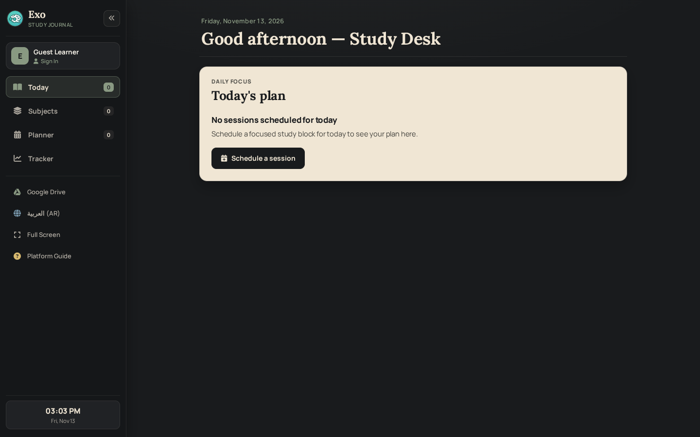
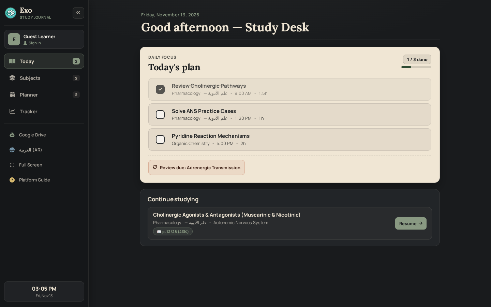
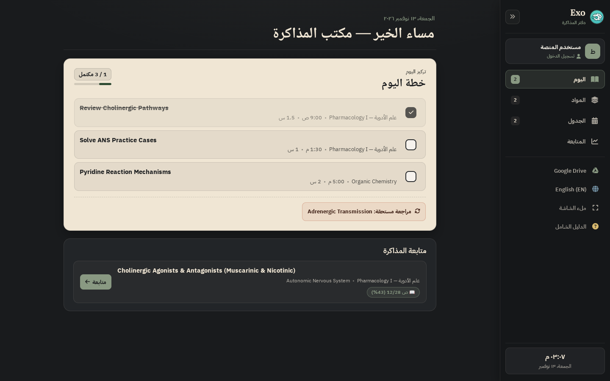
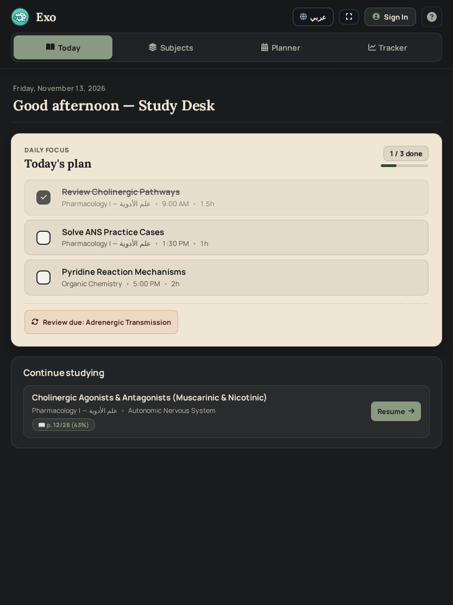
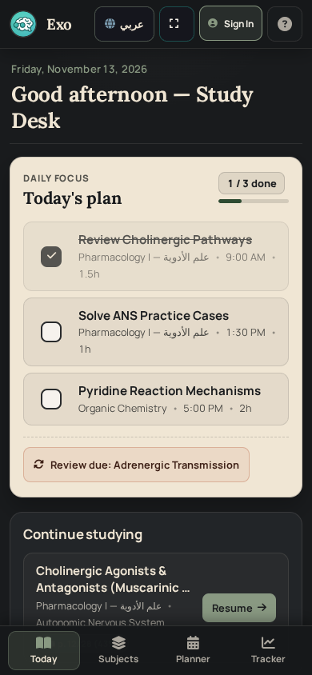
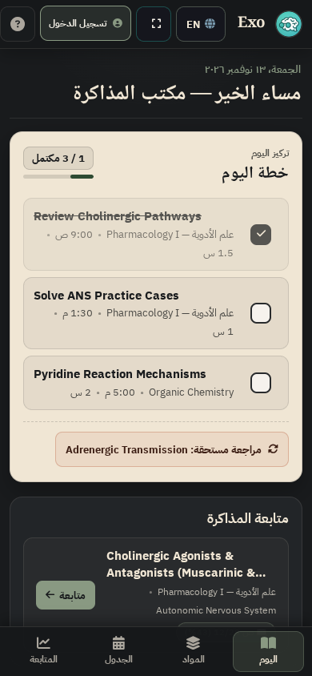
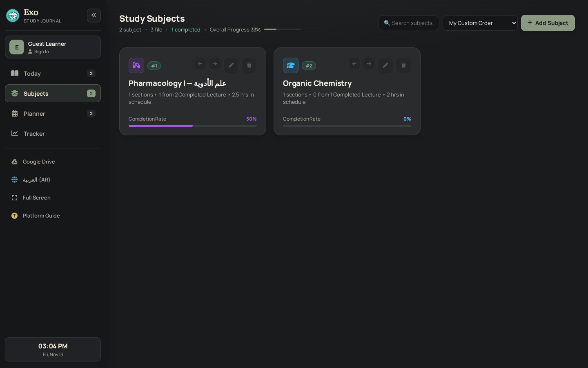
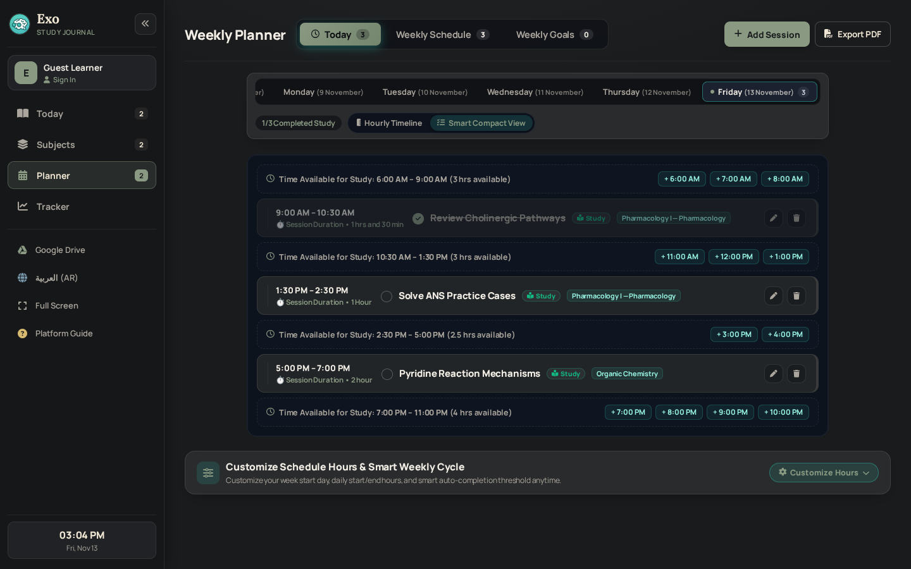
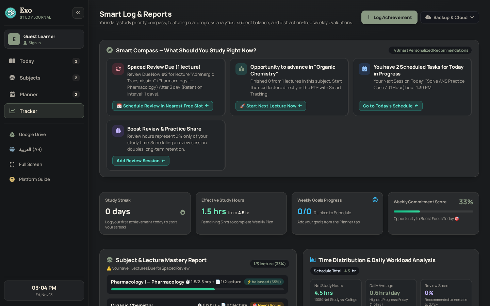
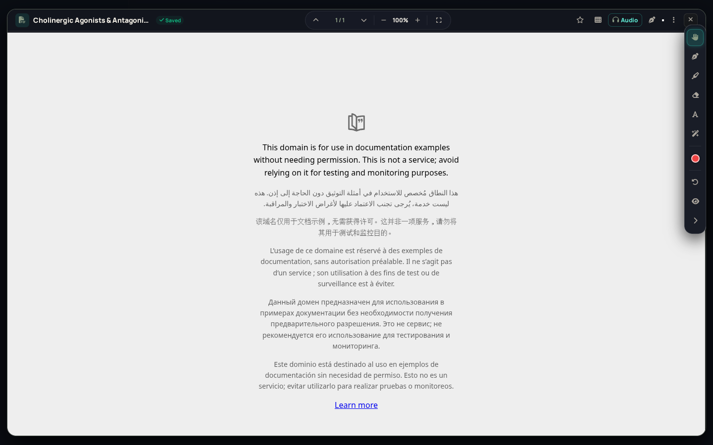

# EXO — Phase 6 (WP 6.1) Completion & CI Repair Report
## Design Foundations, Application Shell, Hybrid Navigation, Typography, Bilingual Foundation & Simplified Today Dashboard

**Work Package:** WP 6.1 — Design Foundations, Application Shell, Hybrid Navigation, Typography, Bilingual Foundation, and Simplified Today Dashboard  
**Repository:** `JemistryMC/study-hub`  
**Target Branch:** `main`  
**Starting GitHub HEAD / Source Baseline:** `ef5b70656530a9f97560bafc87039729c2371f1e`  
**Parent Documentation / Approval Commit:** `8c5dac054294d3e7288061ec35f1c41b5620b009`  
**Prior Pre-Phase-6 Source SHA:** `c74315a4580d68c61da8a0f49ec2b2f5946301e4`  
**WP 6.1 Status:** `CI VERIFIED — COMPLETE`  
**Phase 6 Status:** `IN PROGRESS — WP 6.2 ACTIVE; FINAL OWNER REVIEW DEFERRED TO PHASE 6 COMPLETION`

---

## 1. Executive Summary & Continuation Context

This pass completes the **WP 6.1** partial implementation committed at `ef5b70656530a9f97560bafc87039729c2371f1e` (following Failed CI Run `#52` [`43444338698`] where 147/148 Chromium E2E tests passed and `Test KK.3` failed, and GitHub Pages Run `#145` [`43444338656`]), aligns WP 6.1 strictly with the owner-directed **Simplified Today Dashboard** scope, repairs CI & test-harness wiring, fixes mixed-script RTL/LTR dashboard typography issues caught during visual inspection, and verifies all local test suites after the final code edit.

### Workspace Parity Verified Before Editing
- Local `/app/applet` contains no `.git` metadata directory; byte-for-byte parity of all 61 workspace files against GitHub tree `ef5b70656530a9f97560bafc87039729c2371f1e` was verified via GitHub Tree API blob SHA-1 comparison prior to making edits.
- Neither `Deploying` nor `backup/pre-gemini-security-2026-11-04` was touched. No commits or pushes were executed by Gemini.

---

## 2. Scope Compliance & Hard Boundaries Preserved

- **WP 6.1 Only:** No WP 6.2 (Digital Bookshelf / TOC redesign), WP 6.3 (Unified Chapter Workspace / resource collection models), WP 6.4 (Save/Sync recovery redesign), or WP 6.5 (Planner/Tracker/Modal full redesigns) changes were opened.
- **Zero Persistence / Auth / Security / Policy Mutations:**
  - Zero changes to Supabase schemas, SQL migrations, RLS policies, RPC signatures, or client sync contracts (`syncWorkspaceOnLogin`, `pushWorkspaceToCloud`, `pullWorkspaceFromCloud`, OCC revision checks).
  - Zero changes to IndexedDB stores (`WorkspaceMediaStore`, `annotations`, `pdfs`, `audios`, `annotation_recovery_vault`, `cloud_sync_journal`) or LocalStorage workspace keys.
  - Zero changes to Google Drive OAuth scopes, token lifecycle, or upload/download paths.
  - Zero changes to Free/VIP entitlements (`can_upload_media`), Weekly Evaluation gating (`triggerManualWeekEvaluationAndRollover`), VIP modal pricing copy (`99` / `249` EGP), Annotated PDF Export (Free), Extra Note Sheets (Free), or closed-loop study/review workflows.

---

## 3. Root Causes Resolved & Changes Implemented

### 3.1 CI Failure (`Test KK.3`) & Test Runner Integration
- **Root Cause (`Test KK.3` failure in CI Run `#52`):** Typing a non-matching filter query into `#searchSubjectInput` triggers an immediate re-render of `#subjectsGrid`, filtering card `9901` out of the DOM before DOM assertions checked card `9901` and `.exo-rtl-flip` icons.
- **Fix (`/test_phase4_1_chromium_e2e.js`):** Separated assertions cleanly — verifying visible card `9901` and 2 `.exo-rtl-flip` directional controls before entering the non-matching search query, verifying `#searchSubjectInput` value retention and `pharmaSubjectsV4` model persistence while filtered, and confirming card `9901` restores after clearing the search filter.
- **CI Test Alignment (`/package.json`, `/run_all_tests.js`):**
  - Added `node --check test_wp6_1_unit.js` to `npm run lint`.
  - Appended `&& node --test test_wp6_1_unit.js` to `npm run test:unit`.
  - Registered `test_wp6_1_unit.js` (`useNodeTest: true`) in `run_all_tests.js` using `--test --test-reporter=tap` with `# pass` / `# fail` count parsing so `npm test` runs all WP 6.1 pure unit tests in CI.

### 3.2 Simplified Today Dashboard & Pure Helper Logic (`/index.html`, `/test_wp6_1_unit.js`)
- **Single-Column Journal Stack (`#dashboard`):** Replaced multi-card dashboard clutter with the owner-approved simplified Today layout (`max-width: 880px`):
  1. **Minimal Header:** Formatted locale date eyebrow and time-of-day greeting (`Good morning/afternoon/evening` or `صباح الخير/مساء الخير`) with zero stat blocks or button clusters.
  2. **Today's Plan (`#exoTodayPlanSection`, Warm Paper `#F0E6D4` surface):**
     - Heading completion badge (`#dashTodayRatioPill`, e.g., `1 / 3 done`) and compact progress track (`.exo-today-mini-track` / `.exo-today-mini-fill`).
     - Real scheduled study sessions for today (`isActionableStudySession`), with `44x44px` tactile checkbox buttons (`.exo-paper-check`) persisting directly into `pharmaScheduleV4.events` and launching the scheduled study session on click.
     - Optional compact urgent strip (at most 1 upcoming exam `<=7` days + 1 due spaced-repetition review backed by existing data).
     - Single-CTA empty state (`#dashEmptyScheduleBtn` -> `scheduleSessionFromDashboard`) when today has no scheduled sessions.
  3. **Continue Studying (`#exoContinueStudyingSection`):** At most one compact item chosen by pure helper `selectLatestResumableLecture(subjectsList)`, which returns `null` unless an incomplete lecture has genuine persisted progress (`lastPageNum > 1`, `lastAudioSec > 5`, or `lastStudiedAt > 0`), preserving `p. X/Y (Z%)` progress badge and PDF Studio resume behavior.
- **Excluded Clutter Cards:** Removed separate `Daily Progress`, `Weekly Overview`, `Recent Journal Notes`, and `Quick Access` cards from `renderDashboard()`, leaving the underlying `#schedule` (Planner) and `#tracker` (Tracker / Compass / Evaluations) views intact.
- **Mobile Touch Targets & Bilingual/Bidi Polish:**
  - Raised `.navbar-actions-group button, .navbar-actions-group .icon-btn` mobile touch targets to `>= 44x44px`.
  - Added `.exo-dash-meta-seg { display: inline-block; unicode-bidi: isolate; white-space: nowrap; }` with `dir="auto"` on session titles, lecture titles, and metadata segments so mixed Arabic/English subject names never scramble `AM`/`PM` tokens (e.g., `"9:00 علم الأدوية AM"`) and tokens like `"1.5 س"` never split mid-token on `390px` viewports.
  - Changed `.exo-dash-item-title` from single-line `white-space: nowrap` (which truncated the left edge of English titles under RTL) to clean 2-line `-webkit-line-clamp: 2` with `dir="auto"`.
- **Unit Coverage (`/test_wp6_1_unit.js`):** Added pure `node:test` tests for `selectLatestResumableLecture` and `formatDashHourLabel` alongside `detectDefaultExoLanguage`, `exoTranslateText`, and non-monkey-patched `CanvasRenderingContext2D.prototype`.

### 3.3 E2E Coverage Updates (`/test_phase4_1_chromium_e2e.js`)
- `Test KK.1`: First-run defaults to `en`/`ltr` on `#dashboard` (`Ink Black #191B1D`, `Sage Green #899982`), single `#dashEmptyScheduleBtn` CTA, zero clutter cards, live clock `#sidebarClockTime`, native Canvas prototype.
- `Test KK.2`: Real Today sessions heading progress (`0 / 1 done` -> `1 / 1 done`), mini progress bar, single genuine resume card (`p. 2/10 (20%)`), persistence of `pharmaScheduleV4.events[0].completed === true`, zero clutter cards.
- `Test KK.3`: Live EN<->AR toggle preserving visible subject card `9901` + 2 `.exo-rtl-flip` icons, unsaved search input retention, URLs/emails/filenames/unknown Arabic words, RTL sidebar alignment, and persisted `exoAppLang` across reload.
- `Test KK.4`: Tablet (`834x1112`) & Mobile (`390x844`) hybrid navigation, `>=44px` touch targets across nav/top-bar/checkbox controls, `prefers-reduced-motion: reduce`, zero horizontal overflow, PDF Studio resume & close regression (`#pdfViewerModalOverlay button[onclick*="closePdfViewer"]`), and zero console/network errors.

### 3.4 Design & Plan Documentation Sync
- Updated `/reports/EXO_PERSONAL_STUDY_JOURNAL_DESIGN.md` (Section 6: Dashboard) and `/reports/PHASE_6_EXPERIENCE_REDESIGN_PLAN.md` (WP 6.1 scope) to reflect the owner-approved Simplified Today Dashboard.

---

## 4. Complete File Inventory

### Modified Files (Cumulative WP 6.1 on `ef5b7065` -> Current Workspace)
| File | Role of Change | Size / Notes |
| :--- | :--- | :--- |
| `/index.html` | Design tokens, Dark Journal shell, Hybrid Nav, Typography, `en` first-run default, `exo-i18n-engine` cleanup, Simplified Today Dashboard (`renderDashboard`, `selectLatestResumableLecture`, `formatDashHourLabel`), 44px mobile navbar targets, bidi meta isolation, 2-line title wrapping | `48,443` lines, `2,899,313` bytes (down from `4,165,394` bytes at pre-WP 6.1 baseline `c74315a4`, `-1.266 MB` from removing 4 inline ~260 KB base64 PNG logos) |
| `/package.json` | Wired `test_wp6_1_unit.js` into `lint` and `test:unit` | Scripts aligned with `ci.yml` |
| `/run_all_tests.js` | Registered `test_wp6_1_unit.js` with `useNodeTest: true` TAP count parsing | Preserves 5-tier summary output |
| `/test_phase4_1_chromium_e2e.js` | Updated `Test KK.1`–`KK.4` for Simplified Today Dashboard, repaired `KK.3` search vs visible card assertion, verified `KK.2` `events[0].completed` and `KK.4` `>=44px` targets + PDF close | `148/148` Chromium E2E checks passing |
| `/reports/EXO_PERSONAL_STUDY_JOURNAL_DESIGN.md` | Section 6 updated for Simplified Today Dashboard | Design contract aligned |
| `/reports/PHASE_6_EXPERIENCE_REDESIGN_PLAN.md` | WP 6.1 scope updated for Simplified Today Dashboard | Gate 6.1 definition aligned |
| `/reports/CURRENT.md` | Updated active handoff to record WP 6.1 `CI VERIFIED`, WP 6.2 active, and the no-per-Work-Package-approval/final-Phase-review model; preserved historical sections below divider | Handoff synchronized |
| `/reports/README.md` | Updated Phase 6 status, CI #53 / Pages #146 evidence, and WP 6.2 active scope | Index synchronized |

### New Files Added
| File | Purpose | Notes |
| :--- | :--- | :--- |
| `/test_wp6_1_unit.js` | Pure `node:test` suite extracting & testing `detectDefaultExoLanguage`, `exoTranslateText`, Canvas prototype integrity, `selectLatestResumableLecture`, `formatDashHourLabel` | `5/5` tests passing |
| `/reports/PHASE_6_WP_6_1_REPORT.md` | WP 6.1 implementation, CI evidence, and handoff record | Final owner review is deferred to Phase 6 completion |

### Screenshot Artifacts
- `reports/screenshots/wp6-1/`: Tracked, sanitized visual verification captures (10 PNG screenshots, ~1.1 MB total) covering Empty/Populated Today Dashboard (EN/AR Desktop, Tablet, EN/AR Mobile), Subjects, Planner, Tracker, and PDF Studio.
- `dist/*`: Generated by `npm run build` (gitignored).

---

## 5. Asset, PWA & Bilingual Architecture Findings (Honest State)

### 5.1 PWA & Brand Icon Assets (Preserved Untouched)
- **`./favicon.png` (192,772 bytes):** Verified authentic `512x512` PNG; actively referenced by `index.html` (`<link rel="icon">`, `<link rel="apple-touch-icon">`), `manifest.json` (`192x192` and `512x512` entries), `build.js`, and `sw.js` (`STATIC_ASSET_ALLOWLIST`). Works cleanly with GitHub Pages relative subpath `./` hosting.
- **`icon-192.png` and `icon-512.png` (1,224,056 bytes each):** Inspection revealed both files currently contain JPEG JFIF image data (`ffd8ffe0...`) saved under `.png` extensions. Neither file is referenced by `manifest.json`, `index.html`, or `sw.js`. Kept untouched in WP 6.1; cleanup/re-encoding is noted for owner review.
- **`manifest.json`:** Still retains legacy `theme_color: "#14b8a6"`, `background_color: "#090d16"`, `lang: "ar"`, `dir: "rtl"` (unchanged in WP 6.1 to avoid unintended PWA install/manifest regressions; recommended for a small follow-up when packaging updates are authorized).

### 5.2 Bilingual Engine Honest Status (`#exo-i18n-engine`, Line 47981)
- WP 6.1 establishes **`en` / `ltr` as the first-run default** when `exoAppLang` is unset, honors persisted `ar` or `en` choices across reloads, and protects URLs, emails, filenames, numbers, unknown Arabic words, and `CanvasRenderingContext2D.prototype`.
- New WP 6.1 shell and Today Dashboard UI strings are structured bilingually (`isEn ? ... : ...`) with isolated `dir="auto"` spans for mixed-script metadata.
- **Known Scope Boundary:** Existing legacy views (`#subjects`, `#schedule`, `#tracker`) and modals still rely in part on `#exo-i18n-engine` (`EXO_I18N_PHRASES` dictionary + `MutationObserver` DOM pass) until full structured bilingual templates replace them view-by-view in WP 6.2–6.5.

---

## 6. Post-Final-Edit Verification Results (Local Environment Only)

**Environment:** `Node.js v22.23.2`, `Linux 4.19.0-gvisor x86_64`, `playwright-cli` / Headless Chromium, Express dev server on `http://localhost:3000`.  
**All checks below were executed AFTER the final edit to `/index.html`, `/test_phase4_1_chromium_e2e.js`, `/package.json`, and `/run_all_tests.js`.**

| Check / Suite | Command | Result | Notes |
| :--- | :--- | :--- | :--- |
| **Syntax & Lint** | `npm run lint` | **PASSED** | `server.js`, `build.js`, `run_all_tests.js`, `test_phase4_1_chromium_e2e.js`, `test_phase4_2_postgres_integration.js`, `test_phase4_2_1_pg16_concurrency.js`, `benchmark_tier_a.js`, `benchmark_chromium_tier_a.js`, `test_wp6_1_unit.js` |
| **Production Build** | `npm run build` | **PASSED** | `Build complete: static assets copied to dist/` |
| **Crypto & Static Security** | `npm run test:static` | **54 / 54 PASSED** | PBKDF2, secret hygiene, SW allowlist, CSP/origin isolation |
| **Comprehensive Unit Verification** | `node run_comprehensive_verification.js` (via `npm run test:unit`) | **42 / 42 PASSED** | Academic & storage logic checks |
| **Cross-Account Isolation** | `node test_phase3_cross_account_isolation.js` (via `npm run test:unit`) | **52 / 52 PASSED** | Dual UID scoping & IDB isolation |
| **Phase 4 / M5-B / M6 Regressions** | `node test_phase4_regressions.js` (via `npm run test:unit`) | **317 / 317 PASSED** | OCC, fail-closed recovery, durable sync journal, tombstones |
| **WP 6.1 Pure Logic Unit Tests** | `node --test test_wp6_1_unit.js` (via `npm run test:unit` & `--test-reporter=tap`) | **5 / 5 PASSED** | `detectDefaultExoLanguage`, `exoTranslateText`, native Canvas prototype, `selectLatestResumableLecture`, `formatDashHourLabel` |
| **Embedded PGlite Compatibility** | `npm run test:pglite` | **41 / 41 PASSED** | WASM PostgreSQL RLS/OCC/trigger checks |
| **Real Chromium + IDB E2E** | `npm run test:e2e` | **148 / 148 PASSED** | All 21 Scenarios (`A–V`, `AA–KK`), including `Test KK.1–KK.4` |
| **Node.js Tier A Benchmark** | `npm run benchmark:node` | **5 / 5 TIERS PASSED** | `1.00 MB` (`91.06 ms` canon) through `27.73 MB` (`1394.37 ms` canon), zero leaks |
| **Real PostgreSQL 16 Server** | `npm run test:pg16` | **NOT RUN LOCALLY (Exit 1)** | `connect ECONNREFUSED 127.0.0.1:5432` — PostgreSQL 16 daemon is not installed in `/app/applet`; runs in GitHub Actions `ci.yml` (`postgres:16` service) |

- **Local Verified Total (excluding `test:pg16`):** **659 / 659 checks passed** across Static (`54`), Unit (`416`), PGlite (`41`), and Chromium E2E (`148`).
- **Browser Visual & Console Audit (`playwright-cli` on `http://localhost:3000`):**
  - Verified empty & populated Today Dashboard, Desktop (`1440x900`) EN/AR, Tablet (`834x1112`), Mobile (`390x844`) EN/AR, Subjects, Planner, Tracker, and PDF Studio modal open/close.
  - **0 console errors** across all visual captures (only expected Chromium `about:blank` sandbox warning on empty iframe initialization).

---

## 7. GitHub Actions Verification — CI VERIFIED

**Exact verified source SHA:** `86fda9824880c00268db117f1ab8780b106f6fe0`

- **GitHub Actions CI Run #53** — Run ID `43450226930` — **SUCCESS** on the exact source SHA above.
- **GitHub Pages Run #146** — Run ID `43450226479` — **SUCCESS** on the same source SHA.
- Every CI workflow step completed successfully: dependency install, Chromium setup, lint, production build, static security, unit/isolation/regression tests, PGlite, real PostgreSQL 16, Chromium E2E, and unified `npm test`.
- **Unified `npm test`: 755 / 755 PASSED**.
- CI breakdown: Static Security `54/54`; Comprehensive Verification `42/42`; Cross-Account Isolation `52/52`; Regression Suite `317/317`; WP 6.1 node:test `5/5`; PGlite `41/41`; real PostgreSQL 16 `96/96`; Chromium E2E `148/148`.
- The real PostgreSQL service identified itself as PostgreSQL `16.16`; its concurrency/parity suite passed `96/96`.
- The previous CI Run #52 failure (`Test KK.3`, 147/148) is resolved: Run #53 completed the repaired scenario with all Chromium E2E checks passing (`148/148`).
- This establishes **technical CI verification for WP 6.1**. It does not constitute final Phase 6 product approval, which is intentionally deferred until all Phase 6 work packages are delivered.

## 8. Remaining Limitations & Deferred Follow-ups

1. **WP 6.1 CI Verification Complete:** The real PostgreSQL 16 check was unavailable in the local AI Studio environment, but GitHub Actions CI Run #53 executed it on the exact uploaded source SHA and passed `96/96`. No CI verification is pending for WP 6.1.
2. **Legacy Mixed-Language Dictionary (`#exo-i18n-engine`):** Still active for un-redesigned legacy views and modals. WP 6.2 and later packages must replace relevant screens incrementally without removing compatibility prematurely.
3. **Asset Follow-ups (Non-Blocking):** `icon-192.png` / `icon-512.png` JPEG-in-PNG naming and `manifest.json` legacy theme colors (`#090d16` / `#14b8a6`) remain untouched and available for a separately scoped asset cleanup.
4. **No Secrets Included:** Confirmed zero API keys, JWTs, OAuth tokens, `.env` values, or personal user data exist in any modified or added file.

---

## 9. WP 6.1 Visual Evidence Gallery (Synthetic Demo Data)

All screenshots below were captured from headless Chromium against the WP 6.1 implementation using synthetic demo data (`Pharmacology I — علم الأدوية`, `Organic Chemistry`).

### Today Dashboard — Desktop (1440×900)

*Today Dashboard empty state (English LTR, Desktop 1440×900) showing minimal date/greeting header, Warm Paper focus surface, and single Schedule CTA.*

*Today Dashboard populated state (English LTR, Desktop 1440×900) showing `1 / 3 done` progress indicator, today's sessions, spaced-repetition signal chip, and single Continue Studying resume card (`p. 12/28 (43%)`).*

*Today Dashboard populated state (Arabic RTL, Desktop 1440×900) showing RTL sidebar mirror, bidi-isolated session metadata (`9:00 ص • 1.5 س`), and preserved directional resume arrow.*

### Today Dashboard — Tablet (834×1112) & Mobile (390×844)

*Today Dashboard responsive Tablet layout (834×1112, English LTR) with purpose-built top hybrid navigation bar (`>=44px` targets) and clean bidi isolation.*

*Today Dashboard responsive Mobile layout (390×844, English LTR) with bottom navigation bar, `44×44px` touch checkboxes, and 2-line lecture title wrapping.*

*Today Dashboard responsive Mobile layout (390×844, Arabic RTL) with atomic duration tokens (`1.5 س`) and clean RTL wrapping without left-edge clipping.*

### Existing Views & PDF Studio Regression

*Subjects Hub preserved cleanly inside the Dark Personal Study Journal shell (pre-WP 6.2 Bookshelf redesign).*

*Weekly Planner view preserved inside the WP 6.1 Dark Journal shell.*

*Smart Log & Reports (Tracker) view preserved inside the WP 6.1 Dark Journal shell.*

*Integrated PDF & Audio Studio modal opened and closed cleanly via Continue Studying resume flow (`0` console errors).*
