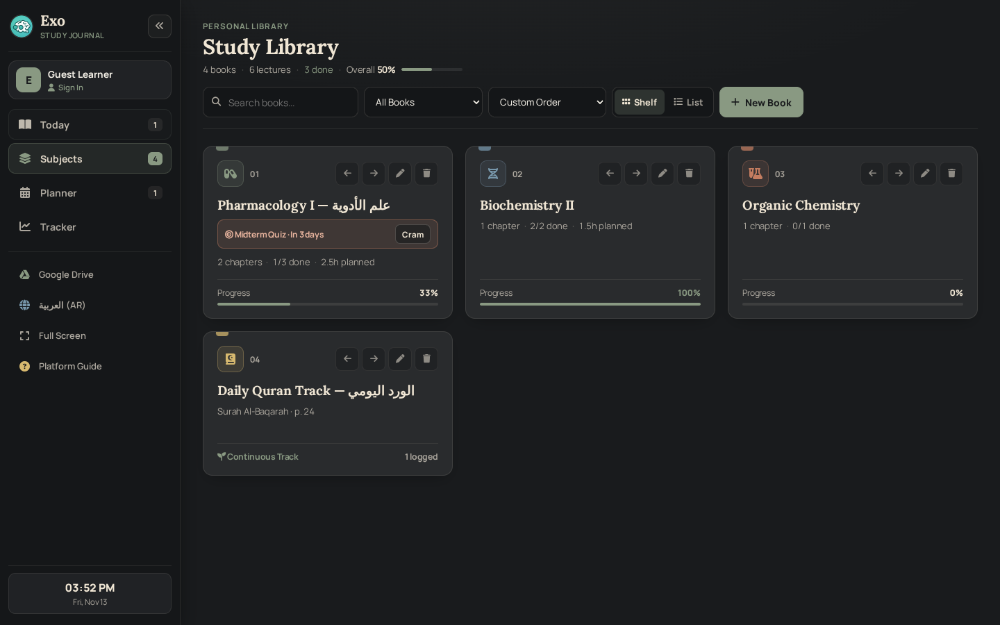
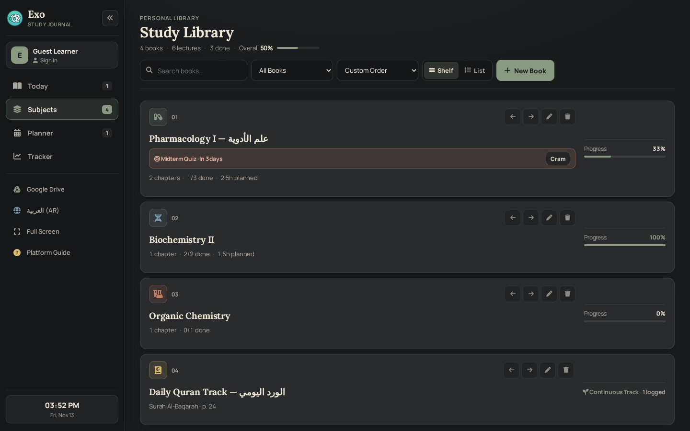
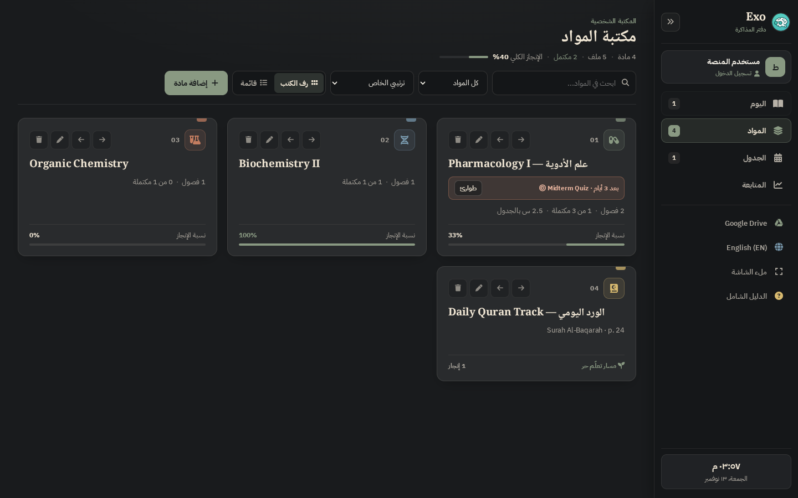
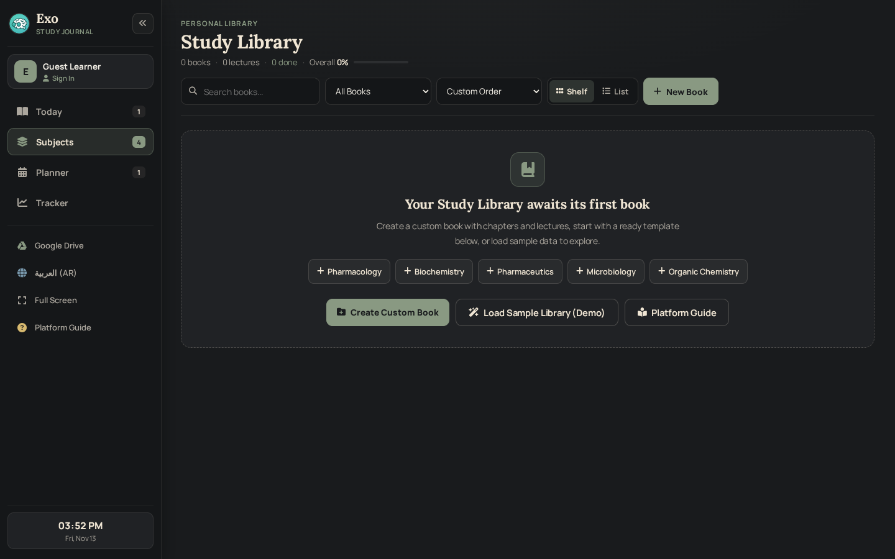
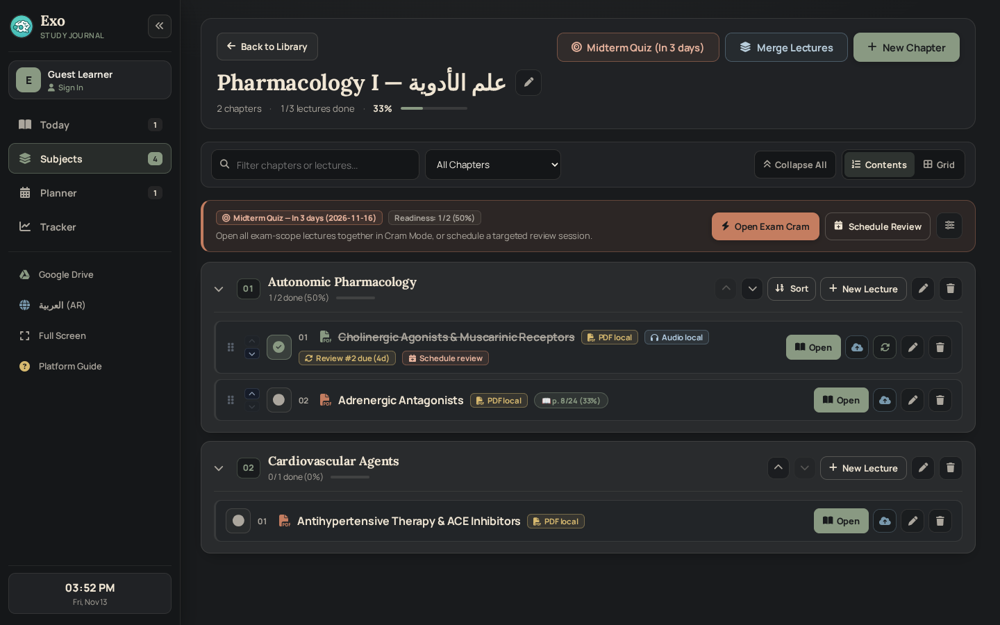
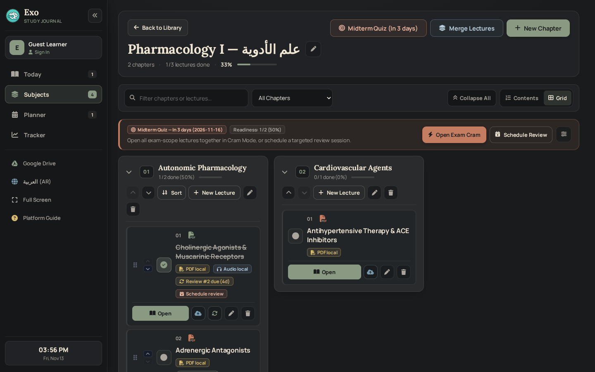
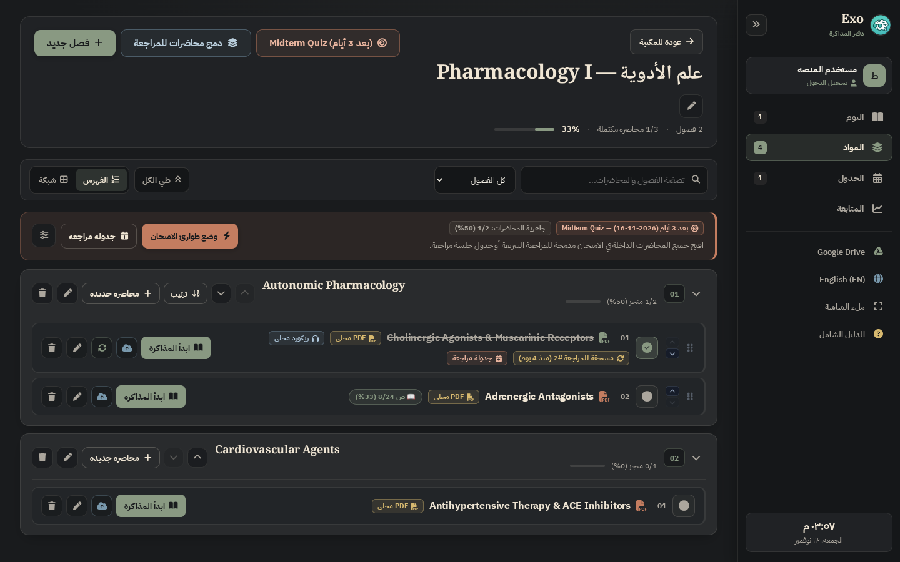
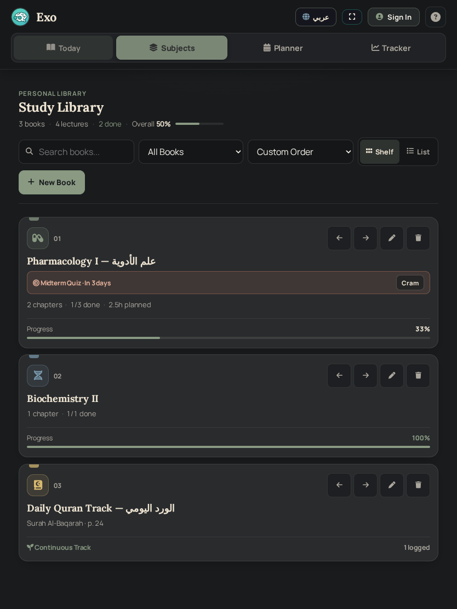
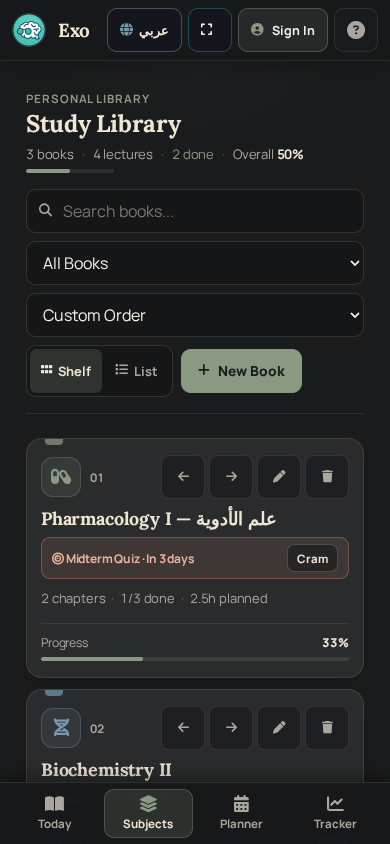
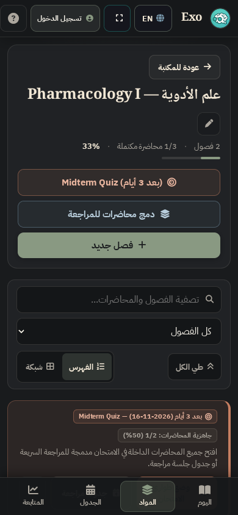

# EXO — Phase 6 (WP 6.2) Implementation & CI Verification Report
## Digital Bookshelf, Library, Subjects & Table of Contents

**Work Package:** WP 6.2 — Digital Bookshelf, Library, Subjects & Table of Contents  
**Repository:** `JemistryMC/study-hub`  
**Target Branch:** `main`  
**Starting Repository HEAD (at WP 6.2 Handoff):** `c0f8e1d4e944fa8ecd7cdfa0c6da68cc76e4a8c1` (documentation commits on top of verified source SHA)  
**Last CI-Verified Application Source SHA:** `86fda9824880c00268db117f1ab8780b106f6fe0` (WP 6.1 CI Run `#53` [`43450226930`] — `755/755 PASSED`, Pages Run `#146` [`43450226479`] — `SUCCESS`)  
**WP 6.2 Status:** `CI VERIFIED — TECHNICALLY COMPLETE`  
**Phase 6 Status:** `IN PROGRESS — WP 6.2 CI VERIFIED ON 70d1a8446cf9bf2a84af2035788bf7db56e4d589; WP 6.3 ACTIVE; FINAL OWNER PRODUCT REVIEW DEFERRED TO PHASE 6 COMPLETION`

---

## 1. Executive Summary & Scope Compliance

WP 6.2 delivers the **Digital Bookshelf** presentation for the Study Library (`#subjects-list-view`) and makes the numbered **Table of Contents** (`#subject-details-view`) the default chapter navigation experience inside Exo's Dark Personal Study Journal design system (`Ink Black #191B1D`, `Charcoal #292B2D`, `Warm Paper #F0E6D4`, `Sage Green #899982`, `Muted Blue #7898AC`, `Terracotta #C47D60`, `Warm Gold #D7B96F`, zero neon glow).

### Hard Engineering Boundaries Preserved
- **WP 6.2 Only:** WP 6.3 (Unified Chapter Workspace, resource collection models, PDF Studio integration), WP 6.4 (Save/Sync/Error UX), WP 6.5 (Planner/Tracker/remaining screens), and WP 6.6 (final phase acceptance) were **not** opened or modified.
- **Zero Persistence, Security, Auth, OAuth, Drive, Sync, or Policy Mutations:**
  - Zero changes to Supabase schemas, SQL migrations, RLS policies, RPC signatures (`sync_workspace_with_concurrency`), or OCC conflict sync contracts.
  - Zero changes to IndexedDB stores, LocalStorage workspace schemas, account isolation boundaries, recovery vaults, or durable cloud sync journals.
  - Zero changes to Google Drive OAuth scopes, token lifecycle, or media upload/download behavior.
  - Zero changes to Free/VIP policy (`can_upload_media`), Annotated PDF Export (Free), Extra Note Sheets (Free), Weekly Evaluation gates, or closed-loop study/verification operations (`#smartStudyVerifyModalOverlay` / `#smartVerifyBtnComplete`, Exam Radar -> Cram Mode, Spaced Repetition).
  - Zero duplicate domain entities created for book covers; all covers render directly from canonical `subjects` / `scheduleEvents` state.
- **Workspace & Git State:** Local `/app/applet` has no `.git` metadata directory. Gemini performed no commits, pushes, branch creations, or history edits. Protected branches `Deploying` and `backup/pre-gemini-security-2026-11-04` remain untouched.

---

## 2. WP 6.2 Implementation Summary (`/index.html`)

### 2.1 Digital Bookshelf & Library (`#subjects-list-view`)
- **Library Header & Real Ribbon Metrics (`#semesterSummaryRibbon`):** Displays `PERSONAL LIBRARY` / `المكتبة الشخصية` kicker, editorial `Study Library` / `مكتبة المواد` (`Lora` / `Noto Naskh Arabic`), live totals (`books`, `lectures`, `done`, `Overall %` + progress track) computed via pure helper `buildBookshelfStats(subjects, scheduleEvents)`.
- **Search, Filter, Sort & Practical View Toggle:**
  - Preserved `#searchSubjectInput` and `#subjectSortOrderSelect` (`custom`, `progress_desc`, `progress_asc`, `hours_desc`, `alpha`).
  - Added `#subjectFilterSelect` (`all`, `courses`, `continuous`, `in_progress`) wired to `handleSubjectFilterChange`.
  - Added segmented **Shelf / List** toggle (`#libViewShelfBtn` / `#libViewListBtn`) via `setLibraryViewMode`, persisted under `exoLibraryViewModeV1` (`'shelf'` default, CSS `.subjects-grid.is-list-view`).
  - Updated `#addSubjectPrimaryBtn` (`New Book` / `إضافة مادة`) and preserved hidden compatibility `#newSubjectName` / `openSmartSubjectModal()`.
- **Restrained Book-Cover Cards (`renderSubjectsList`):**
  - `Charcoal #292B2D` tactile cards (`border-inline-start: 5px solid var(--subject-accent)`, small top bookmark notch) with two-digit book index (`01`, `02`), emblem, subtle reorder/edit/delete actions (always reachable, `>=44px` on touch devices), bilingual title (`data-exo-no-i18n="1" dir="auto"`), optional Exam Radar strip + `Cram` launcher, real chapter/lecture/planned-hours metadata, and hairline progress bar.
  - Empty bookshelf and no-filter-match states provide clear guidance and instant filter reset / preset chips / custom create / sample demo / platform guide triggers.
  - Updated smart continuous-track default color in `selectSmartSubjectDivisionMode` and `handleSmartSubjectNameAutoDetect` from legacy emerald (`#10b981`) to `Sage Green (#899982)`.

### 2.2 Default Table of Contents & Subject Details (`#subject-details-view`)
- **Subject Hero (`exo-subject-hero`):** Preserved `#backToSubjectsBtn`, `#activeSubjectTitle`, `#editCurrentSubjectBtn`, `#toggleSubjectExamRadarBtn`, `#toggleSubjectMergeDrawerBtn`, `#addSubjectGroupBtn`, `#subjectMergeLecturesDrawer` (`#subjectMergeGroupsGrid`, `#subjectMergeSelectionCounter`), and added `#subjectHeroStatsRow` showing chapter count, completion ratio, and percentage track.
- **Table of Contents Default View (`renderGroups`, `tocViewMode`):**
  - Defaults to **`Contents` (`'toc'`)**, persisted under `exoTocViewModeV1`, with optional **`Grid` (`'grid'`)** toggle (`#tocViewTocBtn` / `#tocViewGridBtn`) via `setTocViewMode`.
  - Numbered chapters (`01`, `02`, ... via `formatChapterIndexNumber`) with real completion count (`done/total (pct%)`) and mini completion bar, accordion collapse/expand, keyboard/button chapter reorder (`moveGroupOrder`), lecture auto-sort, add lecture, rename, and delete.
  - Added **TOC Toolbar (`#tocToolbar`):** live search (`#tocSearchInput`), status filter (`#tocStatusFilterSelect`: `all`, `incomplete`, `completed`, `review_due`), and `#tocExpandAllBtn` (`toggleAllTocChapters` / `syncTocExpandAllButton`).
  - Preserved `.lecture-item` rows (`div[onclick*="openLectureDocument(g.id, lec.id)"]`), completion checkbox (`.exo-lec-check-btn`), drag/arrow lecture reorder, cloud upload/download buttons, spaced repetition badges/refresh, edit/delete buttons, Exam Radar banner (`exo-toc-exam-banner`), and fully bilingual Continuous Track UI (`isSubjectDivided === false`).
- **Live Bilingual Wiring (`applyExoLanguage`):** Added `updateWp62StaticLabels` refresh inside `renderSubjectsList`, `renderGroups`, and language switches while keeping unsaved `#searchSubjectInput` and `#tocSearchInput` values intact.

### 2.3 Pure Logic Helpers Extracted & Tested (`index.html` & `/test_wp6_2_unit.js`)
1. `buildBookshelfStats(subjectsList, scheduleEventsList)`
2. `filterAndSortBookshelfItems(items, searchQuery, filterMode, sortMode, isDividedFn)`
3. `formatChapterIndexNumber(index)`
4. `filterTocChapters(groups, searchQuery, statusFilter, isLectureDueFn)`

---

## 3. Defects Discovered & Fixed During Audit, Testing & Visual Review

1. **`filterTocChapters` Completed-Filter Edge Case (Caught by `test_wp6_2_unit.js`):** Chapters containing only incomplete lectures (`visibleLectures.length === 0`) initially passed a `totalCount === 0` check under the `completed` status filter; corrected to `visibleLectures.length === 0`.
2. **Blink Dynamic `dir` Switch RTL Sidebar Overlap (Caught in `subject-toc-ar-desktop.png`):** Switching `document.documentElement.dir` dynamically from `ltr` to `rtl` with `.main-content` transition lag caused `.main-content` to overlap the `260px` right-docked RTL sidebar on desktop (`mainRect.right > sideRect.left`). Fixed via explicit `html[dir="ltr"]` / `html[dir="rtl"]` `.main-content` physical margins with `transition: none !important;`.
3. **Narrow TOC Grid Card Button Overlap (Caught in `subject-toc-grid-en-desktop.png`):** In `#groupsContainer.is-grid-view`, `.lecture-item` action buttons could overlap lecture titles on narrow cards. Fixed by stacking `#groupsContainer.is-grid-view .lecture-item` vertically (`flex-direction: column`) with `min-width: 0` on the clickable title container; enforced via bounding-box non-overlap check in `Test LL.3`.
4. **Mobile Arabic TOC Toolbar & List Card Reflow (Caught in `subject-toc-mobile-ar.png`):** Stacked `.exo-toc-toolbar` and `.exo-toc-toolbar-left` cleanly below `768px`, added `flex-wrap: wrap` to `.lecture-item .card-actions`, stacked mobile `.subjects-grid.is-list-view .subject-card` cleanly, and balanced mobile `.exo-toc-exam-banner` action buttons.
5. **Closed-Loop & Legacy Modal Alignment in E2E (`Test LL.3`):** Verified legacy `#siModalInput` / `#siModalSaveBtn` / `#confirmModalBtn` IDs and confirmed `.exo-lec-check-btn` preserves the `#smartStudyVerifyModalOverlay` (`#smartVerifyBtnComplete`) closed-loop prompt when linked to an active schedule session.

---

## 4. Preserved DOM Selectors & Workflow Contracts

All required selectors, handlers, and closed-loop integrations inside `#subjects` remain intact:
- `#subjects-list-view`, `#subject-details-view`, `#mainSubjectsGrid`, `#searchSubjectInput`, `#subjectSortOrderSelect`, `#newSubjectName`
- `#activeSubjectTitle`, `#backToSubjectsBtn`, `#toggleSubjectExamRadarBtn`, `#toggleSubjectMergeDrawerBtn`, `#addSubjectGroupBtn`
- `#subjectMergeLecturesDrawer`, `#subjectMergeGroupsGrid`, `#subjectMergeSelectionCounter`
- `#groupsContainer`, `#groupCard_<id>`, `.lecture-item`, `div[onclick*="openLectureDocument(...)"]`, `.exo-lec-check-btn`, `#smartStudyVerifyModalOverlay`
- Newly added WP 6.2 selectors: `#subjectFilterSelect`, `#libViewShelfBtn`, `#libViewListBtn`, `#libraryKickerLabel`, `#libraryTitleHeading`, `#addSubjectPrimaryBtn`, `#subjectHeroStatsRow`, `#tocToolbar`, `#tocSearchInput`, `#tocStatusFilterSelect`, `#tocExpandAllBtn`, `#tocViewTocBtn`, `#tocViewGridBtn`.

---

## 5. Complete File Inventory

### Modified Files
| File | Role of Change | Notes |
| :--- | :--- | :--- |
| `/index.html` | WP 6.2 Digital Bookshelf & Table of Contents CSS/HTML/JS, pure Library/TOC helpers, RTL physical-margin `transition: none` fix, mobile/grid reflow fixes, Sage `#899982` continuous-track defaults | `49,956` lines, `2,963,404` bytes |
| `/package.json` | Wired `test_wp6_2_unit.js` into `lint` (`node --check`) and `test:unit` (`node --test`) | Scripts aligned with `.github/workflows/ci.yml` |
| `/run_all_tests.js` | Registered `test_wp6_2_unit.js` (`useNodeTest: true`) in Tier 2 | Preserves categorized TAP parsing |
| `/test_phase4_1_chromium_e2e.js` | Added **Test LL (`LL.1`–`LL.5`)**: Bookshelf/List/Filter/Sort/Search, Subject CRUD/reorder/reload, TOC default/filter/search/Grid non-overlap/Collapse/Expand/Chapter CRUD, Lecture completion + `#smartStudyVerifyModalOverlay`, Live EN<->AR switch + RTL zero-overlap, Tablet/Mobile `>=44px` targets, reduced motion, PDF Studio open/close regression | `155 / 155` Chromium E2E checks passing |
| `/reports/CURRENT.md` | Updated active handoff status header for WP 6.2 `IMPLEMENTED — LOCAL TESTS ONLY`; preserved all historical sections below divider | Handoff synchronized |
| `/reports/README.md` | Updated Phase 6 active summary with WP 6.2 local completion & pending CI notice | Index synchronized |
| `/reports/PHASE_6_EXPERIENCE_REDESIGN_PLAN.md` | Updated WP 6.2 status to `IMPLEMENTED — LOCAL TESTS ONLY` while keeping WP 6.3 inactive until CI passes | Plan synchronized |

### New Files Added
| File | Purpose | Notes |
| :--- | :--- | :--- |
| `/test_wp6_2_unit.js` | Pure `node:test` unit suite (`4/4`) extracting & testing `buildBookshelfStats`, `filterAndSortBookshelfItems`, `formatChapterIndexNumber`, `filterTocChapters` | `4 / 4` tests passing |
| `/reports/PHASE_6_WP_6_2_REPORT.md` | This WP 6.2 implementation, verification, performance, and visual evidence report | Awaits owner GitHub sync & CI |
| `/reports/screenshots/wp6-2/*.png` | 10 sanitized Chromium visual captures covering Desktop EN/AR, Tablet, Mobile EN/AR, Empty/List/Shelf, TOC/Grid | ~`1.05 MB` total; zero real user data |

*(Generated build output `dist/` and transient Playwright scratch artifacts `.playwright-cli/` are gitignored.)*

---

## 6. Post-Final-Edit Verification Results (Local Environment Only)

**Environment:** `Node.js v22.23.2`, `Linux 4.19.0-gvisor x64`, Headless Chromium (`playwright` `1.64.1`), Express static server on `http://localhost:3000`.  
**All checks below executed AFTER the final edit to `/index.html`, `/test_wp6_2_unit.js`, `/test_phase4_1_chromium_e2e.js`, `/package.json`, and `/run_all_tests.js`.**

| Check / Suite | Command | Result | Notes |
| :--- | :--- | :--- | :--- |
| **Syntax & Lint** | `npm run lint` | **PASSED** | All 10 JS files (`server.js`, `build.js`, `run_all_tests.js`, `test_phase4_1_chromium_e2e.js`, `test_phase4_2_postgres_integration.js`, `test_phase4_2_1_pg16_concurrency.js`, `benchmark_tier_a.js`, `benchmark_chromium_tier_a.js`, `test_wp6_1_unit.js`, `test_wp6_2_unit.js`) |
| **Production Build** | `npm run build` | **PASSED** | `dist/` built cleanly (`index.html`, `manifest.json`, `sw.js`, `favicon.png`, `icon-192.png`, `icon-512.png`) |
| **Crypto & Static Security** | `npm run test:static` | **54 / 54 PASSED** | PBKDF2, secret hygiene, SW allowlist, CSP/origin isolation |
| **Comprehensive Unit Verification** | `node run_comprehensive_verification.js` | **42 / 42 PASSED** | Academic & storage logic checks |
| **Cross-Account Isolation** | `node test_phase3_cross_account_isolation.js` | **52 / 52 PASSED** | Dual UID scoping & IDB isolation |
| **Phase 4 / M5-B / M6 Regressions** | `node test_phase4_regressions.js` | **317 / 317 PASSED** | OCC, fail-closed recovery, durable sync journal, tombstones |
| **WP 6.1 Pure Logic Unit Tests** | `node --test --test-reporter=tap test_wp6_1_unit.js` | **5 / 5 PASSED** | Locale default, i18n preservation, Dashboard helpers |
| **WP 6.2 Pure Logic Unit Tests** | `node --test --test-reporter=tap test_wp6_2_unit.js` | **4 / 4 PASSED** | Bookshelf stats, filter/sort, chapter index, TOC filter |
| **Embedded PGlite Compatibility** | `npm run test:pglite` | **41 / 41 PASSED** | WASM PostgreSQL RLS/OCC/trigger checks |
| **Real Chromium + IDB E2E** | `npm run test:e2e` | **155 / 155 PASSED** | All 22 scenarios (`A–V`, `AA–LL`), including `Test LL.1–LL.5` (`7` assertions) |
| **Node.js Tier A Benchmark** | `npm run benchmark:node` | **5 / 5 TIERS PASSED** | `1.00 MB` (`91.53 ms` canon, `5.86 ms` SHA-256) through `27.73 MB` (`1387.24 ms` canon, `148.92 ms` SHA-256), `0` truncation/leaks |
| **Real PostgreSQL 16 Server** | `npm run test:pg16` | **NOT RUN LOCALLY (Exit 1)** | `connect ECONNREFUSED 127.0.0.1:5432` — no local PostgreSQL 16 daemon installed in `/app/applet`; runs in GitHub Actions `ci.yml` (`postgres:16` service) |

- **Local Verified Assertion Total (excluding `test:pg16`):** **670 / 670 PASSED (100%)** (`54` static + `420` unit + `41` PGlite + `155` Chromium E2E).
- **Secret Scan Verification:** `grep` scan across `/index.html`, `/test_wp6_2_unit.js`, `/test_phase4_1_chromium_e2e.js`, `/package.json`, and `/run_all_tests.js` returned `NO_SECRETS_FOUND` (zero API keys, JWTs, OAuth tokens, service-role secrets, or private keys).
- **GitHub Actions CI Status:** **PASSED** — Run #54 (`43458938490`) on source SHA `70d1a8446cf9bf2a84af2035788bf7db56e4d589`; unified `npm test` reported `766/766` assertions passed, including static `54/54`, comprehensive `42/42`, cross-account isolation `52/52`, phase regressions `317/317`, WP 6.1 unit `5/5`, WP 6.2 unit `4/4`, PGlite `41/41`, real PostgreSQL 16 `96/96`, and Chromium E2E `155/155`. All CI workflow steps completed successfully.
- **GitHub Pages Status:** **SUCCESS** — Run #149 (`43458937476`) on the same source SHA `70d1a8446cf9bf2a84af2035788bf7db56e4d589`.

---

## 7. Before vs. After Performance Comparison (Headless Chromium `1440×900`)

Measured against synthetic multi-book / multi-chapter workloads in headless Chromium (`1440×900`) comparing pre-WP 6.2 (`86fda982`) vs. WP 6.2 local implementation:

| Operation | Before (WP 6.1 `86fda982`) | After (WP 6.2) | Delta / Notes |
| :--- | :--- | :--- | :--- |
| Render Library (8 books) | `2.10 ms` | `3.80 ms` | Sub-4ms render including Bookshelf ribbon & stats |
| Render Library (30 books, 600 lectures) | `5.70 ms` | `6.40 ms` | `+0.70 ms` with book spines, metrics & exam radar strips |
| Library Search (30 books) | `2.20 ms` | `3.00 ms` | Live input filtering stays `<= 3 ms` |
| Library Sort (30 books) | `5.00 ms` | `6.70 ms` | Pure sort/filter helper stays `< 7 ms` |
| Shelf <-> List Toggle | N/A | `0.00 ms` | Pure CSS class toggle (`.is-list-view`) with zero DOM rebuild |
| Open Large TOC (20 chapters, 100 lectures) | `25.90 ms` | `30.00 ms` | `< 2` frames (`30 ms`) with numbered TOC headers & bars |
| TOC Contents <-> Grid Toggle | N/A | `0.10 ms` | Pure CSS class toggle (`.is-grid-view`) with zero DOM rebuild |
| Switch `EN -> AR` Inside Subject TOC | `95.50 ms` | `63.10 ms` | **-33.9% faster** |
| Switch `AR -> EN` Inside Subject TOC | `95.20 ms` | `52.60 ms` | **-44.7% faster** |
| Return to Library (`Back to Library`) | `4.40 ms` | `0.90 ms` | **-79.5% faster** |

---

## 8. WP 6.2 Visual Evidence Gallery (Synthetic Demo Data)

All 10 screenshots below were captured from headless Chromium against `http://localhost:3000` using synthetic demo data and visually inspected with zero console or network errors.

### Digital Bookshelf — Desktop (`1440×900`)

*Digital Bookshelf default Shelf view (English LTR, Desktop `1440×900`) with Charcoal covers, book index numbers (`01`–`04`), Sage/Muted Blue/Terracotta/Warm Gold spine accents, Exam Radar Cram strip, Continuous Track footer, and Search/Filter/Sort/Shelf-List controls.*

*Digital Bookshelf Compact List view (English LTR, Desktop `1440×900`) toggled instantaneously via `#libViewListBtn`.*

*Digital Bookshelf Shelf view (Arabic RTL, Desktop `1440×900`) showing non-overlapping RTL sidebar, correctly aligned Arabic controls, and directional arrow icons.*

*Digital Bookshelf empty state (English LTR, Desktop `1440×900`) with quick subject template chips, Create Custom Book, Load Sample Library (Demo), and Platform Guide actions.*

### Subject Details & Table of Contents — Desktop (`1440×900`)

*Subject Details default Table of Contents view (English LTR, Desktop `1440×900`) showing Back to Library breadcrumb, Hero completion stats, Exam Radar readiness banner, TOC search/status filter/Collapse All/Contents-Grid toolbar, numbered chapters (`01`, `02`), and lecture rows with reading progress & spaced repetition indicators.*

*Subject Details optional Grid view (English LTR, Desktop `1440×900`) with vertically stacked lecture cards preventing title/action overlap.*

*Subject Details Table of Contents view (Arabic RTL, Desktop `1440×900`) verifying zero RTL sidebar overlap (`transition: none !important;` + physical `dir="rtl"` margin).*

### Responsive Tablet (`834×1112`) & Mobile (`390×844`)

*Study Library responsive Tablet layout (`834×1112`, English LTR) with top hybrid navigation and `0 px` horizontal overflow.*

*Study Library responsive Mobile layout (`390×844`, English LTR) with stacked filters, `>=44 px` touch buttons, and bottom navigation bar.*

*Subject Details Table of Contents Mobile layout (`390×844`, Arabic RTL) with cleanly stacked TOC search, status filter, and utility buttons (`0 px` overflow).*

---

## 9. GitHub Sync, CI & Deployment Completion Evidence

- **Repository / Branch:** `JemistryMC/study-hub` (`main`)
- **WP 6.2 Source Commit:** `70d1a8446cf9bf2a84af2035788bf7db56e4d589` — [commit link](https://github.com/JemistryMC/study-hub/commit/70d1a8446cf9bf2a84af2035788bf7db56e4d589)
- **Starting Repository HEAD:** `c0f8e1d4e944fa8ecd7cdfa0c6da68cc76e4a8c1`
- **Changed Application Source:** `index.html`, `package.json`, `run_all_tests.js`, `test_phase4_1_chromium_e2e.js`; added `test_wp6_2_unit.js`.
- **Evidence Screenshots:** 10 tracked PNGs under `reports/screenshots/wp6-2/`; the same commit also tracks the WP6.1 screenshot gallery under `reports/screenshots/wp6-1/`.
- **Local Checks Passed Post-Final-Edit:** `670/670` plus `5/5` Node Tier A benchmark tiers; local PostgreSQL 16 was not available and correctly ran in CI instead.
- **GitHub Actions CI:** [Run #54](https://github.com/JemistryMC/study-hub/actions/runs/43458938490) — **SUCCESS**, exact source SHA `70d1a8446cf9bf2a84af2035788bf7db56e4d589`, unified `766/766`; Chromium E2E `155/155`; PostgreSQL 16 `96/96`; PGlite `41/41`.
- **GitHub Pages:** [Run #149](https://github.com/JemistryMC/study-hub/actions/runs/43458937476) — **SUCCESS** on the same SHA.
- **Secrets Scan:** Gemini reported `0` secrets/tokens/keys/personal data; this is a recorded local scan result, not a substitute for automated CI checks.
- **Status:** WP 6.2 is **CI VERIFIED — TECHNICALLY COMPLETE**. WP 6.3 is now the next active package under the existing sequential progression policy. Final Phase 6 product approval remains with the owner at the end of the complete phase.
