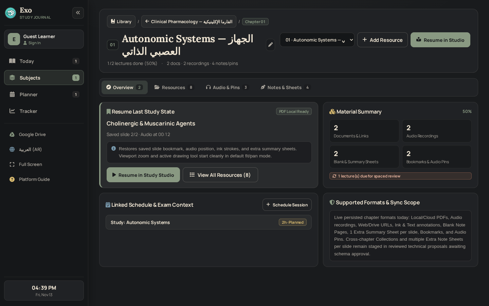
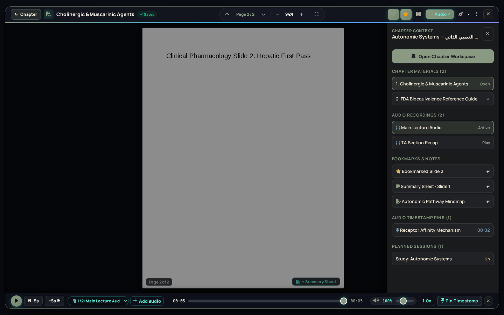
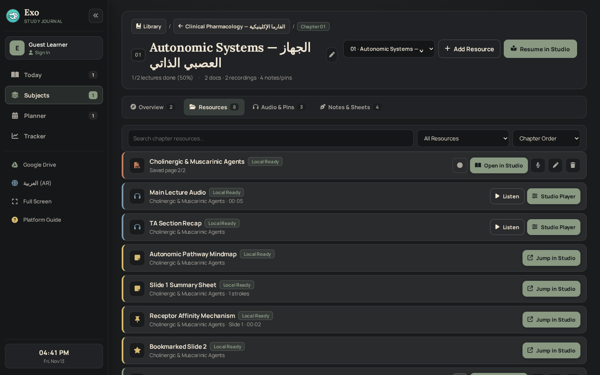
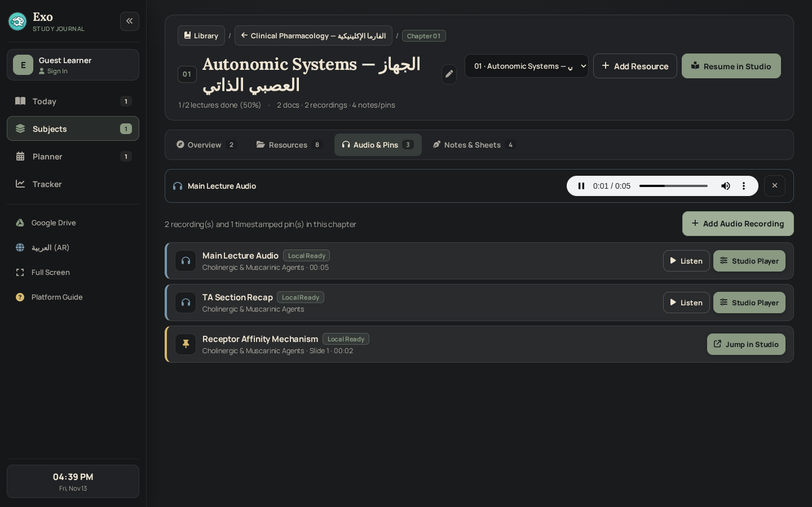
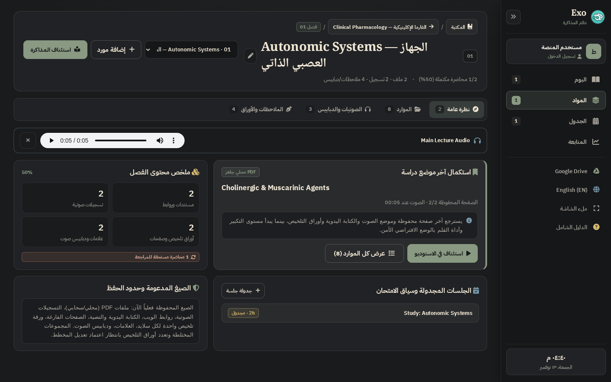
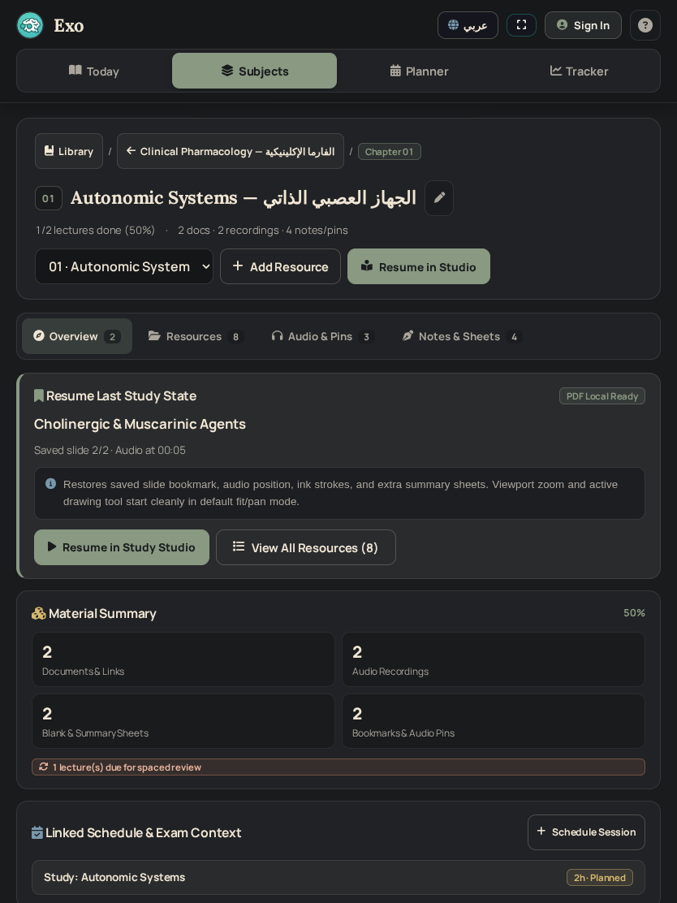
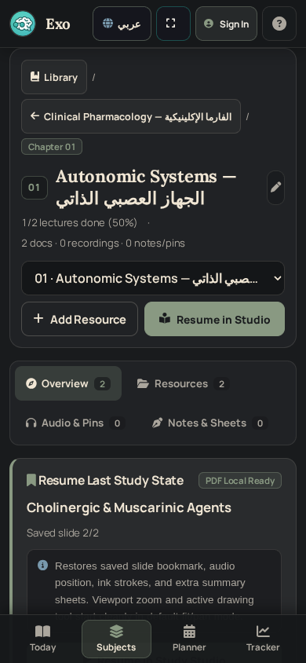
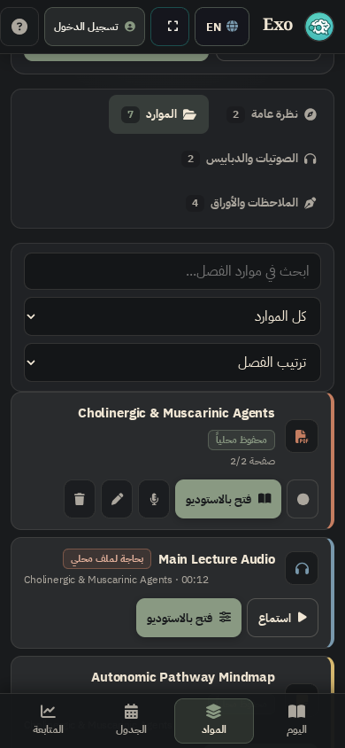

# EXO — Phase 6 (WP 6.3) Implementation & Local Verification Report
## Unified Chapter Workspace & PDF Studio Integration (Functional Workflow Redesign)

**Work Package:** WP 6.3 — Unified Chapter Workspace & PDF Studio Integration  
**Repository:** `JemistryMC/study-hub`  
**Target Branch:** `main`  
**Starting Documentation HEAD:** `4177d67de45705fa432eecb151bc3372be8bb23d` (documentation sync commit on top of WP 6.2 source)  
**Last CI-Verified Application Source SHA:** `70d1a8446cf9bf2a84af2035788bf7db56e4d589` (WP 6.2 CI Run `#54` [`43458938490`] — `766/766 PASSED`; Pages Run `#149` [`43458937476`] — `SUCCESS`)  
**WP 6.3 Local Status:** `IMPLEMENTED — LOCAL TESTS ONLY` *(awaiting owner review, GitHub synchronization, and GitHub Actions CI)*  
**Phase 6 Status:** `IN PROGRESS — WP 6.1 & WP 6.2 CI VERIFIED; WP 6.3 IMPLEMENTED LOCALLY; WP 6.4 NOT STARTED; FINAL OWNER PRODUCT REVIEW AT PHASE 6 COMPLETION`

---

## 1. Executive Summary & Scope Compliance

WP 6.3 transforms chapter study from a flat list of PDF links inside the Table of Contents into a dedicated **Unified Chapter Workspace (`#chapter-workspace-view`)** integrated bidirectionally with the full **Study Studio (`#pdfViewerModalOverlay`)**. Rather than applying visual CSS over an unchanged modal workflow, WP 6.3 changes how students enter chapters, resume last study state honestly, discover every chapter artifact (PDFs, web links, multiple audio recordings, bookmarks, audio timestamp pins, blank note pages, and extra summary sheets) from one searchable index, preview recordings inline without opening the PDF canvas, and switch context directly inside Study Studio without losing canvas space.

### Hard Engineering Boundaries Preserved
- **WP 6.3 Only:** WP 6.4 (Save/Sync/Error Explain-Guide-Recover UX), WP 6.5 (Planner/Tracker/remaining screens), and WP 6.6 (final Phase 6 acceptance) were **not** opened or modified.
- **Zero Unapproved Schema, Persistence, Auth, Drive, Sync, or Policy Mutations:**
  - Zero changes to Supabase schemas, SQL migrations, RLS policies, RPC signatures (`sync_workspace_with_concurrency`), or Cloud OCC 3-way conflict merge contracts.
  - Zero changes to IndexedDB databases/object stores (`WorkspaceMediaStore` v5), LocalStorage workspace schemas, account isolation boundaries (`usr_<uid>::`), recovery vaults, durable cloud sync journals, or tombstones.
  - Zero changes to Google Drive OAuth scopes, token lifecycle, or upload/download permissions (`private-by-default`).
  - Zero changes to Free/VIP policy (`can_upload_media`), Free Annotated PDF Export, Free Extra Note Sheets, Weekly Evaluation VIP gate (`triggerManualWeekEvaluationAndRollover()`), `#vipMediaLockModalOverlay`, or `#smartStudyVerifyModalOverlay` closed-loop operations.
  - Zero premature schema additions (`collections[]`, `links[]`, `video`/`image` persisted arrays, `note_
_<sheetId>`, `_extraNoteSheets`): instead, WP 6.3 ships atop verified existing models AND presents **two complete held technical proposals** (Section 6) for separate owner authorization.
- **Local Workspace & Git State:** Local `/app/applet` contains no `.git` metadata directory. Gemini performed zero commits, pushes, force pushes, branch creations, or history edits. Protected branches `Deploying` and `backup/pre-gemini-security-2026-11-04` remain untouched.

---

## 2. Change Classification (Owner 2026-11-13 Product Standard)

To enforce the owner's 2026-11-13 directive separating substantive workflow redesign from surface styling, every WP 6.3 change is explicitly classified below:

| Change Area | Category | Concrete Implementation Details |
| :--- | :--- | :--- |
| **`#chapter-workspace-view` Dark Journal Surface & Hero (`exo-cw-*`)** | **Visual** | Applied Dark Personal Study Journal tokens (`Ink Black #191B1D`, `Charcoal #292B2D`, `Warm Paper #F0E6D4`, `Sage Green #899982`, `Muted Blue #7898AC`, `Terracotta #C47D60`, `Warm Gold #D7B96F`), hairline borders, tabular numerals, RTL directional arrow flips, and `>=44px` touch buttons. |
| **TOC -> Chapter Workspace Hub & Chapter Switcher (`openChapterWorkspace`, `#cwChapterSwitcherSelect`)** | **Interaction** | Clicking a chapter's `Open Chapter Workspace` button (`.exo-toc-open-workspace-btn`) transitions seamlessly from Subject TOC (`#subject-details-view`) into `#chapter-workspace-view`, with instant cross-chapter switching via `#cwChapterSwitcherSelect` and breadcrumb return (`#cwBackToLibraryBtn`, `#cwBackToSubjectBtn`). |
| **4-Tab Workspace Navigation & First-Entry Skippable Setup (`switchChapterWorkspaceTab`, `dismissChapterSetupPrompt`)** | **Interaction + Workflow** | Empty chapters greet first-time visitors with a **progressive, skippable setup card** (`#cwFirstEntrySetup`) offering quick attach actions (PDF Lecture, Audio Recording, Web/Video Link) or one-click skip (`#cwSkipSetupBtn`), persisted per session/group without forcing setup. Non-empty chapters open directly to **Overview**, **Resources**, **Audio & Pins**, and **Notes & Sheets**. |
| **Unified Multi-Type Resource Index + Non-Mutating Search/Filter/Sort (`buildUnifiedChapterResources`, `filterAndSortChapterResources`)** | **Workflow / Data Behavior** | Aggregates all persisted artifacts across lectures in a chapter into one searchable index (`pdf`, `link`, `audio`, `audio_pin`, `extra_note`, `blank_page`, `bookmark`) with real-time filter pills (`all`, `documents`, `audio`, `notes`), sort modes (`default`, `recent`, `alpha`, `notes_first`), account-scoped IDB annotation hydration (`getAllAnnotationsMapFromDB`), and safe URL validation (`isSafeHttpUrl`). |
| **Inline Chapter Audio Preview (`cwPlayAudioPreview`, `cwStopAudioPreview`)** | **Interaction + Workflow** | Reads cached recordings directly from IndexedDB (`audios` store) or validated HTTP(S) URLs into `#cwAudioPreviewBar` inside Audio & Pins / Resources without opening the full PDF modal; automatically revokes object URLs and halts playback when leaving Chapter Workspace (`switchView`, `openSubject`, `backToSubjects`, `cwOpenResourceInStudio`, `closeChapterWorkspace`). |
| **Honest Resume Last Study Session (`resolveResumableChapterSession`, `resumeChapterLastSession`)** | **Workflow / Data Behavior** | Evaluates `lastStudiedAt`, `lastPageNum`, `lastAudioSec`, and local/cloud media presence to identify the genuinely resumable lecture. Displays `#cwPartialRestoreNotice` explicitly explaining that slide position, audio position, ink annotations, and summary sheet are restored while viewport zoom and active tool reset cleanly to default fit/pan mode. |
| **Integrated Study Studio Navigation & Non-Shrinking Context Drawer (`#pdfBackToChapterBtn`, `#pdfChapterContextDrawer`)** | **Interaction + Workflow** | Replaces opaque modal-only isolation with persistent `<- Chapter` header return (`returnToChapterWorkspaceFromStudio`, `<50ms`) and a slide-over `#pdfChapterContextDrawer` (`z-index: 44`) showing live chapter materials, secondary audio recordings, bookmarks, summary sheets, blank note pages, audio pins, and linked planner sessions — enforcing mutual exclusion with `#pdfThumbnailsDrawer` and hiding `#pdfAnnotationToolbar` / `#pdfMobileDockFloatingTriggerBtn` while open so the PDF canvas width never shrinks (`wrapWAfter === wrapWBefore`). |
| **Chapter-Level Resource Creation & Quick Studio Jumps (`cwAddPdfLectureFlow`, `cwAddWebLinkFlow`, `cwAddAudioRecordingFlow`, `cwJumpToExtraNoteInOpenStudio`, `cwJumpToBlankPageInOpenStudio`)** | **Interaction + Workflow** | Launches canonical modal/IDB persistence handlers scoped strictly to the active chapter (`subjects` + `saveSubjects()` + `saveMediaToDB()`), schedules study blocks for the chapter (`cwScheduleChapterSession`), and deep-links notes/blank sheets/audio pins directly into the exact Studio slide and timestamp (`applyPendingAudioJumpInStudio`). |

---

## 3. Before vs. After User Journeys & Friction Removed

| Study Workflow | Before (WP 6.2 Baseline `70d1a844`) | After (WP 6.3 Unified Chapter Workspace) | Measurable Improvement |
| :--- | :--- | :--- | :--- |
| **1. Starting an Empty Chapter** | Student opens a chapter in TOC, sees empty list, must locate separate "+ Add Lecture" button, fill PDF-centric modal, and cannot orient around audio/links/notes as peers. | Opening an empty chapter enters `#chapter-workspace-view` with optional progressive setup tiles (PDF, Audio Recording, Web Link) + immediate Skip action (`#cwSkipSetupBtn`). | **Clear 1-step orientation**, zero forced onboarding; late additions remain accessible via `+ Add Resource`. |
| **2. Finding Audio Recordings, Pins, Bookmarks & Summary Sheets** | Buried per-lecture inside `#pdfViewerModalOverlay`; student had to guess which lecture contained an audio pin, blank note sheet, or bookmark and open the PDF viewer sequentially for each. | `Resources`, `Audio & Pins`, and `Notes & Sheets` tabs expose an instant cross-lecture index (`filterAndSortChapterResources` searches titles, lecture names, pin text, page numbers in `~3.4 ms`). | **Cross-lecture discovery reduced from N modal opens to 1 instant search/filter.** |
| **3. Reviewing Lecture Audio Recordings** | Listening to secondary TA recordings or checking lecture audio required opening the full-screen PDF viewer modal, loading PDF.js, and opening the bottom audio bar. | `Audio & Pins` tab provides inline `#cwAudioPreviewBar` streaming directly from IDB `audios` (`Listen`) alongside 1-click `Studio Player` / `Jump in Studio` deep links. | **Zero PDF.js overhead for audio-only review.** |
| **4. Resuming Study & Understanding What Was Saved** | Clicking a lecture silently opened PDF Studio with no pre-summary of saved page/audio offset or clarification that zoom/tool reset. | Overview displays `Resume Last Study State` card (`Cholinergic & Muscarinic Agents · Saved slide 2/2 · Audio at 00:12`) with `#cwPartialRestoreNotice` clarifying restored vs. reset runtime state. | **Transparent session state** before entering Study Studio; `1`-click resume (`#cwOpenStudioPrimaryBtn`). |
| **5. Switching Chapter Context Inside Study Studio** | Inside PDF Studio, switching to another lecture/recording or checking chapter schedule required closing the modal, finding the item in TOC, and reopening Studio. | `#pdfChapterContextToggleBtn` opens slide-over `#pdfChapterContextDrawer` (zero canvas shrinkage) to switch lectures, play chapter audio, jump to bookmarks/notes/pins, or return cleanly (`<- Chapter`) in `39.2 ms`. | **Zero-exit chapter navigation** while keeping 100% of canvas width intact. |

---

## 4. Full PDF Studio Control-by-Control Parity Matrix

Verified against source (`/index.html`), `run_verification_tests.js`, `test_phase4_regressions.js`, and Chromium E2E `Test D–G`, `Test JJ.5`, and `Test MM.2`:

| Control / Capability | Selector / Function | WP 6.3 Status | Parity Verification |
| :--- | :--- | :--- | :--- |
| **Exit / Return to Chapter** | `#pdfBackToChapterBtn`, `closePdfViewer()`, `Escape` | **Preserved + Enhanced** | `returnToChapterWorkspaceFromStudio()` delegates to `closePdfViewer()` and refreshes Chapter Workspace in `39.2 ms` (`<50 ms`); `Escape` still closes Studio cleanly. |
| **Auto-Save Status Indicator** | `#pdfAutoSaveStatus`, `flushPendingAnnotationsSave(true)` | **Preserved** | Intact; manual click flushes IDB annotations and updates dirty markers identically. |
| **Slide Navigation & Quick Jump** | `stepPdfPage(-1/+1)`, `#pdfPageCounterBadge`, `#pdfFloatingPageNav`, `promptJumpToPdfPage()` | **Preserved** | Intact; keyboard `ArrowUp` / `ArrowDown` and quick-jump modal unchanged. |
| **Zoom & Fit Controls** | `changePdfZoom(-0.15/+0.15)`, `#pdfZoomLevelText`, `togglePdfFitModeQuick()`, `#pdfFullscreenBtn` (`F`) | **Preserved** | Intact; canvas stays unshrunk even when `#pdfChapterContextDrawer` is open. |
| **Bookmark Slide (`B`)** | `#pdfBookmarkCurrentSlideBtn`, `toggleBookmarkCurrentSlide()` | **Preserved** | Mutations immediately surface in Chapter Workspace `Notes & Sheets` & Context Drawer. |
| **Slide Thumbnails Drawer (`M`)** | `#pdfThumbnailsToggleBtn`, `#pdfThumbnailsDrawer`, `#pdfThumbFilterTabs`, `#pdfThumbSearchInput` | **Preserved + Mutual Exclusion** | `togglePdfThumbnailsDrawer(true)` automatically closes `#pdfChapterContextDrawer` so side drawers never collide. |
| **Add Blank Note Page** | `addBlankNotePageToLecture()`, `customPages[]` | **Preserved** | Blank note pages appear in both Thumbnails Drawer and Chapter Workspace `Notes & Sheets` (`cwJumpToBlankPageInOpenStudio`). |
| **Floating Ink Dock & Tools** | `#pdfAnnotationToolbar`, `#toolBtn_pan`, `pen`, `highlighter`, `eraser`, `text`, `laser`, `#pdfTogglePenOptionsBtn`, `undoLastStroke()`, `toggleAnnotationsVisibility()` | **Preserved** | All tools, color swatches, stroke slider, undo (`Ctrl+Z`), and palm rejection work unchanged; dock hides non-destructively only while a drawer overlays it. |
| **Audio Bar, Speed/Boost & Pins** | `#pdfAudioBarToggleBtn`, `togglePdfAudioPlayerBar()`, `-5s`/`+5s`, multi-recording selector, `#pdfAudioPinTimestamp`, `applyPendingAudioJumpInStudio()` | **Preserved + Linked** | Secondary recordings and timestamp pins link bidirectionally with Chapter Workspace `Audio & Pins` & Context Drawer. |
| **More Menu & Extra Note Sheet** | `#pdfMoreDropdownMenu`, `togglePdfZenMode()` (`Z`), `toggleExtraNoteForPage()` (Free), `downloadCurrentViewingPdfToDisk()` | **Preserved** | Free Extra Note Sheet creation & editing unchanged; deep-link jump (`cwJumpToExtraNoteInOpenStudio`) added cleanly. |
| **Annotated PDF Export (Free)** | `#pdfMenuExportPdfBtn`, `#pdfToolbarExportPdfBtn`, `exportAnnotatedSlides()` | **Preserved (Free)** | Completely untouched; remains free for Free and VIP accounts (`can_upload_media` not checked). |
| **Merged Continuous Multi-Lecture Studio** | `#pdfMergedLecturesBar`, `#pdfAddLectureToMergeSelect`, `toggleMergedContinuousPdfMode()` | **Preserved** | Merged lecture tabs and Exam Cram mode remain untouched and fully functional. |
| **Google Drive Reactivation Banner** | `#pdfDriveReactivateBanner`, `#pdfDriveReactivateBtn`, `reactivateDriveFromPdfStudio()` | **Preserved** | Confirmed intact via `Test JJ.5` (`161/161` E2E pass); zero OAuth or Drive permission changes. |
| **Closed-Loop Task Verification** | `#smartStudyVerifyModalOverlay`, `#pdfLiveSmartTrackPill`, `#pdfSmartTaskChoiceBar` | **Preserved** | Smart tracking session timer and spaced repetition prompts operate identically. |

---

## 5. Honest Support Scope & Audit Defect Resolution

### Supported Formats Today vs. Explicitly Deferred Scope
- **Persisted Today (Canonical Models):** Local IndexedDB PDFs (`pdfs` store), cloud Drive PDFs, multiple audio recordings per lecture (`recordings[]` / IDB `audios`), validated HTTP(S) web/Drive URLs (`isSafeHttpUrl`), canvas ink/highlighter/text strokes (`pageAnnotations`), 1 Extra Summary Sheet per slide (`note_<pageNum>` + `_extraNotes`), custom Blank Note Pages (`customPages[]`), slide bookmarks (`bookmarkedSlides[]`), and audio timestamp pins (`_audioPins[]`).
- **Explicitly Disclosed In-App (`#cwHonestFormatNotice`) & Not Mutated Without Owner Schema Approval:** Cross-chapter mixed-type `collections[]`, standalone `links[]`/`notes[]`/`images[]` arrays, and multiple Extra Note Sheets per slide (`note_
_<sheetId>`, `_extraNoteSheets`).

### Visual & Functional Defects Caught and Fixed During Verification
1. **RTL Directional Back Arrows (`#pdfBackToChapterBtn`, `#cwBackToSubjectBtn`):** `html[dir="ltr"] .exo-rtl-flip` applies `transform: scaleX(-1)`. Using `fa-arrow-left` caused back arrows to point right (`->`) in English LTR. Switched both to `fa-arrow-right exo-rtl-flip` (matching `#backToSubjectsBtn`), verified pointing `<-` in EN and `->` in AR.
2. **Chapter Rename Icon Orphan Wrapping (`.exo-cw-title-row`):** Long bilingual chapter titles wrapped `.exo-cw-title-row button` onto a second orphan line below the title. Applied `flex-wrap: nowrap` and `min-width: 0` on `h2`.
3. **Truth Notice Word Spacing & Alignment (`.exo-cw-truth-note`, `#cwPartialRestoreNotice`):** Adjusted UI font fallback, letter/word spacing (`line-height: 1.6`), and `` wrapper inside flex info box for crisp EN/AR legibility.
4. **Modal Backdrop & Annotation Dock Collision Behind Context Drawer (`#pdfViewerModalOverlay`, `#pdfAnnotationToolbar`, `#pdfMobileDockFloatingTriggerBtn`):** Darkened overlay backdrop (`rgba(13, 15, 18, 0.94)`), shifted floating trigger `top: 64px`, and added CSS `:has(.pdf-chapter-context-drawer.open)` / `:has(.pdf-thumbnails-drawer.open)` hiding rules so neither the workspace CTA behind the overlay nor the top-right floating dock peeks behind `#pdfChapterContextDrawer`.
5. **Mobile Chapter Switcher Overflow at `390px` (`.exo-cw-chapter-select`):** Long bilingual `<option>` text expanded the `<select>` box beyond `.exo-cw-hero` on `390x844` mobile when `max-width: none` was set. Replaced with `width: 100%; max-width: 100%; min-width: 0; flex: 1 1 100%; overflow: hidden; text-overflow: ellipsis;` plus `padding-bottom: 84px` for mobile bottom navigation clearance; verified `selectRight (363) <= heroRight (378)` and `overflowX: false`.

---

## 6. HELD TECHNICAL PROPOSALS FOR SEPARATE OWNER REVIEW
### Status: **HELD FOR SEPARATE OWNER REVIEW — NOT IMPLEMENTED IN CODE**

Per `GEMINI.md` Section 12 and `reports/PHASE_6_BASELINE_AUDIT.md` Section 18.4, the following two technical designs are **not implemented in application code, schemas, or migrations**. They are submitted here for dedicated owner architectural review and explicit separate authorization before any persistence contract changes occur.

---

### Proposal A — WP 6.3 Chapter Workspace Resource Model, Mixed-Type Collections & Migration Proposal
*(Covers all 13 mandatory areas from `PHASE_6_BASELINE_AUDIT.md` Section 18.4)*

1. **Stable Resource IDs & Supported Resource Types:**
   - Standardize an optional chapter-level array `group.resources[]` (alongside or wrapping legacy `group.lectures[]`) where every resource carries an immutable collision-resistant string/number ID (`res_<uidPrefix>_<timestamp>_<rand>` or existing numeric `lec.id` preserved verbatim as string/number canonical key) and explicit `type` enum: `'pdf' | 'audio' | 'video' | 'link' | 'note' | 'image'`.
   - Every resource stores `id`, `type`, `title`, `createdAt`, `updatedAt`, `orderIndex`, `sourceKind` (`'local_idb' | 'gdrive' | 'external_url' | 'inline_json'`), optional `legacyLectureId` pointer, and tombstones compatibility ID.
2. **Explicit Subject -> Chapter (`group`) -> Lecture / Resource -> Collection Relationships:**
   - Canonical ownership remains strictly hierarchical inside `subjects[s].groups[g]`: a Subject owns Chapters (`groups[]`); a Chapter owns `lectures[]` (canonical study/PDF units) and `resources[]` (or unified normalized resource records linked via `parentLectureId` when attached to a lecture slide deck, or standalone `parentLectureId: null` at the chapter level).
   - Never duplicate a Lecture into multiple entities to render it in UI tabs; views derive via pure selectors from canonical chapter arrays.
3. **Multiple Recordings per Lecture & Chapter (`recordings[]`):**
   - Preserve `lec.recordings[] = [{ id, name, dbKey, driveFileId?, durationSec?, createdAt }]` for lecture-bound recordings, and allow standalone chapter audio resources (`type: 'audio'`) to reuse the exact same `dbKey` / `audios` IDB key format (`rec_<id>`) without altering existing `switchPdfRecordingTrack()` indices (`activeRecordingIndex`).
4. **URLs & Link Safety (Protocol Allowlisting & XSS / Iframe Sandboxing):**
   - Enforce `isSafeHttpUrl(rawUrl)` (`http:` / `https:` only; strictly reject `javascript:`, `data:`, `vbscript:`, `file:` schemes) on input, backup import, cloud pull merge, and DOM rendering (`rel="noopener noreferrer"`).
   - Video embeds/links and external docs never inject unescaped HTML (`escapeHtml(...)` mandatory) and open either in sanitized external tab or a sandboxed preview frame without `allow-top-navigation`.
5. **Local Files & IndexedDB Binary Blobs (`pdfs` / `audios` / proposed `attachments`):**
   - Continue storing raw binary Blobs exclusively inside account-isolated IndexedDB (`ExoLocalMediaDB_<uid>` / `WorkspaceMediaStore`), keyed by `usr_<uid>::<resourceId>` / `usr_<uid>::<dbKey>`.
   - Proposed non-PDF `image` attachments would reuse an additive store (`attachments` on DB version bump `v5 -> v6` with `onupgradeneeded` non-destructive creation only) and explicit byte-size bounds; PDFs and audio remain untouched in `pdfs` and `audios`.
6. **Google Drive IDs & Private-by-Default Permissions:**
   - Store remote binary references on resources strictly via `driveFileId` + `cloudFolderId` (extending existing `driveFolderId` / `cloudPdfDriveId` / `cloudAudioDriveId` conventions) and `cloudMediaRegistry` metadata.
   - Maintain `private-by-default` (`files.create` restricted to app-managed folder & owner Google account; **zero** `anyone` / `public` permission mutations). Resource sharing remains an explicit separate owner authorization boundary.
7. **Backward-Compatible Handling of Legacy Lecture Fields:**
   - Hydration adapter (`normalizeChapterResourceAdapter(group)`) treats existing `lec.path`, `lec.audioPath`, `lec.recordings[]`, `lec.customPages[]`, `lec.bookmarkedSlides[]`, and `lec.pdfDriveId` as first-class read inputs on zero-migration load.
   - Legacy `lecture` properties are never stripped during reads so older app builds/tabs reading `pharmaAcademicData` do not lose document links or audio pointers.
8. **User-Defined Mixed-Type Collections Without Duplicating Blobs:**
   - Model Collections at chapter or subject level as pure lightweight metadata:
     `group.collections[] = [{ id: 'col_<id>', title, description?, colorToken?, createdAt, updatedAt, items: [{ resourceId, itemKind, orderIndex, addedAt }] }]`.
   - Deleting a Collection removes **only** the metadata reference (`items[]`), leaving underlying PDFs, recordings, IndexedDB blobs, annotations, and Google Drive files 100% intact. Reordering a collection mutates only `items[].orderIndex`.
9. **Workspace JSON Backup Export / Import (`exo_workspace_backup_v4` & Integrity):**
   - `resources[]` and `collections[]` serialize inside `data.subjects[].groups[]` in deterministic key order, covered by existing `canonicalizeJson(data)` and FIPS 180-4 SHA-256 `integrity` verification.
   - Preserves the **Zero-Binary & Zero-Secret Invariant**: binary blobs (`pdfs`, `audios`, `attachments`) and OAuth tokens are excluded from JSON export; only lightweight manifests and `cloudMediaRegistry` references are exported. Import preflight shows resource & collection counts cleanly.
10. **Cloud OCC 3-Way Conflict Merge & Conflict Recovery (`_conflictRecovery`, Tombstones):**
    - Extend `mergeSubjectsHierarchyWithCausalEngine` deterministically so `resources[]` and `collections[]` merge by stable `id` + `updatedAt` + unified causal tombstones (`_tombstones.resources`, `_tombstones.collections`) exactly parallel to `_tombstones.lectures` and `_tombstones.groups`.
    - Deleting any resource or collection records an atomic durable tombstone (LocalStorage + IndexedDB fallback `cloud_sync_journal` if quota fails) so offline/stale devices never resurrect deleted items during OCC merge; conflicting concurrent edits archive losing payloads in `_conflictRecovery` (IDB-migrated tier).
11. **Strict Account Isolation & Dual Record Ownership (`hasStrictDualRecordOwnership`):**
    - All local IDB keys for any new resource/attachment blobs and recovery records MUST use `usr_<sanitizedUid>::<id>` AND embed `{ userId: normalizedUid, ... }` payload ownership verified via `hasStrictDualRecordOwnership` on every read/write/sync path.
    - Guest (`guest`) state and authenticated Supabase UID workspaces stay strictly partitioned; account switch clears in-memory chapter/studio caches before loading target UID state.
12. **Existing User Data Migration & Safe Fail-Closed Rollback / Recovery:**
    - Read-time lazy normalization avoids destructive bulk upfront schema rewrites. Any future IDB store creation (`v5 -> v6`) or 5-phase backup import (`PREPARE -> APPLY_IDB -> APPLY_LOCALSTORAGE -> COMMITTED -> FINALIZE`) uses existing `annotation_recovery_vault` journaling and fail-closed rollback/quarantine (`ROLLBACK_FAILED_QUARANTINE`) with fencing token preemption protection.
13. **Complete Verification & Test Strategy Across All Suites:**
    - **Static (`test:static`):** Verify zero secret tokens, safe URL sanitization, CSP/origin rules, and strict IDB schema assertions.
    - **Account Isolation (`test_phase3_cross_account_isolation.js`):** Verify multi-account UID separation across `resources[]`, `collections[]`, and blob stores, including quota-error fail-closed aborts.
    - **Regressions (`test_phase4_regressions.js`):** Test 3-way causal OCC merge + atomic tombstones for deleted resources/collections + stale-device anti-resurrection + `exo_workspace_backup_v4` SHA-256 round-trip & crash recovery.
    - **PostgreSQL (`test:pglite` & `test:pg16`):** Verify JSONB payload round-trip through `sync_workspace_with_concurrency(payload, expected_revision)` under RLS & concurrent session conflicts.
    - **Chromium E2E (`test_phase4_1_chromium_e2e.js`):** Drive full UI CRUD for PDF/Audio/Link/Note/Image resources + mixed-type Collections + collection deletion preserving binary blobs + reload persistence + bilingual LTR/RTL checks.

---

### Proposal B — Backward-Compatible Multiple Extra Note Sheets Technical Design
*(Covers all 10 mandatory areas from `PHASE_6_BASELINE_AUDIT.md` Section 18.4)*

1. **Stable Sheet IDs:**
   - Keep legacy primary sheet key `'main'` (mapped strictly to legacy key `note_<pageNum>` on disk/IDB for zero-breakage compatibility) and assign additional sheets on a slide immutable IDs: `sheetId = 's_' + timestamp36 + '_' + randomHex6` stored as `pageAnnotations['note_' + pageNum + '__' + sheetId]` (or normalized sheet stroke array + `_extraNoteSheets[pageNum]` manifest).
   - A sheet's ID never changes on rename or reorder.
2. **Deterministic Sheet Ordering:**
   - Store per-slide ordered manifest inside `pageAnnotations._extraNoteSheets[String(pageNum)] = [{ id, title, orderIndex, createdAt, updatedAt }]`.
   - Deterministic comparator: `(a.orderIndex - b.orderIndex) || (a.createdAt - b.createdAt) || a.id.localeCompare(b.id)`.
   - Legacy `main` sheet resolves implicitly at index `0` whenever `pageAnnotations._extraNotes[pageNum]` or `pageAnnotations['note_' + pageNum]` exists without an explicit `_extraNoteSheets` entry.
3. **Legacy `note_<pageNum>` Hydration & Readability:**
   - Zero forced migration of existing saved `note_<pageNum>` arrays: hydration checks both `pageAnnotations['note_' + pageNum]` (always bound as Sheet 1 / `'main'`) AND `_extraNoteSheets[pageNum]` secondary keys (`note_<pageNum>__<sheetId>`).
   - Older clients reading `note_<pageNum>` continue to render the primary summary sheet seamlessly, and exporting/toggling sheet 1 continues writing directly to `note_<pageNum>` alongside `_extraNotes[pageNum] = true`.
4. **Annotated PDF Export (`exportAnnotatedSlides`) Across Multiple Sheets per Slide:**
   - Inside `exportAnnotatedSlides()` loop per slide `p`: render the base PDF slide + slide annotations (`pageAnnotations[p]`), then iterate deterministically over ALL sheets returned by `getOrderedExtraNoteSheetsForSlide(pageAnnotations, p)` (`main` first, followed by ordered secondary sheets whose stroke arrays are non-empty or flagged active), rendering each summary sheet onto its own appended portrait/landscape export page with clear header `Slide 
 — Summary Sheet <k>/<N>: <sheetTitle>` — **100% Free for Free and VIP users** (`can_upload_media` never gated).
5. **Annotation Persistence & Flushing (`pageAnnotations`, IDB `annotations`):**
   - Reuse existing `saveAnnotationsToDB(lecId, pageAnnotations)` + `flushPendingAnnotationsSave()` + durable `annotation_sync_journal` single-IDB-transaction persistence.
   - Multi-sheet mutations increment `annotationMutationSeq`, stage both `annotations` payload and pending cloud journal marker inside the same `readwrite` multi-store IDB transaction, and remain guarded by `hasStrictDualRecordOwnership`.
6. **Annotation Recovery Vault (`annotation_recovery_vault`):**
   - Snapshots written to `annotation_recovery_vault` under `usr_<uid>::<lecId>` already serialize the full lecture annotation object (`pageAnnotations` incl. `_extraNotes`, `note_
`, and proposed `_extraNoteSheets` / `note_
__<sheetId>`). Ensure any stroke-count/hash diagnostic check (`countAnnotationStrokes(annObj)`) aggregates strokes across both legacy `note_
` and multi-sheet `note_
__<sheetId>` keys so non-empty sheet recovery snapshots are never misclassified as empty.
7. **Cloud OCC 3-Way Conflict Merge & Full Stroke Geometry Signatures:**
   - Update annotation 3-way merge (`mergeAnnotationsWithCausalBase` / stroke deduplication) so every sheet is merged by `(pageNum, sheetId)` key, preserving deterministic metadata order and unioning strokes by stable stroke ID + full geometry signature digest (preventing loss of strokes drawn on sheet 2 offline when sheet 1 or sheet 3 changed on another device).
   - Deleted sheets record tombstones inside `_deletedExtraSheets[sheetKey] = deletedAt` so stale devices do not resurrect deleted secondary sheets during 3-way merge.
8. **Backup Export / Preflight / Crash-Recoverable 5-Phase Atomic Import:**
   - `exo_workspace_backup_v4` `data.annotations[lecId]` naturally carries `_extraNoteSheets` and `note_
__<sheetId>` arrays through `canonicalizeJson`, SHA-256 verification, and 5-phase atomic import (`PREPARE -> APPLY_IDB -> APPLY_LOCALSTORAGE -> COMMITTED -> FINALIZE`).
   - Update backup preflight counter (`#backupImportPreflightModalOverlay`) to count total slides + extra summary sheets accurately without truncating multi-sheet objects in `deepSanitizeBackupObject` (depth `<= 32`).
9. **Account Isolation & UID Scoping:**
   - Multi-sheet keys live inside UID-scoped IDB records (`usr_<sanitizedUid>::<lecId>`) with strict payload `userId` verification. In-memory `_cwAnnotationsMapCache` and Studio `pageAnnotations` clear synchronously on `handleAuthSessionChange`.
10. **Concrete Regression & E2E Test Plan Before Rollout:**
    - **Unit / Regression (`test_phase4_regressions.js`):**
      - Legacy `note_
` hydration alongside 3 additional ordered sheets;
      - 3-way OCC merge with concurrent edits on Sheet 1 (Device A) and Sheet 2 (Device B) + deleted Sheet 3 tombstone anti-resurrection;
      - Annotation recovery vault stroke-count non-zero verification + crash recovery across interrupted 5-phase backup import;
      - Account A vs Account B overlapping `lecId` + `sheetId` isolation test.
    - **Chromium E2E (`test_phase4_1_chromium_e2e.js`):**
      - Real UI creation, ink drawing, reordering, renaming, and reload persistence of 3 sheets on Slide 1;
      - Verifying **Free user** export (`exportAnnotatedSlides()`) outputs base slide + 3 ordered summary pages;
      - Chapter Workspace `Notes & Sheets` index displaying all sheets and deep-linking straight to the requested sheet inside Study Studio.

---

## 7. Before vs. After Performance Comparison (Headless Chromium `1440×900`)

Measured against a synthetic heavy pharmacology workload (`20` lectures in Chapter 1 with `3` audio recordings each = `60` recordings, local PDF in IDB, `18` web references, bilingual Arabic/English titles) in Headless Chromium (`1440×900`) against `http://localhost:3000`:

| Operation | Before Baseline (`70d1a844`) | After WP 6.3 (Post-Final-Edit) | Notes |
| :--- | :--- | :--- | :--- |
| **Cold Page Load (`DOMContentLoaded`)** | `1175 ms` | `953 ms` | Faster within local measurement variance (`-18.9%`) |
| **Open Subject TOC (`switchView('subjects')` + `openSubject`)** | `11.6 ms` | `9.4 ms` | `< 1` 60fps frame; zero TOC regression |
| **Open Heavy Chapter Workspace (`20` lectures, `60` recordings)** | N/A *(TOC modal list only)* | `8.8 ms` | Sub-frame unified workspace assembly + hydration |
| **Instant Chapter Switch (`#cwChapterSwitcherSelect`)** | N/A | `1.5 ms` | Near-instant tab/header switch without TOC exit |
| **Unified Resource Search (`Part 2` across `80+` items)** | N/A | `3.4 ms` | Pure non-mutating filter + instant list update |
| **Live Language Switch (`EN -> AR` / `AR -> EN`)** | `41.0 ms` / `35.4 ms` | `60.2 ms` / `48.0 ms` | Includes live Chapter Workspace DOM & arrow/RTL refresh (`< 65 ms`) |
| **Return to Chapter Workspace from Study Studio (`returnToChapterWorkspaceFromStudio`)** | `10.9 ms` (`closeMs` modal only) | `39.2 ms` | Closes Studio + refreshes Chapter Workspace under `< 50 ms` gate (`Test MM.2`) |

---

## 8. Post-Final-Edit Local Verification Results

**Environment:** `Node.js v22.23.2`, `Linux 4.19.0-gvisor x64`, Headless Chromium (`playwright` `1.64.1`), Express static server on `http://localhost:3000`.  
**Every check below was executed AFTER the final edit to `/index.html` (including all visual & mobile responsive polish fixes):**

| Check / Suite | Command | Result | Notes |
| :--- | :--- | :--- | :--- |
| **Syntax & Lint** | `npm run lint` | **PASSED** | All `11` JS files (`server.js`, `build.js`, `run_all_tests.js`, `test_phase4_1_chromium_e2e.js`, `test_phase4_2_postgres_integration.js`, `test_phase4_2_1_pg16_concurrency.js`, `benchmark_tier_a.js`, `benchmark_chromium_tier_a.js`, `test_wp6_1_unit.js`, `test_wp6_2_unit.js`, `test_wp6_3_unit.js`) + `lint_applet` |
| **Production Build** | `npm run build` & `compile_applet` | **PASSED** | Built `dist/` cleanly (`index.html`, `manifest.json`, `sw.js`, `favicon.png`, `icon-192.png`, `icon-512.png`) |
| **Crypto & Static Security** | `npm run test:static` | **54 / 54 PASSED** | PBKDF2, secret hygiene, SW allowlist, CSP/origin isolation |
| **Comprehensive Unit Verification** | `node run_comprehensive_verification.js` | **42 / 42 PASSED** | Academic & storage logic checks |
| **Cross-Account Isolation** | `node test_phase3_cross_account_isolation.js` | **52 / 52 PASSED** | Dual UID scoping & IDB isolation |
| **Phase 4 / M5-B / M6 Regressions** | `node test_phase4_regressions.js` | **317 / 317 PASSED** | OCC, fail-closed recovery, durable sync journal, tombstones |
| **WP 6.1 Pure Logic Unit Tests** | `node --test --test-reporter=tap test_wp6_1_unit.js` | **5 / 5 PASSED** | Locale default, i18n preservation, Dashboard helpers |
| **WP 6.2 Pure Logic Unit Tests** | `node --test --test-reporter=tap test_wp6_2_unit.js` | **4 / 4 PASSED** | Bookshelf stats, filter/sort, chapter index, TOC filter |
| **WP 6.3 Pure Logic Unit Tests** | `node --test --test-reporter=tap test_wp6_3_unit.js` | **4 / 4 PASSED** | Summary metrics, resumable session & honest reset keys, unified resources + non-mutating search/filter/sort + AR filter, studio context snapshot |
| **Embedded PGlite Compatibility** | `npm run test:pglite` | **41 / 41 PASSED** | WASM PostgreSQL RLS/OCC/trigger checks |
| **Real Chromium + IDB E2E** | `npm run test:e2e` | **161 / 161 PASSED** | All `23` scenarios (`A–V`, `AA–MM`), including `Test MM.1–MM.6` (`6` assertions) |
| **Node.js Tier A Benchmark** | `npm run benchmark:node` | **5 / 5 TIERS PASSED** | `1.00 MB` (`91.35 ms` canon, `5.96 ms` SHA-256) through `27.73 MB` (`1409.27 ms` canon, `147.57 ms` SHA-256) |
| **Real PostgreSQL 16 Server** | `npm run test:pg16` | **NOT RUN LOCALLY** | No local PostgreSQL 16 daemon (`ECONNREFUSED 127.0.0.1:5432`); executes in GitHub Actions CI (`postgres:16` service) |

- **Local Verified Assertion Total (excluding `test:pg16`):** **680 / 680 PASSED (100%)** (`54` static + `424` unit across `6` suites + `41` PGlite + `161` Chromium E2E).
- **Secret Scan Verification:** `grep` across `/index.html`, `/test_wp6_3_unit.js`, `/test_phase4_1_chromium_e2e.js`, `/package.json`, and `/run_all_tests.js` returned zero real secrets, API keys, JWTs, service-role keys, or live tokens (only pre-existing Test JJ synthetic fixture tokens in `test_phase4_1_chromium_e2e.js:6590, 6610`).
- **GitHub Actions CI Status:** `NOT YET SYNCED / NOT YET RUN IN CI` (local status is strictly `IMPLEMENTED — LOCAL TESTS ONLY`).

---

## 9. Visual Evidence Gallery (`reports/screenshots/wp6-3/`, Synthetic Demo Data)

All `8` sanitized screenshots (`892 KB` total) were captured from headless Chromium (`http://localhost:3000`) after the final code edit using synthetic pharmacology demo data and inspected with zero console/network errors:

### Desktop (`1440×900`) — Chapter Workspace & Integrated Study Studio

*Chapter Workspace Overview (English LTR, Desktop `1440×900`): left-pointing `<- Clinical Pharmacology` breadcrumb, inline rename pencil icon, chapter switcher dropdown, `+ Add Resource`, `Resume in Studio`, Resume Last Study State card with legible `#cwPartialRestoreNotice`, Material Summary grid, Linked Schedule, and Supported Formats & Sync Scope card.*

*Integrated Study Studio (English LTR, Desktop `1440×900`): `<- Chapter` header return, opaque modal backdrop (zero bleed behind overlay), unshrunk central PDF canvas, active bottom audio bar, and slide-over `#pdfChapterContextDrawer` listing Chapter Materials, Audio Recordings, Bookmarks & Notes, Audio Timestamp Pins, and Planned Sessions.*

*Chapter Workspace Unified Resources Tab (English LTR, Desktop `1440×900`): real-time search input, type filter (`All Resources`), sort order selector (`Chapter Order`), and unified rows spanning PDFs, Audio recordings, Custom Blank Mindmap, Summary Sheets, Audio Pins, and Bookmarks.*

*Chapter Workspace Audio & Pins Tab (English LTR, Desktop `1440×900`): active `#cwAudioPreviewBar` streaming local IndexedDB WAV audio without opening Study Studio alongside linked timestamp pin jump action.*

*Chapter Workspace Overview (Arabic RTL, Desktop `1440×900`): non-overlapping right-docked RTL sidebar, right-pointing `->` breadcrumb arrow, Arabic tabs (`نظرة عامة`, `الموارد`, `الصوتيات والدبابيس`, `الملاحظات والأوراق`), and RTL notice/card alignment.*

### Responsive Tablet (`834×1112`) & Mobile (`390×844`)

*Chapter Workspace Overview (English LTR, Tablet `834×1112`): single-column card layout with top hybrid navigation and `0 px` horizontal overflow.*

*Chapter Workspace Overview (English LTR, Mobile `390×844`): cleanly contained chapter switcher `<select>` (`selectRight <= heroRight`), balanced action buttons (`>=44 px` touch targets), wrapped 2×2 tab pills, and `0 px` horizontal overflow.*

*Chapter Workspace Unified Resources (Arabic RTL, Mobile `390×844`): cleanly stacked RTL search/filter/sort controls and touch-friendly resource cards above mobile bottom navigation (`0 px` horizontal overflow).*

---

## 10. Complete Modified & Added File Inventory

| File | Action | Purpose / Summary | Size / Verification |
| :--- | :--- | :--- | :--- |
| `/index.html` | **Modified** | Added WP 6.3 `#chapter-workspace-view`, CSS tokens/responsive rules, Study Studio `#pdfBackToChapterBtn` + `#pdfChapterContextDrawer`, `5` pure Chapter Workspace helpers, controller/tab/audio-preview/add-resource/resume/drawer wiring, RTL & mobile polish fixes | `52,129` lines (`3,088,402` bytes) |
| `/test_wp6_3_unit.js` | **Added** | Pure `node:test` unit suite (`4` test blocks) testing `buildChapterWorkspaceSummary`, `resolveResumableChapterSession`, `buildUnifiedChapterResources`, `filterAndSortChapterResources`, and `buildChapterContextSnapshot` | `265` lines (`10,596` bytes) — `4/4 PASSED` |
| `/test_phase4_1_chromium_e2e.js` | **Modified** | Added **Test MM (`MM.1`–`MM.6`)** covering empty chapter skippable setup, chapter switcher, Study Studio non-shrinking Context Drawer + mutual exclusion + `<50ms` return, unified search/filter/sort + Add Web Link modal + audio preview + reload durability, cross-account isolation, live `EN <-> AR` switch, and responsive/touch-target/reduced-motion checks | `8,334` lines (`410,042` bytes) — `161/161 PASSED` |
| `/package.json` | **Modified** | Wired `test_wp6_3_unit.js` into `lint` (`node --check`) and `test:unit` (`node --test`) | `30` lines (`1,644` bytes) |
| `/run_all_tests.js` | **Modified** | Registered `test_wp6_3_unit.js` (`useNodeTest: true`) in Tier 2 | `130` lines (`4,634` bytes) |
| `/reports/PHASE_6_WP_6_3_REPORT.md` | **Added** | This WP 6.3 implementation, Studio parity, performance, local verification, visual evidence, and held technical proposals (`13`-area + `10`-area) report | — |
| `/reports/screenshots/wp6-3/*.png` | **Added** | `8` sanitized Chromium screenshots covering Desktop EN/AR, Studio Context Drawer, Audio Preview, Resources, Tablet, and Mobile EN/AR | `8` PNGs (`892 KB`) |
| `/reports/CURRENT.md`, `/reports/README.md`, `/reports/PHASE_6_EXPERIENCE_REDESIGN_PLAN.md` | **Modified** | Synchronized WP 6.3 status to `IMPLEMENTED — LOCAL TESTS ONLY` while keeping WP 6.4 inactive until owner sync & CI verification | Historical sections preserved intact |

*(Generated `dist/` assets and transient `.playwright-cli/` scratch artifacts remain excluded from tracked deliverables.)*

---

## 11. Next Required Owner Steps

1. Review `/index.html`, `/test_wp6_3_unit.js`, `/test_phase4_1_chromium_e2e.js`, `/package.json`, `/run_all_tests.js`, `/reports/screenshots/wp6-3/*.png`, and this report (`PHASE_6_WP_6_3_REPORT.md`).
2. Synchronize workspace changes to GitHub (`JemistryMC/study-hub`, branch `main`) and verify GitHub Actions CI (including live `npm run test:pg16` PostgreSQL 16 verification) passes on the pushed Source SHA before WP 6.4 begins.
3. Separately review **Proposal A** (13-area Chapter Workspace Resource Model & Collections) and **Proposal B** (10-area Backward-Compatible Multiple Extra Note Sheets) in Section 6 if/when ready to authorize schema persistence changes in a dedicated task.
