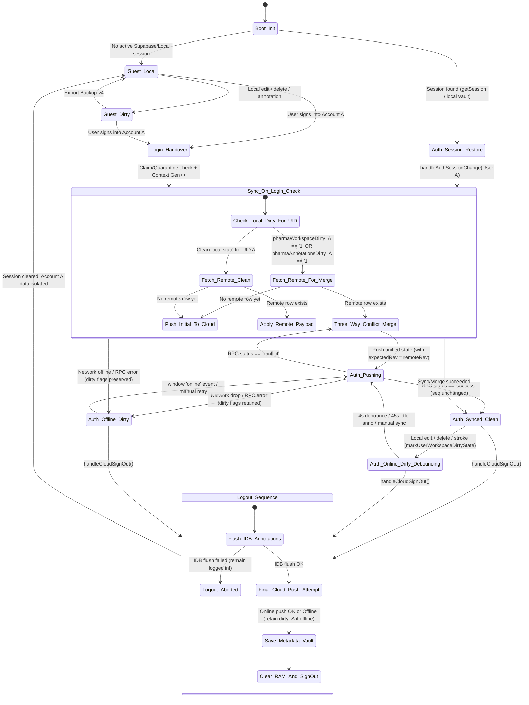
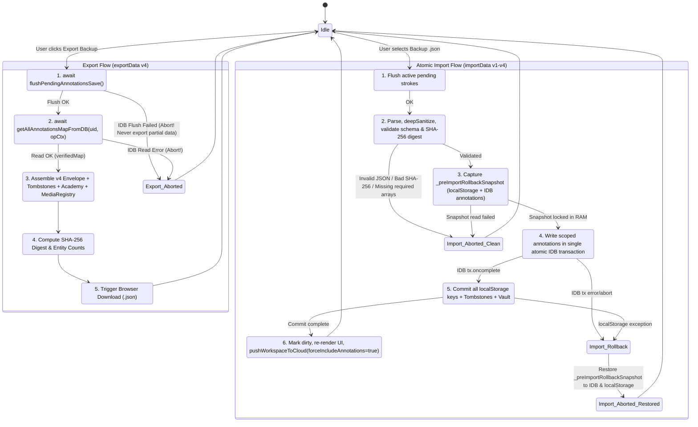
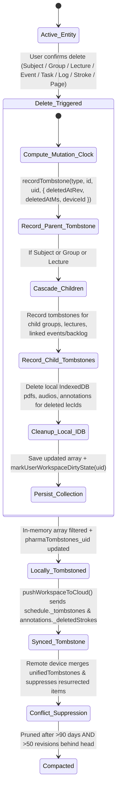

# EXO — PHASE 5.1.0: DATA-SAFETY IMPLEMENTATION BLUEPRINT & EXECUTION PLAN

**Document ID:** `EXO-P5.1.0-BLUEPRINT`  
**Status:** Design & Planning Blueprint (Awaiting Owner & Independent Reviewer Approval)  
**Target Phase:** Phase 5.1 — Data Safety, Backup Completeness & Synchronization Integrity  
**Date:** 2026-11-05  

---

## 0. Verified Repository Baseline & Scope Boundary

| Attribute | Verified Value |
| :--- | :--- |
| **Repository** | `JemistryMC/study-hub` |
| **Active Branch** | `main` |
| **Verified Remote `main` SHA** | `1758bba343746f4b457d8793fa9389b80117bcf8` (`docs: add phase 5.0.2 storage and sync audit report`) |
| **Previous Application Baseline SHA** | `c211d034eb074c43f74eee480b8186e58868dc80` |
| **Approved Audit Input** | `reports/phases/phase-5-storage-sync-audit/gemini-report.md` (`157,293` bytes, git blob SHA `90e616006a02b5fa5aca31d750a2e07c42c39905`, SHA-256 prefix `e0ff785839962df9`) |
| **Primary Application Entrypoint** | `index.html` (`3,286,646` bytes, `32,324` logical lines, git blob SHA `b0b4cd11f9568809490740190ecda9012db1debc`, SHA-256 prefix `525d477140f3f716`) |
| **Canonical Database Schema** | `supabase/schema.sql` (`22,539` bytes, git blob SHA `8915164c1fb9d21c410ec442f6708d203178d9a1`) |
| **Baseline Verification Status** | `335/335` checks passing across 5 verification tiers (`test_phase4_2_static.js`, `test_phase4_2_unit.js`, `test_phase4_2_1_pglite.js`, `test_phase4_2_1_pg16_concurrency.js`, `test_phase4_2_e2e.js`) |
| **Phase 5.1.0 Deliverable** | `reports/phases/phase-5-storage-sync-audit/phase-5-1-implementation-blueprint.md` (Design & Planning Only — zero source, test, or database modifications) |

---

## Section A — Current-State-to-Target-State Mapping

The table below maps every finding from the approved Phase 5.0.2 audit (`F-01` through `F-15`) to its current source location, root cause, Phase 5.1 target state, and phase assignment.

| Finding ID | Sev. | Current State & Source Evidence (`index.html` / `supabase/*`) | Phase 5.1 Target State & Architectural Resolution | Target Functions / Modules | Scope Phase |
| :--- | :---: | :--- | :--- | :--- | :---: |
| **F-01** | **P1** (Deployment Readiness) | Repository migrations (`supabase/migrations/*`, `supabase/schema.sql`) have not been confirmed applied to the live Supabase project (`c2745326-...`). If `public.sync_workspace_with_concurrency` (`supabase/schema.sql:171–263`) is missing or outdated on the remote instance, `pushWorkspaceToCloud()` (`index.html:29799`) fails with RPC errors. | **Pre-Deployment Verification Gate (Work Package F / Section G):** Establish a non-destructive read-only SQL verification checklist for the owner before production rollout, plus client-side graceful RPC diagnostic reporting (`ERR_RPC_MISSING_OR_OUTDATED`) that preserves local dirty flags (`pharmaWorkspaceDirty_<uid>`) without data loss. | `pushWorkspaceToCloud()` (`29798–29833`), Owner SQL Pre-Flight Checklist | **Phase 5.1 (Client Guard) + Owner Ops** |
| **F-02** | **P0** | `exportData()` (`19051–19070`) exports only 6 `localStorage` keys (`v3`: `subjects`, `logs`, `schedule`, `backlog`, `plannerPrefs`, `weeklyReports`). It completely omits IndexedDB `WorkspaceMediaStore.annotations` (ink strokes, text notes, `_extraNotes`, `_audioPins`), `completedAcademyModules` (`pharmaAcademyProgressV1`), `cloudMediaRegistry` (`pharmaCloudMediaRegistryV1`), per-account tombstones (`pharmaTombstones_<uid>`), and workspace revision metadata. Furthermore, `importData()` (`19072–19105`) performs non-atomic `localStorage` overwrites followed by `location.reload()` (`19098`) without syncing to Supabase or restoring IndexedDB annotations. | **Tier A Complete Study-State Backup v4 (`exo_workspace_backup_v4`) (Work Package A):** Export all study metadata + all verified account-scoped IndexedDB `annotations` + `academyProgress` + `cloudMediaRegistry` + `_tombstones` + revision metadata + SHA-256 integrity manifest (`crypto.subtle.digest`). Implement staged, atomic pre-commit snapshot & rollback in `importData()` with backward compatibility for `v1`/`v2`/`v3`, explicit Replace vs. Merge import modes, and post-import dirty marking + cloud sync scheduling. | `exportData()` (`19051`), `importData()` (`19072`), `deepSanitizeBackupObject()` (`18977`), `getAllAnnotationsMapFromDB()` (`29131`), `restoreAllAnnotationsMapToDB()` (`29257`) | **Phase 5.1 (Milestone M1)** |
| **F-03** | **P0** | `syncWorkspaceOnLogin()` (`30167–30200`) and `pullWorkspaceFromCloud()` (`30092–30115`) unconditionally call `applyCloudWorkspacePayload(data)` (`29934–30081`) without checking `localStorage.getItem('pharmaWorkspaceDirty')`, `dirtyAnnotationsForCloud`, or pending local tombstones. Offline edits made while logged in (or before reload) are silently overwritten by older remote state upon login/reload, and line `30065` clears `pharmaWorkspaceDirty`. | **Dirty-Aware Login & Pull Reconciliation (Work Package B):** Before applying any remote row in `syncWorkspaceOnLogin()`, `pullWorkspaceFromCloud()`, or `pullWorkspaceFromCloudIfNewer()`, inspect per-account dirty state (`pharmaWorkspaceDirty_<uid>`, `pharmaAnnotationsDirty_<uid>`, `pendingAnnoSaveMap`). If local state has unpushed mutations, flush pending annotations to IndexedDB first and invoke `mergeAndApplyCloudConflict(remoteRow, localSnapshot, opCtx)` instead of overwriting local state with `applyCloudWorkspacePayload()`. | `syncWorkspaceOnLogin()` (`30123`), `pullWorkspaceFromCloud()` (`30083`), `pullWorkspaceFromCloudIfNewer()` (`30233`), `applyCloudWorkspacePayload()` (`29934`) | **Phase 5.1 (Milestone M2)** |
| **F-04** | **P0** | None of the entity deletion handlers (`triggerDeleteSubject` at `11844`, `triggerDeleteGroup` at `12465`, `triggerDeleteLecture` at `12585`, `deleteSessionFromModal` at `15602`, `deleteSessionDirect` at `15609`, `deleteEventFromPdfAdjuster` at `17794`, `executeClearSchedule` at `15744`, `deleteBacklogTask` at `15867`, `deleteContinuousSubjectWirdLog` at `12413`) ever call `recordTombstone()` (`29407`). As a result, `pharmaTombstones_<uid>` is always empty (`{"subjects":{},"lectures":{},"events":{}}`), causing deleted items to resurrect during `mergeAndApplyCloudConflict()` (`29527–29624`). Additionally, deleting a lecture or subject orphans its IndexedDB `pdfs`, `audios`, and `annotations` records. | **Universal Tombstone Wiring & Referential Cascade Cleanup (Work Package C):** Wire `recordTombstone()` into every delete and bulk-clear handler across all entity types (`subjects`, `groups`, `lectures`, `events`, `backlog`, `logs`, `weeklyReports`, `audioPins`), storing monotonic `{ deletedAtRev, deletedAtMs, deviceId, parentId }`. Cascade parent deletions (`subject -> groups -> lectures -> IndexedDB pdfs/audios/annotations`). Stamp `_updatedAt` and `_rev` on every entity create/update so causal deletion vs. modification comparison is deterministic. | `recordTombstone()` (`29407`), `triggerDeleteSubject()` (`11844`), `triggerDeleteGroup()` (`12465`), `triggerDeleteLecture()` (`12585`), schedule/backlog/log delete handlers, `mergeAndApplyCloudConflict()` (`29439`) | **Phase 5.1 (Milestone M3)** |
| **F-05** | **P0** | In `mergeAndApplyCloudConflict()` (`29497–29505`), PDF page annotations are merged via set union (`strokeSigSet`). Because strokes lack persistent UUIDs (`s.id` is never assigned in `finishStroke` at `23788` or `commitOrCloseFloatingTextEditor` at `23927`) and erasing/undoing/clearing (`eraseAtPoint` at `24611`, `undoLastStroke` at `24661`, `clearCurrentPageAnnotations` at `24700`, `clearExtraNotePage` at `25241`, text note delete at `23951, 24137, 24185`) never records stroke tombstones, any erased or cleared stroke is resurrected from `remoteRow.annotations` during conflict merge. | **Stroke UUIDs, `_deletedStrokes` Tombstone Ledger & `_clearedAtRev` Barrier (Work Package D):** Assign a deterministic/unique `id` (`st_<timestamp36>_<random64>`) and `_rev` to every created stroke and text note (and lazily backfill deterministic `st_legacy_<fnv1a64>` IDs during `normalizeAndRecoverLectureAnnotations`). Record deleted stroke IDs in per-page `pages._deletedStrokes[pageKey][strokeId]` on erase, undo, or text deletion, and record `pages._clearedAt[pageKey] = { rev, ts, deviceId }` on full page clear. Enforce tombstone exclusion during `mergeAndApplyCloudConflict()`. | `finishStroke()` (`23788`), `commitOrCloseFloatingTextEditor()` (`23927`), `eraseAtPoint()` (`24611`), `undoLastStroke()` (`24661`), `clearCurrentPageAnnotations()` (`24700`), `clearExtraNotePage()` (`25241`), `normalizeAndRecoverLectureAnnotations()` (`20357`), `mergeAndApplyCloudConflict()` (`29490`) | **Phase 5.1 (Milestone M4)** |
| **F-06** | **P1** | `mergeAndApplyCloudConflict()` (`29527–29570`) checks if `mergedSubMap.has(s.id)` (`29544`). When both remote and local contain the same subject `s.id`, it keeps `rSub` (`remoteRow` subject) and only merges `rSub.groups` with `s.groups` (`29547–29567`). Any local edits to subject-level scalar/array properties (`name`, `icon`, `color`, `examDate`, `isContinuous`, `wirdGoal`, `wirdLogs`), group-level properties (`rg.name`), or existing lecture properties (`lecMap.set(l.id, l)` unconditionally overwrites remote lecture with local lecture without comparing `_updatedAt`/`_rev`, or vice versa) are lost or inconsistently overwritten. | **Deterministic Entity & Field-Level Three-Way Merge (Work Package E):** Stamp `_rev` and `_updatedAt` on subjects, groups, lectures, scheduleEvents, backlog tasks, logs, and weeklyReports. In `mergeAndApplyCloudConflict()`, resolve scalar properties on subjects, groups, and lectures using deterministic LWW (`_rev` tie-broken by `_updatedAt` and `deviceId`), while merging nested collections (`groups`, `lectures`, `recordings`, `customPages`, `deletedPages`, `wirdLogs`) by ID respecting `unifiedTombstones`. | `mergeAndApplyCloudConflict()` (`29527–29630`), subject/group/lecture mutation helpers (`11819–12594`) | **Phase 5.1 (Milestone M5)** |
| **F-07** | **P1** | `pushWorkspaceToCloud()` (`29718–29723`) sets `shouldSendAnnotations = Boolean(forceIncludeAnnotations \|\| manualNotify \|\| (dirtyAnnotationsForCloud && !isPdfModalOpenNow))`. While the PDF viewer modal (`#pdfViewerModalOverlay.active`) remains open during long tablet study sessions, the 4-second autosave timer (`markLocalWorkspaceModified` at `29684`) pushes metadata (`subjects`, `schedule`, `logs`) and increments `user_workspaces.revision` on the server, but **omits** `payload.annotations` until the modal is closed (`closePdfViewer` at `25541`), the tab is hidden (`visibilitychange` at `30284`), or manual sync is clicked. | **Periodic Idle Annotation Cloud Sync During Active PDF Study (Work Package D / E):** Maintain separation between lightweight 4s metadata sync and heavier annotation payloads during active stylus drawing, but add a bounded idle annotation cloud-sync window (e.g., when `dirtyAnnotationsForCloud === true` and the stylus has been idle for `>= 45 seconds` or `>= 25 strokes` have been committed to IndexedDB) so long PDF study sessions sync annotations to Supabase without waiting for modal close. | `flushPendingAnnotationsSave()` (`20334–20345`), `pushWorkspaceToCloud()` (`29718–29723`) | **Phase 5.1 (Milestone M4)** |
| **F-08** | **P1** | Google Identity Services (`google.accounts.oauth2.initTokenClient` at `27585–27636`) issues implicit-flow OAuth access tokens (`exo_gdrive_token`) that expire in ~3,600s (`exo_gdrive_token_exp`). There is no silent refresh or pre-flight token expiry check before batch media uploads (`syncAllLocalMediaToCloud` at `28569`), causing mid-batch `401 Unauthorized` failures if a token expires. | **Deferred to Phase 5.2 (Google Drive Reliability):** Out of scope for Phase 5.1 data-safety implementation; documented in Section G boundary. | `initGoogleDriveSync()`, `ensureValidGoogleToken()` | **Phase 5.2** |
| **F-09** | **P1** | `uploadBlobToGoogleDrive()` (`27894–27947`) sets `permissions.create({ role: 'reader', type: 'anyone' })` (`27932–27940`) on every uploaded lecture PDF and audio recording in Google Drive so direct download links work across devices without OAuth headers. | **Deferred to Phase 5.2 (Google Drive Security & Link Access Design):** Out of scope for Phase 5.1; documented in Section G boundary. | `uploadBlobToGoogleDrive()` (`27932`) | **Phase 5.2** |
| **F-10** | **P1** | `uploadBlobToGoogleDrive()` (`27850–27947`) constructs a single `multipart/related` body in memory (`new Blob([ metadataPart, fileBlob, closeDelim ])`) and uploads via a single `POST` request without resumable upload chunking (`uploadType=resumable`) or exponential backoff retry. | **Deferred to Phase 5.2 (Google Drive Upload Engine):** Out of scope for Phase 5.1; documented in Section G boundary. | `uploadBlobToGoogleDrive()` (`27850`) | **Phase 5.2** |
| **F-11** | **P2** | `uploadBlobToGoogleDrive()` searches for an existing file in the Drive folder by `name = '${safeFileName}' and trashed = false` (`27864`). Two lectures in different subjects with identical filenames (e.g., `Lecture 1.pdf`) can collide in the shared `Exo_Academic_Cloud_Storage` Drive folder if `existingFileId` is not bound to `lec.id`. | **Deferred to Phase 5.2 (Google Drive File Naming & `appProperties` Binding):** Out of scope for Phase 5.1; documented in Section G boundary. | `uploadBlobToGoogleDrive()` (`27864`) | **Phase 5.2** |
| **F-12** | **P2** | `computeFastStringSignature(str)` (`29658–29668`) samples at most 512 characters (`step = Math.max(1, Math.floor(len / 512))`). If an in-place edit (e.g. changing a stroke color `7` chars or editing a text note of identical byte length) occurs between sampled indices without changing `serializedAnnos.length`, `currentSig === lastUploadedAnnotationsSignature` can collide. | **Full-Pass Deterministic Content Digest / Mutation Sequence Gate (Work Package D / E):** Replace the sparse 512-point stride in `computeFastStringSignature()` with a full-pass 64-bit FNV-1a (two 32-bit halves) + monotonic `localAnnotationsMutationSeq` comparison so any single-character change in `serializedAnnos` is guaranteed to change the signature in `< 2ms` for 2 MB strings. | `computeFastStringSignature()` (`29658`), `pushWorkspaceToCloud()` (`29768`) | **Phase 5.1 (Milestone M4)** |
| **F-13** | **P2** | `mergeAndApplyCloudConflict()` (`29574–29609`) updates in-memory `scheduleEvents` (`29588`) and `scheduleBacklog` (`29595`), and writes `pharmaWeeklyReportsV1` (`29604`) and `pharmaPlannerPrefsV1` (`29608`), but omits writing `pharmaScheduleV4` and `pharmaScheduleBacklogV1` before the 1,200ms `setTimeout` (`29645–29649`) calls `pushWorkspaceToCloud()` (which only writes `pharmaAccountWorkspace_<uid>` at `29787`, never `pharmaScheduleV4` or `pharmaScheduleBacklogV1`). If the user reloads or closes the tab before a subsequent `saveScheduleData()` (`13093`) or `applyCloudWorkspacePayload()` (`30028`), the initial boot script (`index.html:12994–13040`) reads stale `pharmaScheduleV4` / `pharmaScheduleBacklogV1`. | **Immediate Atomic Schedule & Vault Persistence in Conflict Merge (Work Package E):** Immediately call `persistMergedScheduleToLocalStorage()` inside `mergeAndApplyCloudConflict()` (writing `pharmaScheduleV4`, `pharmaScheduleBacklogV1`, `pharmaWeeklyReportsV1`, `pharmaPlannerPrefsV1`, and `pharmaAccountWorkspace_<uid>`) synchronously before scheduling the follow-up `pushWorkspaceToCloud()` call. | `mergeAndApplyCloudConflict()` (`29588–29609`) | **Phase 5.1 (Milestone M5)** |
| **F-14** | **P2** | `handleCloudSignOut()` (`29018–29059`) reads all verified annotations from IndexedDB (`getAllAnnotationsMapFromDB`) and serializes the entire workspace + annotations into `localStorage.setItem('pharmaAccountWorkspace_' + canonicalUid, ...)` (`29052`), and `pushWorkspaceToCloud()` (`29780–29788`) does the same. Once a heavy tablet user's annotations exceed ~3.5–4.5 MB, `localStorage.setItem` throws `QuotaExceededError`. In `handleCloudSignOut()`, this sets `localVaultBackupOk = false` (`29056`), triggers a scary error toast (`29066`), and leaves `pharmaWorkspaceDirty = '1'` (`29063`) even when IndexedDB and Supabase both succeeded. | **Metadata-Only `localStorage` Vault & IndexedDB Annotation Authority (Work Package B / E):** Decouple annotations from the `localStorage` `pharmaAccountWorkspace_<uid>` snapshot (or move the full snapshot to an IndexedDB object store / keep annotations exclusively in IndexedDB `WorkspaceMediaStore.annotations` where they are already durably stored under `usr_<sanitizedUid>::<lecId>`). Store only lightweight metadata + an annotation manifest summary (`{ count, lectureIds, updatedAt }`) in `localStorage['pharmaAccountWorkspace_' + uid]`, eliminating `QuotaExceededError` on logout and autosave. | `handleCloudSignOut()` (`29018–29070`), `pushWorkspaceToCloud()` (`29780–29788`), `pullWorkspaceFromCloud()` (`30105`), `syncWorkspaceOnLogin()` (`30180`) | **Phase 5.1 (Milestone M2)** |
| **F-15** | **P2** | `sw.js` (`sw.js:1–85`) caches external CDN assets (`cdnjs`, Google Fonts, PDF.js, Supabase JS) with stale-while-revalidate, which is benign for sync, but `index.html` lacks an explicit `beforeunload` warning when a large backup import or final logout sync is in progress. | **Non-Intrusive Sync Lifecycle Guard:** Ensure `visibilitychange` (`30278`) and `pagehide` (`20350`) flush pending IndexedDB annotations and persist per-account dirty markers deterministically without service-worker interference. | `visibilitychange` (`30278`), `pagehide` (`20350`) | **Phase 5.1 (Milestone M2)** |

---

## Section B — Architecture and Data Model

### B.1 Entity Logical Revision, Timestamp & Device Metadata Schema

To eliminate clock-skew vulnerabilities while providing deterministic Last-Write-Wins (LWW) conflict resolution for entity fields and causal ordering for tombstones, Phase 5.1 introduces three lightweight metadata properties across all mutable workspace entities:

1. **Per-Device Persistent Identifier (`exo_device_id_v1`):**
   - Generated once per browser profile via `crypto.randomUUID()` (or CSPRNG hex fallback) and stored in `localStorage.getItem('exo_device_id_v1')`, e.g., `"dev_9f8a7b6c5d4e"`.
2. **Per-Account Monotonic Logical Mutation Counter (`pharmaLocalMutationClock_<uid>`):**
   - Stored per user in `localStorage`. On every local entity creation, modification, or deletion, `nextEntityMutationMeta(uid)` computes:
     ```javascript
     const currentCloudRev = Number(localStorage.getItem('pharmaWorkspaceRevision_' + uid) || 1);
     const prevClock = Number(localStorage.getItem('pharmaLocalMutationClock_' + uid) || 0);
     const nextClock = Math.max(prevClock + 1, currentCloudRev * 1000 + 1);
     localStorage.setItem('pharmaLocalMutationClock_' + uid, String(nextClock));
     ```
   - Whenever a remote workspace with `remoteRow.revision` is applied or merged, `pharmaLocalMutationClock_<uid>` is advanced to at least `Math.max(prevClock, remoteRow.revision * 1000)`.
3. **Standard Entity Metadata Envelope (`_meta` / inline fields):**
   Every mutable entity (`Subject`, `Group`, `Lecture`, `ScheduleEvent`, `BacklogTask`, `StudyLog`, `WeeklyReport`, `WirdLog`, `AudioPin`) carries:
   ```json
   {
     "_rev": 14005,
     "_baseRev": 14,
     "_updatedAt": 1762300800123,
     "_deviceId": "dev_9f8a7b6c5d4e",
     "_fieldRevs": {
       "name": { "rev": 14005, "ts": 1762300800123, "dev": "dev_9f8a7b6c5d4e" },
       "examDate": { "rev": 12002, "ts": 1762210000000, "dev": "dev_3a2b1c0d9e8f" }
     }
   }
   ```
   - **Deterministic Comparison Rule (`compareCausalOrder(a, b)`):**
     1. Compare logical revision `a._rev` vs. `b._rev` (if both `> 0` and from different base revisions, higher `_baseRev` or higher `_rev` wins; if concurrent offline edits share the same `_baseRev`, compare `_updatedAt` wall-clock timestamp).
     2. If `_updatedAt` timestamps are within `<= 1000ms` or identical, break ties lexicographically by `_deviceId` (`String(a._deviceId).localeCompare(String(b._deviceId))`), guaranteeing **commutativity, associativity, and idempotency** across all devices.

---

### B.2 Universal Tombstone Registry Schema (`pharmaTombstones_<uid>` & `schedule._tombstones`)

The existing tombstone structure (`{"subjects":{},"lectures":{},"events":{}}` at `index.html:29404`) is upgraded to **Tombstone Schema v2** while remaining 100% backward-compatible with legacy numeric timestamp entries (`stones[type][id] = 1762300000000`):

```json
{
  "_schemaVersion": 2,
  "subjects": {
    "1730000100": {
      "deletedAtRev": 15003,
      "baseRev": 15,
      "deletedAtMs": 1762301200450,
      "deviceId": "dev_9f8a7b6c5d4e",
      "entityType": "subjects",
      "parentId": null
    }
  },
  "groups": {
    "1730000200": {
      "deletedAtRev": 15003,
      "baseRev": 15,
      "deletedAtMs": 1762301200450,
      "deviceId": "dev_9f8a7b6c5d4e",
      "entityType": "groups",
      "parentId": "1730000100"
    }
  },
  "lectures": {
    "1730000300": {
      "deletedAtRev": 15003,
      "baseRev": 15,
      "deletedAtMs": 1762301200450,
      "deviceId": "dev_9f8a7b6c5d4e",
      "entityType": "lectures",
      "parentId": "1730000200"
    }
  },
  "events": {},
  "backlog": {},
  "logs": {},
  "weeklyReports": {},
  "wirdLogs": {},
  "scheduleClearBarrier": {
    "all": { "clearedAtRev": 0, "clearedAtMs": 0, "deviceId": "" },
    "completed": { "clearedAtRev": 0, "clearedAtMs": 0, "deviceId": "" }
  }
}
```

#### Normalization & Backward Compatibility Helper (`normalizeTombstoneEntry(rawEntry)`):
- If `typeof rawEntry === 'number'`, normalize in-memory to `{ deletedAtRev: 0, baseRev: 0, deletedAtMs: rawEntry, deviceId: 'legacy' }`.
- **Resurrection Prevention Rule (`isEntityDeletedByTombstone(entity, tombstoneEntry)`):**
  - If `!tombstoneEntry`, return `false`.
  - Extract `stone = normalizeTombstoneEntry(tombstoneEntry)`.
  - An entity is considered deleted unless the entity carries explicit proof of re-creation/modification strictly newer than the tombstone:
    - If both `entity._baseRev` and `stone.baseRev` are present and `entity._baseRev !== stone.baseRev`: entity is deleted if `stone.baseRev > entity._baseRev`.
    - Otherwise, entity is deleted if `!entity._updatedAt || entity._updatedAt <= stone.deletedAtMs`.
- **Tombstone Pruning / Compaction Policy:**
  - To prevent unbounded growth of `schedule._tombstones` over multi-year usage, tombstones older than **90 days** (`90 * 86400 * 1000` ms) AND with `baseRev < currentCloudWorkspaceRevision - 50` are compacted during `pushWorkspaceToCloud()`, keeping at most the 2,000 most recent tombstones per collection.

---

### B.3 PDF Annotation & Stroke Tombstone Schema (`WorkspaceMediaStore.annotations`)

Within `WorkspaceMediaStore.annotations` (and `user_workspaces.annotations` in Supabase JSONB), each lecture's `pages` object (`index.html:20358`) currently stores:
- Slide stroke arrays: `pages["1"] = [ strokeObj, ... ]`
- Extra note sheet stroke arrays: `pages["note_1"] = [ strokeObj, ... ]`
- Extra note sheet visibility map: `pages._extraNotes = { "1": true }`
- Audio pin arrays: `pages._audioPins = { "1": [ { id, time, label, createdAt } ] }`

Phase 5.1 extends `pages` with three non-breaking metadata keys (`_deletedStrokes`, `_clearedAt`, `_deletedAudioPins`) and enriches every stroke/text object with `id`, `_rev`, and `_updatedAt`:

```json
{
  "1": [
    {
      "id": "st_m3k9x2p_8f4a1c9e2b0d",
      "_rev": 15008,
      "_updatedAt": 1762302000110,
      "_deviceId": "dev_9f8a7b6c5d4e",
      "tool": "pen",
      "color": "#ef4444",
      "size": 3,
      "alpha": 1,
      "points": [
        { "x": 0.1245, "y": 0.3412, "p": 0.52 }
      ],
      "_compactedV3": true,
      "_bbox": { "minX": 0.12, "minY": 0.34, "maxX": 0.45, "maxY": 0.51 }
    },
    {
      "id": "st_m3k9x8q_1d2e3f4a5b6c",
      "_rev": 15012,
      "_updatedAt": 1762302050900,
      "_deviceId": "dev_9f8a7b6c5d4e",
      "tool": "text",
      "text": "ملاحظة هامة للامتحان",
      "x": 0.25,
      "y": 0.18,
      "color": "#38bdf8",
      "size": 4,
      "fontKey": "marhey"
    }
  ],
  "note_1": [],
  "_extraNotes": {
    "1": { "open": true, "_rev": 15009, "_updatedAt": 1762302010000 }
  },
  "_audioPins": {
    "1": [
      {
        "id": 1762301900000,
        "time": 142.5,
        "label": "شرح الآلية الدوائية",
        "createdAt": 1762301900000,
        "_rev": 15007,
        "_updatedAt": 1762301900000
      }
    ]
  },
  "_deletedStrokes": {
    "1": {
      "st_m3k9x1a_7c8d9e0f1a2b": { "r": 15010, "t": 1762302030000 },
      "st_legacy_9a8b7c6d5e4f3a2b": { "r": 15011, "t": 1762302040000 }
    },
    "note_1": {}
  },
  "_clearedAt": {
    "1": { "r": 15005, "t": 1762301800000, "d": "dev_9f8a7b6c5d4e" }
  },
  "_deletedAudioPins": {
    "1": {
      "1762301500000": { "r": 15006, "t": 1762301850000 }
    }
  }
}
```

#### Legacy Stroke Deterministic ID Backfill (`ensureStrokeHasDeterministicId(stroke)`):
- When `normalizeAndRecoverLectureAnnotations(lecId, rawPages, rawUserId)` (`index.html:20357`) loads a page array containing legacy strokes without `stroke.id`:
  - It computes a deterministic 64-bit FNV-1a hex digest over the full canonical geometry (`computeStrokeUniqueSignature(stroke)` at `29416`) and assigns `stroke.id = 'st_leg_' + fnv1a64Hex(sig)`.
  - Because `computeStrokeUniqueSignature` is deterministic across devices for identical legacy strokes, both Device A and Device B independently assign the **exact same `st_leg_<hash>` ID** to any pre-existing legacy stroke!
  - Consequently, if Device A erases a legacy stroke, it records `pages._deletedStrokes[pageKey]['st_leg_<hash>'] = { r, t }`, which matches and suppresses that legacy stroke on Device B during `mergeAndApplyCloudConflict()`!

---

### B.4 Per-Account Dirty State & Metadata-Only `localStorage` Vault

To eliminate global dirty-flag cross-talk and `localStorage` `QuotaExceededError` (`F-03`, `F-14`):

1. **Account-Scoped Dirty Markers:**
   - Replace reliance on the single unscoped `pharmaWorkspaceDirty` flag with account-scoped keys:
     - `pharmaWorkspaceDirty_<uid>`: `'1'` when metadata (`subjects`, `schedule`, `logs`, `academy_progress`, `_tombstones`) has unpushed local mutations for `<uid>`.
     - `pharmaAnnotationsDirty_<uid>`: `'1'` when IndexedDB `annotations` has unpushed local mutations for `<uid>`.
     - `pharmaDirtyMutationSeq_<uid>`: monotonic integer tracking the latest local mutation sequence for `<uid>`.
   - For backward compatibility with existing tests that inspect `localStorage.getItem('pharmaWorkspaceDirty')`, synchronize `localStorage.setItem('pharmaWorkspaceDirty', '1')` whenever the **currently active** account (`getCanonicalUserId()`) is dirty, and recompute it from `pharmaWorkspaceDirty_<activeUid> || pharmaAnnotationsDirty_<activeUid>` whenever switching accounts in `handleAuthSessionChange()`.
2. **Decoupling Annotations from `localStorage['pharmaAccountWorkspace_' + uid]` (`F-14`):**
   - `WorkspaceMediaStore.annotations` in IndexedDB already stores all per-lecture annotations durably under strict dual-ownership keys (`usr_<sanitizedUid>::<lecId>`).
   - duplicating the entire multi-megabyte `annotations` map inside `localStorage['pharmaAccountWorkspace_' + uid]` in `handleCloudSignOut()` (`29052`) and `pushWorkspaceToCloud()` (`29787`) is redundant and causes `QuotaExceededError` once annotations exceed ~4 MB.
   - **Target Design:**
     - `localStorage['pharmaAccountWorkspace_' + uid]` stores all workspace metadata (`user_id`, `user_email`, `revision`, `can_upload_media`, `subjects`, `schedule`, `logs`, `academy_progress`, `updated_at`) plus a lightweight `annotationsManifest`:
       ```json
       "annotationsManifest": {
         "storage": "indexeddb:WorkspaceMediaStore.annotations",
         "lectureCount": 18,
         "lectureIds": ["1730000300", "1730000301"],
         "signature": "412890:e4a1b90c:f8201a3b",
         "updatedAt": "2026-11-05T08:30:00.000Z"
       }
       ```
     - If the serialized `annotations` map is small (`<= 128 KB`), an optional inline fallback copy may be included if `localStorage.setItem` succeeds; if `annotations > 128 KB` or if `QuotaExceededError` is caught, `localStorage['pharmaAccountWorkspace_' + uid]` writes the metadata + `annotationsManifest` cleanly while `getAllAnnotationsMapFromDB(uid, opCtx)` remains the authoritative local store for annotations.
     - When `pullWorkspaceFromCloud()` (`30105`) or `syncWorkspaceOnLogin()` (`30180`) falls back to `localStorage['pharmaAccountWorkspace_' + uid]` while offline, `applyCloudWorkspacePayload()` preserves the user's existing IndexedDB annotations (`WorkspaceMediaStore.annotations`) whenever `cloudRow.annotations` is omitted (because `annotationsManifest.storage === 'indexeddb:WorkspaceMediaStore.annotations'`).

---

### B.5 Tier A Complete Study-State Backup Schema (`exo_workspace_backup_v4`)

#### 1. Complete JSON Schema (`exo_workspace_backup_v4`)

```json
{
  "format": "exo_workspace_backup",
  "version": 4,
  "exportedAt": "2026-11-05T08:45:12.345Z",
  "exportedBy": {
    "userId": "a1b2c3d4-e5f6-4789-8012-3456789abcde",
    "userEmail": "student@example.com",
    "deviceId": "dev_9f8a7b6c5d4e",
    "workspaceRevision": 42,
    "localMutationClock": 42015
  },
  "tier": "Tier_A_Study_State_And_Annotations",
  "mediaBlobsIncluded": false,
  "integrity": {
    "algorithm": "SHA-256",
    "canonical DigestFields": [
      "subjects",
      "schedule",
      "backlog",
      "plannerPrefs",
      "weeklyReports",
      "logs",
      "academyProgress",
      "annotations",
      "tombstones",
      "cloudMediaRegistry"
    ],
    "sha256": "e3b0c44298fc1c149afbf4c8996fb92427ae41e4649b934ca495991b7852b855",
    "counts": {
      "subjects": 6,
      "groups": 18,
      "lectures": 74,
      "scheduleEvents": 28,
      "backlogTasks": 11,
      "logs": 45,
      "weeklyReports": 4,
      "academyModules": 3,
      "annotatedLectures": 19,
      "totalAnnotationPages": 312,
      "totalAnnotationStrokes": 4890,
      "totalAudioPins": 27
    }
  },
  "data": {
    "subjects": [],
    "schedule": {
      "version": 3,
      "events": [],
      "backlog": [],
      "plannerPrefs": {
        "weekStartDay": 6,
        "dayStartHour": 6,
        "dayEndHour": 23,
        "autoCompletePct": 75,
        "currentWeekStartIso": "2026-10-31"
      },
      "weeklyReports": [],
      "pdfFitMode": "height"
    },
    "backlog": [],
    "plannerPrefs": {},
    "weeklyReports": [],
    "logs": [],
    "academyProgress": [],
    "annotations": {
      "1730000300": {
        "1": [],
        "_extraNotes": {},
        "_audioPins": {},
        "_deletedStrokes": {},
        "_clearedAt": {}
      }
    },
    "tombstones": {
      "_schemaVersion": 2,
      "subjects": {},
      "groups": {},
      "lectures": {},
      "events": {},
      "backlog": {},
      "logs": {},
      "weeklyReports": {},
      "wirdLogs": {}
    },
    "cloudMediaRegistry": {},
    "userSpecialtyTitle": "PharmD Clinical"
  }
}
```
*(Note: Top-level aliases `data.subjects`, `data.logs`, `data.schedule`, `data.backlog`, `data.plannerPrefs`, `data.weeklyReports` are ALSO mirrored at the root of the JSON object or read from `data.*` so that any legacy parser expecting top-level `subjects`/`logs` continues to work seamlessly.)*

#### 2. Memory-Safe Large Payload Handling Strategy (Technical Trade-Off Analysis)

A heavy graphic-tablet student may accumulate 5,000–25,000 ink strokes across 30+ lectures (~3 MB to 15 MB of JSON). We evaluated three browser serialization strategies for `exportData()` and `importData()`:

| Strategy | Mechanism | Peak RAM Overhead (for 10 MB Annotations) | Browser Compatibility & UX | Verdict for Phase 5.1 |
| :--- | :--- | :--- | :--- | :--- |
| **Option 1: Naive Monolithic `JSON.stringify(fullBackup)`** | Build one massive object and call `JSON.stringify` twice (once for SHA-256 digest, once for download Blob). | ~60–80 MB transient UTF-16 string allocation; blocks main thread for 150–400ms. | Supported everywhere, but double-stringifying large objects risks UI jank on mid-range Android tablets. | **Reject double-stringify.** |
| **Option 2: Single-Pass Canonical Section Serialization + Chunked `Blob` Assembly** | Serialize each top-level section (`subjects`, `schedule`, `logs`, `annotations` per-lecture chunk, `tombstones`) once into UTF-8 `Uint8Array` chunks via `TextEncoder`, compute incremental/concatenated SHA-256 over the `Uint8Array` buffer, and construct `new Blob(chunks, { type: 'application/json' })` without creating a monolithic 15 MB UTF-16 string. | **~15–22 MB** (1x UTF-8 buffer); zero duplicate string allocation; yields to main thread every 25 lectures during IndexedDB read. | 100% standard `.json` file; works with native `File.text()` / `JSON.parse()` on import; supported in all modern Desktop & Android browsers. | **SELECTED for Phase 5.1.** |
| **Option 3: `CompressionStream('gzip')` (`.json.gz`)** | Stream chunks through `CompressionStream` into a compressed binary file. | ~10 MB, 75% smaller file on disk. | Breaks user expectation of human-readable `.json` backup files and complicates legacy `v1–v3` file picker inspection. | **Keep optional / Phase 5.3 Tier B archive.** |

#### 3. Atomic Import Staging, Verification & Rollback Protocol (`importData()`)

Current `importData()` (`index.html:19072–19105`) overwrites `localStorage` keys one by one and calls `location.reload()`, leaving the workspace corrupted if a mid-import error occurs and never restoring IndexedDB annotations or syncing to Supabase.

Phase 5.1 replaces `importData()` with a **6-Stage Atomic Import Transaction**:

1. **Stage 1 — Flush & Pre-Flight Validation (Read-Only):**
   - Await `flushPendingAnnotationsSave(false, opCtx)` so any unsaved canvas strokes are committed before snapshotting.
   - Parse JSON and run `deepSanitizeBackupObject(rawParsed)` (`index.html:18977`) to strip `__proto__`, `constructor`, `prototype`, and script payloads.
   - Validate schema version (`v1`, `v2`, `v3`, or `v4`) and required array/object types (`subjects` must be an Array, `logs` must be an Array).
   - If `version >= 4` and `integrity.sha256` is present: recompute the SHA-256 digest (or FNV-1a fallback in insecure HTTP contexts where `crypto.subtle` is unavailable) over the canonical `data` sections. **If the digest mismatches, abort immediately with an Arabic integrity error toast (`خطأ: ملف النسخة الاحتياطية تالف أو غير مكتمل — لم يتم تغيير أيٍّ من بياناتك الحالية`) before touching any state.**
2. **Stage 2 — Import Mode Selection (Replace vs. Merge):**
   - Present a clear confirmation choice in the existing UI modal (with programmatic default `mode = 'replace'` for backward-compatible automated callers, or `mode = 'merge'` when selected):
     - **Replace Mode (`استبدال كامل مع حفظ نسخة تراجع آمنة`):** Replaces workspace state with the backup payload.
     - **Merge Mode (`دمج ذكي مع بياناتي الحالية دون حذفها`):** Merges backup subjects, schedule, logs, and annotations non-destructively with current local state using the same engine as `mergeAndApplyCloudConflict()`.
3. **Stage 3 — Pre-Commit Rollback Snapshot Capture:**
   - Capture an in-memory + IndexedDB rollback point (`_preImportRollbackSnapshot`) containing:
     - Deep clone of current `localStorage` workspace keys (`pharmaSubjectsV4`, `pharmaLogsV4`, `pharmaScheduleV4`, `pharmaScheduleBacklogV1`, `pharmaPlannerPrefsV1`, `pharmaWeeklyReportsV1`, `pharmaAcademyProgressV1`, `pharmaCloudMediaRegistryV1`, `pharmaTombstones_<uid>`, `pharmaAccountWorkspace_<uid>`).
     - Complete map of current user's IndexedDB annotations via `getAllAnnotationsMapFromDB(uid, opCtx)`.
   - If `getAllAnnotationsMapFromDB()` returns `{ ok: false }`, **abort import before any mutation**.
4. **Stage 4 — IndexedDB Annotations Commit First (with Scoped Key Re-Binding):**
   - Re-scope all incoming `annotations` keys to the active user (`toScopedKey(rawLecId, uid)`) — stripping any old user prefix from a backup exported by the same student under `'local'` or a previous session, while strictly validating lecture IDs against the backup's `subjects` list.
   - In Replace Mode, delete only the active user's existing annotation keys (`usr_<sanitizedUid>::*`) and write the backup's annotations in a **single atomic IndexedDB `readwrite` transaction** on `WorkspaceMediaStore.annotations`.
   - If the IndexedDB transaction errors or aborts, restore `_preImportRollbackSnapshot.annotations` and abort before touching `localStorage`.
5. **Stage 5 — Synchronous `localStorage` & In-Memory Commit (With Try/Catch Rollback):**
   - Inside a `try { ... } catch (commitErr)` block, write all `localStorage` keys (`pharmaSubjectsV4`, `pharmaLogsV4`, `pharmaScheduleV4`, `pharmaScheduleBacklogV1`, `pharmaPlannerPrefsV1`, `pharmaWeeklyReportsV1`, `pharmaAcademyProgressV1`, `pharmaCloudMediaRegistryV1`, `pharmaTombstones_<uid>`, `pharmaAccountWorkspace_<uid>`).
   - If any `localStorage.setItem` throws, restore every key from `_preImportRollbackSnapshot.localStorage` and restore `_preImportRollbackSnapshot.annotations` to IndexedDB, leaving the workspace 100% unchanged.
6. **Stage 6 — Dirty Marking, Live UI Re-Render & Cloud Sync (No Blind `location.reload()` Race):**
   - Set `pharmaWorkspaceDirty_<uid> = '1'`, `pharmaAnnotationsDirty_<uid> = '1'`, `pharmaWorkspaceDirty = '1'`, and `dirtyAnnotationsForCloud = true`.
   - Update in-memory globals (`subjects`, `scheduleEvents`, `scheduleBacklog`, `plannerPrefs`, `weeklyReports`, `logs`, `completedAcademyModules`, `cloudMediaRegistry`, `inMemoryAnnotationsCache`), re-render all views (`renderSubjectsList()`, `renderSchedule()`, `updateTracker()`, `updateAcademyXpUI()`, `updateCloudMediaStatsUI()`), and if `currentCloudUser && supabaseClient && navigator.onLine`, await `pushWorkspaceToCloud(false, true, opCtx)` **before** any optional page reload.

---

### B.6 Migration & Backward Compatibility Strategy

| Artifact / Store | Legacy Format (`v1`–`v3` / Phase 4.2) | Phase 5.1 Format (`v4` / Schema v2) | Forward & Backward Migration Rule |
| :--- | :--- | :--- | :--- |
| **Backup Files (`exportData` / `importData`)** | `v1`/`v2` (`subjects`, `logs`, `schedule`) and `v3` (`+ backlog, plannerPrefs, weeklyReports`), no `annotations` or `integrity` block. | `v4` (`format: "exo_workspace_backup"`, `version: 4`, `integrity.sha256`, `data.*` + root-level compatibility aliases). | `importData()` auto-detects `version`: if `1..3` (or missing `version`), imports metadata and **preserves existing local IndexedDB annotations** unless the user explicitly clears them (preventing accidental wipe of tablet ink when importing a legacy metadata-only backup!). |
| **Entity Metadata (`_rev`, `_updatedAt`, `_deviceId`)** | Most entities have `id` (`Date.now()`), some have `_updatedAt`, none have `_rev` or `_deviceId`. | All mutated entities carry `_rev`, `_baseRev`, `_updatedAt`, `_deviceId`. | Lazy non-destructive hydration: missing `_updatedAt` defaults to `Number(entity.id) \|\| 0` for chronological comparison; missing `_rev` defaults to `0`. Older code or Supabase JSONB readers ignore unknown `_`-prefixed keys. |
| **Tombstones (`pharmaTombstones_<uid>`)** | `{ subjects: { "123": 1762000000000 }, lectures: {}, events: {} }` | `{ _schemaVersion: 2, subjects: { "123": { deletedAtRev, baseRev, deletedAtMs, deviceId } }, groups: {}, lectures: {}, events: {}, backlog: {}, logs: {}, weeklyReports: {}, wirdLogs: {} }` | `normalizeTombstoneEntry()` transparently reads both numeric timestamps (`1762000000000`) and v2 objects. When writing `schedule._tombstones`, `deletedAtMs` is preserved so older client versions still recognize numeric/object truthiness. |
| **Stroke & Page Annotations (`WorkspaceMediaStore.annotations`)** | `pages[pageNum] = [ { tool, color, size, alpha, points, _compactedV3, _bbox } ]` (no `id`, no `_deletedStrokes`, no `_clearedAt`). | Each stroke has `id` (`st_...` or `st_leg_<fnv1a64>`), `_rev`, `_updatedAt`; `pages._deletedStrokes` and `pages._clearedAt` track removals. | `normalizeAndRecoverLectureAnnotations()` (`20357`) assigns deterministic `st_leg_<fnv1a64>` IDs to any stroke lacking `id` and initializes `_deletedStrokes: {}` and `_clearedAt: {}` without altering stroke rendering (`drawSingleStrokeOnCanvas` ignores metadata keys). |
| **Supabase `public.user_workspaces` Row** | Columns: `user_id`, `user_email`, `subjects` (JSONB), `schedule` (JSONB), `logs` (JSONB), `academy_progress` (JSONB), `annotations` (JSONB), `can_upload_media` (BOOLEAN), `revision` (INTEGER), `updated_at` (TIMESTAMPTZ). | **Zero DDL column changes required.** All new metadata (`_rev`, `_tombstones`, `_deletedStrokes`, `_clearedAt`) lives inside the existing `subjects`, `schedule`, `logs`, and `annotations` JSONB columns. | 100% compatible with existing `public.sync_workspace_with_concurrency(p_payload jsonb, p_expected_revision integer)` (`supabase/schema.sql:171–263`). |

---

## Section C — State Machines

### C.1 Workspace Authentication, Offline & Cloud Synchronization State Machine



#### Explicit State-Transition Table (All 9 Required Scenarios)

| # | Transition Scenario | Active UID (`opCtx.uid`) | Authoritative Local Source | Authoritative Remote Source | Merge Permitted? | Upload (`push`) Permitted? | Dirty Markers (`_uid` & global) | Failure Recovery Behavior |
| :---: | :--- | :--- | :--- | :--- | :---: | :---: | :--- | :--- |
| **1** | **Anonymous local use -> First login to Account A** | `'local'` -> `uid_A` (`generation++`) | Pre-login `'local'` state is isolated unless `uid_A` has **no** remote row and **no** existing `pharmaAccountWorkspace_uid_A` vault (first-time account creation handover); IndexedDB records require provenance or explicit first-account binding. | `user_workspaces` row for `uid_A` (if existing account). | **Only if** `uid_A` already has `pharmaWorkspaceDirty_uid_A == '1'` from a prior session on this device. Foreign `'local'` data is **never** merged into an existing Account A. | Yes, after `syncWorkspaceOnLogin()` resolves remote state. | `pharmaWorkspaceDirty_uid_A` initialized from merge/push outcome. | If offline during first login, loads `pharmaAccountWorkspace_uid_A` (if present) and keeps `pharmaWorkspaceDirty_uid_A = '1'`. |
| **2** | **Logged-in Account A -> Offline edits -> Page reload -> Reconnect** | `uid_A` | `localStorage` (`pharmaSubjectsV4`, `pharmaScheduleV4`, `pharmaTombstones_uid_A`) + IndexedDB `usr_<uid_A>::*` (since `pharmaLastActiveUserIdV1 === uid_A` and `pharmaWorkspaceDirty_uid_A === '1'`). | `user_workspaces` row for `uid_A` (fetched on reload/reconnect). | **YES (Mandatory — Fixes F-03).** Because `isAccountDirty(uid_A)` is `true`, `syncWorkspaceOnLogin()` **must not** call `applyCloudWorkspacePayload()` directly; it runs `mergeAndApplyCloudConflict(remoteRow, localSnapshot, opCtx)`. | Yes, immediately after `mergeAndApplyCloudConflict()` completes. | `pharmaWorkspaceDirty_uid_A = '1'` and `pharmaAnnotationsDirty_uid_A` remain `'1'` until post-merge `pushWorkspaceToCloud()` receives `status: 'success'`. | If reload happens while still offline, `syncWorkspaceOnLogin()` detects `isAccountDirty(uid_A)` and preserves current in-memory/`localStorage`/IndexedDB state without overwriting from stale vault. |
| **3** | **Logged-in Account A -> Offline edits -> Logout -> Later login to Account A** | `uid_A` -> `'local'` -> `uid_A` | On logout: `pharmaAccountWorkspace_uid_A` (`localStorage`), `pharmaTombstones_uid_A`, and IndexedDB `usr_<uid_A>::*` (annotations). | `user_workspaces` row for `uid_A` (which lacks the offline edits made before logout). | **YES (Mandatory — Fixes F-03 & F-14).** On logout while offline, `pharmaWorkspaceDirty_uid_A = '1'` and `pharmaAnnotationsDirty_uid_A = '1'` are persisted. On later login to `uid_A`, `syncWorkspaceOnLogin()` restores `pharmaAccountWorkspace_uid_A` + IndexedDB `usr_<uid_A>::*`, sees `isAccountDirty(uid_A) === true`, and merges with `remoteRow` via `mergeAndApplyCloudConflict()`. | Yes, unified merged state is pushed to Supabase (`expectedRev = remoteRow.revision`). | Cleared **only** after the post-login merged push succeeds on Supabase. | If IndexedDB flush fails during logout (`flushOk === false` at `28988`), logout is **aborted** and user remains logged in. If `localStorage` vault write fails, metadata is kept in IndexedDB backup store and `pharmaWorkspaceDirty_uid_A = '1'` is preserved. |
| **4** | **Logged-in Account A -> Switch to Account B** | `uid_A` -> `uid_B` (`generation++`) | For `uid_A`: flushed to IndexedDB `usr_<uid_A>::*` and `pharmaAccountWorkspace_uid_A` before switch. For `uid_B`: `pharmaAccountWorkspace_uid_B` + IndexedDB `usr_<uid_B>::*`. | `user_workspaces` row for `uid_B`. | **NO cross-account merge ever permitted.** `uid_A` RAM caches (`subjects`, `scheduleEvents`, `inMemoryAnnotationsCache`, `pendingAnnoSaveMap`) are wiped/isolated per-UID before loading `uid_B`. | Only for `uid_B` under new `opCtx` (`generation`). Any in-flight `uid_A` push aborts at `opCtx.isCurrent()`. | `pharmaWorkspaceDirty_uid_A` remains untouched in `localStorage` for `uid_A`; global `pharmaWorkspaceDirty` reflects `isAccountDirty(uid_B)`. | If `flushPendingAnnotationsSave` for `uid_A` fails during switch, uncommitted annotations are quarantined in `isolatedPendingAnnotationsByUser[uid_A]` (`26239`). |
| **5** | **Account B -> Switch back to Account A** | `uid_B` -> `uid_A` (`generation++`) | `pharmaAccountWorkspace_uid_A` + `pharmaTombstones_uid_A` + IndexedDB `usr_<uid_A>::*` + any `isolatedPendingAnnotationsByUser[uid_A]`. | `user_workspaces` row for `uid_A`. | **YES (within `uid_A` only):** If `pharmaWorkspaceDirty_uid_A === '1'`, `uid_A`'s saved local vault + IndexedDB annotations are merged with `uid_A`'s remote Supabase row via `mergeAndApplyCloudConflict()`. If `uid_A` was clean (`'0'`), `uid_A`'s remote row is applied directly. | Yes, for `uid_A` if `isAccountDirty(uid_A)` was true. | Restored from `pharmaWorkspaceDirty_uid_A` and `pharmaAnnotationsDirty_uid_A`. | If network fails during switch back to `uid_A`, `pharmaAccountWorkspace_uid_A` and IndexedDB `usr_<uid_A>::*` hydrate the UI immediately. |
| **6** | **Manual Cloud Pull (`pullWorkspaceFromCloud`)** | `uid_A` | Current local state for `uid_A`. | `user_workspaces` row for `uid_A`. | **Conditional (Fixes F-03):** If `isAccountDirty(uid_A)` is `false`, overwrites local state with remote row (`applyCloudWorkspacePayload`). If `isAccountDirty(uid_A)` is `true`, flushes pending annotations and runs `mergeAndApplyCloudConflict(remoteRow, localSnapshot, opCtx)` so unpushed local edits are never lost on pull! | Yes, if a dirty merge occurred or if no remote row existed yet. | Cleared after clean apply or after post-merge push succeeds. | If offline or Supabase query fails, falls back to local state without clearing dirty flags. |
| **7** | **Manual Cloud Push (`pushWorkspaceToCloud(true, true)`)** | `uid_A` | Current in-memory state + flushed IndexedDB `usr_<uid_A>::*` + `pharmaTombstones_uid_A`. | `user_workspaces` via RPC `sync_workspace_with_concurrency(p_payload, p_expected_revision)`. | If RPC returns `status: 'conflict'`, fetches fresh `user_workspaces` row and runs `mergeAndApplyCloudConflict()`. | **Yes (Primary Action):** Forces `shouldSendAnnotations = true` and awaits `flushPendingAnnotationsSave(false, opCtx)` before reading `getAllAnnotationsMapFromDB`. | Cleared **only** if `rpcRes.status === 'success'` AND `localWorkspaceMutationSeq === mutationSeqAtStart` AND `localAnnotationsMutationSeq === annoSeqAtStart`. | If `getAllAnnotationsMapFromDB()` returns `{ ok: false }`, push aborts immediately (`29762`) so empty annotations are never sent to Supabase. |
| **8** | **Background Auto-Sync (`markLocalWorkspaceModified` / `visibilitychange`)** | `uid_A` | Current in-memory metadata + (if idle `>= 45s` or PDF modal closed or tab hidden) IndexedDB `usr_<uid_A>::*`. | `user_workspaces` via RPC `sync_workspace_with_concurrency`. | Yes, on RPC `status: 'conflict'`. | Yes, coalesced via 4s debounce for metadata and 45s idle / modal-close / `visibilitychange(hidden)` for annotations. | `pharmaWorkspaceDirty_uid_A` cleared only when all dirty dimensions (including annotations if `dirtyAnnotationsForCloud` was set) have been confirmed by server. | Silent background transition to `offline` / `error` nav state while preserving `pharmaWorkspaceDirty_uid_A = '1'`. |
| **9** | **Concurrent Edit Conflict (`status: 'conflict'`)** | `uid_A` | `localPayload` passed to `pushWorkspaceToCloud()` + IndexedDB `usr_<uid_A>::*` + `pharmaTombstones_uid_A`. | Freshly fetched `remoteRow` from `user_workspaces` (`revision = R_remote`). | **YES (Mandatory):** Executes deterministic three-way merge (`mergeAndApplyCloudConflict`), uniting tombstones, filtering deleted entities & deleted strokes, merging entity fields by `_rev`/`_updatedAt`, persisting all `localStorage` keys (`pharmaSubjectsV4`, `pharmaScheduleV4`, `pharmaScheduleBacklogV1`, `pharmaWeeklyReportsV1`, `pharmaPlannerPrefsV1`, `pharmaLogsV4`, `pharmaAcademyProgressV1`, `pharmaTombstones_uid_A`, `pharmaAccountWorkspace_uid_A`), and updating `expectedRev = R_remote`. | Yes, immediately schedules `pushWorkspaceToCloud(false, true, opCtx)` (including merged annotations) to commit `revision = R_remote + 1`. | Remains dirty (`'1'`) during the 1,200ms post-merge window until the follow-up push succeeds and confirms `R_remote + 1`. | If IndexedDB read or write fails during step 2 of `mergeAndApplyCloudConflict()` (`29469, 29515`), merge aborts before mutating any in-memory or `localStorage` state. |

---

### C.2 Backup Export & Atomic Import State Machine



---

### C.3 Delete, Cascade & Tombstone Lifecycle State Machine



---

## Section D — Execution Order, Work Packages & Milestones

### Detailed Engineering Specification of Work Packages A–F

#### Work Package A — Complete Backup & Restore (`F-02`)
- **Target Functions in `index.html`:**
  - `deepSanitizeBackupObject(obj)` (`18977–19049`)
  - `exportData()` (`19051–19070`) — convert from synchronous `localStorage`-only function to `async function exportData()` that:
    1. Calls `await flushPendingAnnotationsSave(false, opCtx)` (`20205`).
    2. Calls `await getAllAnnotationsMapFromDB(opCtx.uid, opCtx)` (`29131`) and aborts with an explicit error toast if `!annoRes.ok`.
    3. Collects `subjects`, `logs`, `scheduleEvents`, `scheduleBacklog`, `plannerPrefs`, `weeklyReports`, `completedAcademyModules`, `cloudMediaRegistry`, `getLocalTombstones(opCtx.uid)`, and `annoRes.verifiedMap`.
    4. Computes canonical SHA-256 digest (`computeBackupIntegrityDigest(dataPayload)`) and entity summary counts.
    5. Triggers download of `Exo_Backup_v4_${date}.json` containing both `data.*` and root-level `subjects`/`logs`/`schedule`/`backlog`/`plannerPrefs`/`weeklyReports`/`annotations`/`academyProgress`/`tombstones`/`cloudMediaRegistry` properties so any existing test or parser reading top-level properties works without modification.
  - `importData(event, options = {})` (`19072–19105`) — implement the 6-stage atomic staging, SHA-256 verification, `_preImportRollbackSnapshot` capture, `restoreAllAnnotationsMapToDB()` atomic IndexedDB commit, `localStorage` commit with full rollback on error, dirty-flag marking, live UI re-render, and cloud sync trigger.

#### Work Package B — Login / Pull vs. Local Dirty-State Protection (`F-03`, `F-14`, `F-15`)
- **Target Functions in `index.html`:**
  - Add per-account dirty state helpers right above `markLocalWorkspaceModified` (`29670`):
    - `isUserWorkspaceDirty(uid)`: checks `localStorage.getItem('pharmaWorkspaceDirty_' + uid) === '1' || localStorage.getItem('pharmaAnnotationsDirty_' + uid) === '1' || (uid === getCanonicalUserId() && (localStorage.getItem('pharmaWorkspaceDirty') === '1' || dirtyAnnotationsForCloud || Object.keys(pendingAnnoSaveMap).length > 0))`.
    - `markUserWorkspaceDirtyState(uid, metaDirty = true, annoDirty = false)`: sets `pharmaWorkspaceDirty_<uid>`, `pharmaAnnotationsDirty_<uid>`, and if `uid === getCanonicalUserId()`, sets `pharmaWorkspaceDirty = '1'`.
    - `clearUserWorkspaceDirtyState(uid, clearMeta = true, clearAnno = true)`: clears the respective per-account flags and updates global `pharmaWorkspaceDirty`.
    - `buildLocalWorkspaceSnapshotForMerge(uid, opCtx)`: builds a complete local payload object (reading current in-memory arrays if `lastLoggedUserId === uid`, or reading `pharmaAccountWorkspace_<uid>` if switching from another user while `uid` had offline dirty state) so `mergeAndApplyCloudConflict(remoteRow, localSnapshot, opCtx)` has the exact unpushed local state for `uid`.
  - Update `syncWorkspaceOnLogin(ctx)` (`30123–30230`):
    - At line `30146` (`isSwitchingDifferentUser`), before wiping global `localStorage` keys (`pharmaSubjectsV4`, etc.), check if `lastLoggedUserId` had unbacked-up state and ensure `opCtx.uid`'s dirty state (`isUserWorkspaceDirty(opCtx.uid)`) is evaluated **before** line `30161` removes `pharmaWorkspaceDirty`!
    - At line `30191`, when remote `data` is fetched: if `isUserWorkspaceDirty(opCtx.uid)` is `true`, flush any pending annotations (`await flushPendingAnnotationsSave(false, opCtx)`), construct `localSnapshot = await buildLocalWorkspaceSnapshotForMerge(opCtx.uid, opCtx)`, and call `await mergeAndApplyCloudConflict(data, localSnapshot, opCtx)` instead of `applyCloudWorkspacePayload(data)`!
  - Update `pullWorkspaceFromCloud(manualNotify, ctx)` (`30083–30121`) and `pullWorkspaceFromCloudIfNewer(ctx)` (`30233–30258`):
    - In `pullWorkspaceFromCloudIfNewer()`, skip automatic background overwrite if `isUserWorkspaceDirty(opCtx.uid)` is `true` (instead, trigger `pushWorkspaceToCloud(false, false, opCtx)` to reconcile via OCC).
    - In `pullWorkspaceFromCloud()`, if `isUserWorkspaceDirty(opCtx.uid)` is `true` and remote `data` exists, flush pending annotations and invoke `await mergeAndApplyCloudConflict(data, localSnapshot, opCtx)` instead of blindly calling `applyCloudWorkspacePayload(data)`.
  - Update `handleCloudSignOut(skipConfirm)` (`28975–29128`) and `pushWorkspaceToCloud()` (`29780–29788`) for `F-14`:
    - Store `annotationsManifest` in `localStorage['pharmaAccountWorkspace_' + uid]` and wrap any optional inline annotations copy in a size/quota guard so `QuotaExceededError` never aborts or fails `localVaultBackupOk` when IndexedDB `WorkspaceMediaStore.annotations` already holds all verified annotations.

#### Work Package C — Deletion & Tombstone Architecture (`F-04`)
- **Target Functions in `index.html`:**
  - Upgrade `getLocalTombstones(targetUid)` (`29402`) and `recordTombstone(entityType, id, targetUid, extraMeta)` (`29407`) to support collections: `subjects`, `groups`, `lectures`, `events`, `backlog`, `logs`, `weeklyReports`, `wirdLogs`, plus `scheduleClearBarrier`.
  - Add helper `stampEntityMutation(entity, fieldName = null, uid = null)` that stamps `_rev`, `_baseRev`, `_updatedAt: Date.now()`, and `_deviceId` on any created or edited entity.
  - Wire `recordTombstone` and cascade cleanup into **every** deletion path in `index.html`:
    1. `triggerDeleteSubject(id, event)` (`11844–11849`):
       - Find subject `sub`. Record tombstone `recordTombstone('subjects', sub.id)`.
       - For each group `g` in `sub.groups || []`: `recordTombstone('groups', g.id, null, { parentId: sub.id })`.
       - For each lecture `l` in `g.lectures || []`: `recordTombstone('lectures', l.id, null, { parentId: g.id })`, and asynchronously clean up local IndexedDB `deleteMediaFromDB('pdfs', l.id)`, `deleteMediaFromDB('audios', l.id)`, secondary `l.recordings` (`deleteMediaFromDB('audios', rec.dbKey)`), and `deleteAnnotationsFromDB(l.id)`.
       - For each `wirdLog` in `sub.wirdLogs || []`: `recordTombstone('wirdLogs', wirdLog.id, null, { parentId: sub.id })`.
       - Detach or tombstone linked `scheduleEvents` (`ev.subjectId === String(sub.id)`) and `scheduleBacklog` tasks (`t.subjectId === String(sub.id)`).
    2. `triggerDeleteGroup(groupId)` (`12465–12472`):
       - Record `recordTombstone('groups', groupId, null, { parentId: activeSubjectId })`.
       - Cascade tombstone & IndexedDB cleanup to all child `group.lectures`.
    3. `triggerDeleteLecture(groupId, lecId)` (`12585–12594`):
       - Record `recordTombstone('lectures', lecId, null, { parentId: groupId })`.
       - Clean up local IndexedDB `pdfs`, `audios`, `recordings`, and `annotations` for `lecId`.
    4. `deleteContinuousSubjectWirdLog(subId, logId)` (`12413–12420`):
       - Record `recordTombstone('wirdLogs', logId, null, { parentId: subId })`.
    5. `deleteSessionFromModal()` (`15602–15607`), `deleteSessionDirect(event, eventId)` (`15609–15617`), and `deleteEventFromPdfAdjuster(eventId)` (`17794–17801`):
       - Record `recordTombstone('events', eventId)`.
    6. `executeClearSchedule(mode)` (`15744–15758`):
       - Before filtering `scheduleEvents`, iterate over every event being removed and call `recordTombstone('events', e.id)`, AND update `stones.scheduleClearBarrier[mode] = { clearedAtRev, clearedAtMs: Date.now(), deviceId }`.
    7. `deleteBacklogTask(taskId)` (`15867–15873`):
       - Record `recordTombstone('backlog', taskId)`.
    8. `deleteOrHidePageFromLecture(pageKey, ev)` (`21643–21660`) and `restoreDeletedPage(pageKey, ev)` (`21662–21677`):
       - Stamp `lec._ deletedPagesMeta[pageKey] = { deleted: true/false, _rev, _updatedAt }` and `stampEntityMutation(lec)` so page hide/restore merges deterministically across devices.

#### Work Package D — PDF Annotation & Stroke Sync Integrity (`F-05`, `F-07`, `F-12`)
- **Target Functions in `index.html`:**
  - **Stroke UUID & Revision Assignment:**
    - Add `generateUniqueStrokeId()` (`st_<timestamp36>_<randomHex8>`).
    - In `finishStroke` (`23788–23796`), stamp `id: generateUniqueStrokeId()`, `_rev: nextMutationRev()`, `_updatedAt: Date.now()`, `_deviceId: getLocalDeviceId()` on `strokeObj`.
    - In `commitOrCloseFloatingTextEditor` (`23927–23943`), preserve existing `id` when editing an existing text note (`editIndex >= 0`), or assign `id: generateUniqueStrokeId()` on new text note, and bump `_rev` and `_updatedAt` on edit, resize (`24111, 24118, 24161`), font change (`24128`), or drag-move (`24225`).
    - In `normalizeAndRecoverLectureAnnotations(lecId, rawPages, rawUserId)` (`20357–20436`), backfill deterministic `id: 'st_leg_' + computeDeterministicHexHash(computeStrokeUniqueSignature(st))` for any stroke lacking `st.id`, and ensure `pages._deletedStrokes`, `pages._clearedAt`, and `pages._deletedAudioPins` exist as objects.
  - **Recording Stroke & Page Deletions:**
    - Add helper `recordPageStrokeDeletion(pagesObj, pageKey, strokeObjOrId)`: ensures `pagesObj._deletedStrokes[pageKey][strokeId] = { r: nextMutationRev(), t: Date.now() }`.
    - Wire `recordPageStrokeDeletion` into:
      1. `eraseAtPoint(pageNum, normX, normY)` (`24611–24659`): before filtering out hit strokes/text notes, pass each removed stroke to `recordPageStrokeDeletion(pageAnnotations, pageNum, stroke)`.
      2. `undoLastStroke(explicitTargetKey)` (`24661–24698`): capture `const popped = strokes.pop();` and call `recordPageStrokeDeletion(pageAnnotations, targetKey, popped)`.
      3. Floating text note deletion (`commitOrCloseFloatingTextEditor` when text is cleared at `23951`, mini-toolbar `act === 'delete'` at `24137`, and eraser tap on text item at `24185`): capture the removed text item and call `recordPageStrokeDeletion(pageAnnotations, pageNum, removedTextItem)`.
      4. `clearCurrentPageAnnotations()` (`24700–24714`) and `clearExtraNotePage(pageNum)` (`25241–25253`): record all existing stroke IDs on that page into `pageAnnotations._deletedStrokes[key]` AND set `pageAnnotations._clearedAt[key] = { r: nextMutationRev(), t: Date.now(), d: getLocalDeviceId() }`.
      5. `deleteAudioPin(event, pageNum, pinId)` (`25087–25095`): record `pageAnnotations._deletedAudioPins[pageNum][String(pinId)] = { r: nextMutationRev(), t: Date.now() }`.
      6. `syncMergedAnnotationsToLectureRecords(specificPageKey)` (`20164–20203`): propagate `_deletedStrokes`, `_clearedAt`, and `_deletedAudioPins` for each composite key (`${lecId}_p_${localP}` and `note_${lecId}_p_${localP}`) back into `mInfo.lecAnnos`.
  - **Tombstone-Aware Annotation Conflict Merge (`mergeAndApplyCloudConflict` at `29490–29509`):**
    - For each lecture `lecId`:
      1. Unify `_deletedStrokes` per page (`unifiedDeletedStrokes[pNum] = mergeStrokeTombstoneMaps(lPages._deletedStrokes?.[pNum], rPages._deletedStrokes?.[pNum])`).
      2. Unify `_clearedAt` per page (`unifiedClearedAt[pNum] = pickNewerClearBarrier(lPages._clearedAt?.[pNum], rPages._clearedAt?.[pNum])`).
      3. For each slide or `note_` page key `pNum`:
         - Combine strokes from `lPages[pNum]` and `rPages[pNum]` by stroke `id` (or signature fallback).
         - If a stroke exists on both sides (e.g., an edited/moved text note with the same `id`), pick the version with the higher `_rev` / `_updatedAt`.
         - Filter out any stroke where `unifiedDeletedStrokes[pNum][stroke.id]` exists (unless `stroke._updatedAt > unifiedDeletedStrokes[pNum][stroke.id].t`), OR where `unifiedClearedAt[pNum]` exists and `(!stroke._updatedAt || stroke._updatedAt <= unifiedClearedAt[pNum].t)`.
      4. Merge `_extraNotes` by LWW per page and `_audioPins` by pin `id` filtered against `unifiedDeletedAudioPins`.
  - **Full-Pass Signature & Periodic Idle Cloud Sync (`F-07`, `F-12`):**
    - Replace the 512-step loop in `computeFastStringSignature(str)` (`29658–29668`) with a full-pass dual-32-bit FNV-1a digest over all characters of `str` (`O(N)`, ~1.2ms per MB).
    - In `flushPendingAnnotationsSave()` (`20334–20345`), schedule a 45-second idle cloud sync timer (`annoCloudSyncTimer`) so that even if `#pdfViewerModalOverlay` stays open for hours, annotations are synced to Supabase once the stylus has been idle for 45 seconds (or immediately when `unpushedStrokeCount >= 25` and stylus is idle for 3 seconds).

#### Work Package E — Entity-Level & Field-Level Conflict Merge (`F-06`, `F-13`)
- **Target Functions in `index.html`:**
  - Upgrade `mergeAndApplyCloudConflict(remoteRow, localPayload, ctx)` (`29439–29652`):
    1. **Unified Tombstones (`29455–29460`):** Merge all 8 tombstone maps (`subjects`, `groups`, `lectures`, `events`, `backlog`, `logs`, `weeklyReports`, `wirdLogs`) plus `scheduleClearBarrier`, picking the entry with the newer `deletedAtMs`/`deletedAtRev` for each ID.
    2. **Subjects, Groups & Lectures Three-Way Merge (`29527–29572`):**
       - Filter both `remoteSubs` and `localSubs` using `isEntityDeletedByTombstone(sub, unifiedTombstones.subjects[sub.id])`.
       - When a subject `s.id` exists in both `remoteSubs` and `localSubs`:
         - Resolve subject-level scalar fields (`name`, `icon`, `color`, `examDate`, `isContinuous`, `wirdGoal`, `customOrder`) using `mergeEntityFieldsLWW(rSub, lSub)`.
         - Merge `wirdLogs` by `id` filtered against `unifiedTombstones.wirdLogs`.
         - Merge `groups` by `g.id` filtered against `unifiedTombstones.groups`:
           - When group `g.id` exists in both `rSub.groups` and `lSub.groups`, resolve group scalar fields (`name`, `collapsed`, `order`) via `mergeEntityFieldsLWW(rGrp, lGrp)`.
           - Merge `lectures` by `l.id` filtered against `unifiedTombstones.lectures`:
             - When lecture `l.id` exists in both `rGrp.lectures` and `lGrp.lectures`, resolve lecture scalar fields (`title`, `path`, `audioPath`, `completed`, `important`, `lastReadPage`, `totalReadSeconds`, `cloudPdfUploaded`, `cloudPdfDriveId`, `cloudPdfPath`, `cloudPdfUrl`, `cloudPdfSize`, `cloudAudioUploaded`, `cloudAudioDriveId`, `cloudAudioPath`, `cloudAudioUrl`, `cloudAudioSize`) via `mergeEntityFieldsLWW(rLec, lLec)` (while always preserving `true` cloud upload metadata via `healSubjectsFromCloudRegistry`), and union `customPages` / `deletedPages` / `recordings` deterministically.
    3. **Schedule Events, Backlog, Weekly Reports, Planner Prefs & Logs (`29574–29624`):**
       - Filter `remoteEvents` and `localEvents` against `unifiedTombstones.events` AND `unifiedTombstones.scheduleClearBarrier`. Merge matching `e.id` via `mergeEntityFieldsLWW(rEv, lEv)`.
       - Filter `remoteBacklog` and `localBacklog` against `unifiedTombstones.backlog`. Merge matching `b.id` via `mergeEntityFieldsLWW(rTask, lTask)`.
       - Filter `remoteReports` and `localReports` against `unifiedTombstones.weeklyReports`. Merge matching `r.weekStartIso || r.id` via `mergeEntityFieldsLWW(rRep, lRep)`.
       - Filter `remoteLogs` and `localLogs` against `unifiedTombstones.logs`.
    4. **Immediate Synchronous Persistence of Merged Schedule & Vault (`F-13` at `29588–29609`):**
       - Immediately write `pharmaScheduleV4` and `pharmaScheduleBacklogV1` (in addition to `pharmaSubjectsV4`, `pharmaWeeklyReportsV1`, `pharmaPlannerPrefsV1`, `pharmaLogsV4`, `pharmaAcademyProgressV1`, `pharmaTombstones_<uid>`, and `pharmaAccountWorkspace_<uid>`) synchronously inside `mergeAndApplyCloudConflict()` before scheduling the follow-up `pushWorkspaceToCloud()` call!
       - Pass `forceIncludeAnnotations = true` to the follow-up `pushWorkspaceToCloud(false, true, opCtx)` call (`29647`) so merged annotations are also persisted to Supabase on conflict resolution.

#### Work Package F — Deployment & Verification Alignment (`F-01`)
- Add client-side RPC error classification in `pushWorkspaceToCloud()` (`29808–29811`) and provide the exact non-destructive SQL verification script in Section G for the owner to run against Supabase SQL Editor before production rollout.

---

### Sequential Implementation Milestones (M1–M6)

```
[M1: Foundation, Mutation Clock & Tier A Backup v4 (F-02)]
       │
       ▼
[M2: Per-Account Dirty State, Login/Pull Protection & Vault Quota Fix (F-03, F-14, F-15)]
       │
       ▼
[M3: Universal Tombstone Registry & Cascade Delete Wiring (F-04)]
       │
       ▼
[M4: Stroke UUIDs, Stroke/Page Tombstones, Full-Pass Hash & Idle PDF Sync (F-05, F-07, F-12)]
       │
       ▼
[M5: Entity/Field-Level Three-Way Conflict Merge & Immediate Schedule Persistence (F-06, F-13)]
       │
       ▼
[M6: Full Regression Suite (Static, Unit, PGlite, PG16, Chromium E2E) & Deployment Verification (F-01)]
```

| Milestone | Scope & Findings Closed | Target Functions & Line Ranges (`index.html`) | Prerequisites | Data Migration Impact | Risk Level | Verification & Tests Required | Rollback Strategy | Completion Gate |
| :--- | :--- | :--- | :--- | :--- | :---: | :--- | :--- | :--- |
| **M1** | **Mutation Clock Foundation & Tier A Complete Backup v4 (`F-02`)** | `getLocalDeviceId()`, `nextEntityMutationMeta()`, `computeBackupIntegrityDigest()`, `exportData()` (`19051–19070`), `importData()` (`19072–19105`), `deepSanitizeBackupObject()` (`18977–19049`). | Baseline `335/335` passing. | Backward-compatible reader for `v1–v3` backups; exports `v4` with root aliases + `data.*` + `integrity.sha256`. | **High** (Import mutates all stores) | Unit + E2E tests for `v4` round-trip (subjects, schedule, backlog, logs, academy, annotations, audioPins, extraNotes, tombstones), `v1–v3` legacy import preserving local annotations, corrupted JSON / bad SHA-256 rejection with zero state mutation, mid-import rollback. | `_preImportRollbackSnapshot` automatically restores `localStorage` + IndexedDB on any import error; Git revert of M1 hunk. | 100% round-trip fidelity of all study & annotation stores; zero partial state on failed import. |
| **M2** | **Per-Account Dirty State, Login/Pull Protection & Vault Decoupling (`F-03`, `F-14`, `F-15`)** | `isUserWorkspaceDirty()`, `markUserWorkspaceDirtyState()`, `clearUserWorkspaceDirtyState()`, `buildLocalWorkspaceSnapshotForMerge()`, `handleCloudSignOut()` (`28975–29128`), `pushWorkspaceToCloud()` (`29780–29788`), `pullWorkspaceFromCloud()` (`30083–30121`), `syncWorkspaceOnLogin()` (`30123–30230`), `pullWorkspaceFromCloudIfNewer()` (`30233–30258`), `handleAuthSessionChange()` (`26221–26332`). | M1 completed. | Adds `pharmaWorkspaceDirty_<uid>`, `pharmaAnnotationsDirty_<uid>`, and `annotationsManifest` in `pharmaAccountWorkspace_<uid>`. | **High** (Auth & login sync paths) | Unit + E2E tests for: (a) offline edit -> reload -> login merges instead of overwriting; (b) offline edit -> logout -> re-login merges; (c) Account A -> Account B -> Account A isolation; (d) >4.5 MB annotation logout without `QuotaExceededError`. | Git revert of M2 hunk; existing `opCtx` dual-ownership guards remain untouched. | Zero silent overwrites of dirty local state on login/pull; zero `QuotaExceededError` on logout. |
| **M3** | **Universal Tombstones & Cascade Delete Wiring (`F-04`)** | `getLocalTombstones()` (`29402`), `recordTombstone()` (`29407`), `isEntityDeletedByTombstone()`, `triggerDeleteSubject()` (`11844`), `triggerDeleteGroup()` (`12465`), `triggerDeleteLecture()` (`12585`), `deleteContinuousSubjectWirdLog()` (`12413`), `deleteSessionFromModal()` (`15602`), `deleteSessionDirect()` (`15609`), `deleteEventFromPdfAdjuster()` (`17794`), `executeClearSchedule()` (`15744`), `deleteBacklogTask()` (`15867`), `deleteOrHidePageFromLecture()` (`21643`). | M1, M2 completed. | Upgrades `pharmaTombstones_<uid>` to Schema v2 while reading numeric v1 timestamps transparently. | **High** (Destructive delete cascades) | Unit + E2E tests for deleting subject (cascading groups, lectures, IndexedDB blobs/annotations), group, lecture, schedule event, bulk clear schedule, backlog task, and verifying `pharmaTombstones_<uid>` records every deletion and suppresses resurrection on conflict merge. | Tombstones are additive metadata; cascade IndexedDB deletes use existing `deleteMediaFromDB` dual-ownership verification. | Every delete action records a tombstone; zero deleted entities resurrect after conflict merge. |
| **M4** | **Stroke UUIDs, Stroke/Page Tombstones, Full-Pass Signature & Idle Sync (`F-05`, `F-07`, `F-12`)** | `generateUniqueStrokeId()`, `recordPageStrokeDeletion()`, `finishStroke()` (`23788`), `commitOrCloseFloatingTextEditor()` (`23927`), `eraseAtPoint()` (`24611`), `undoLastStroke()` (`24661`), `clearCurrentPageAnnotations()` (`24700`), `clearExtraNotePage()` (`25241`), `deleteAudioPin()` (`25087`), `normalizeAndRecoverLectureAnnotations()` (`20357`), `computeFastStringSignature()` (`29658`), `flushPendingAnnotationsSave()` (`20334`). | M1–M3 completed. | Backfills `st_leg_<fnv1a64>` IDs on legacy strokes; adds `_deletedStrokes`, `_clearedAt`, `_deletedAudioPins` to `pages`. | **Medium-High** (Canvas hot path) | Unit + E2E tests for: (a) pen stroke creation -> eraser -> conflict merge (erased stroke stays deleted); (b) undo last stroke -> conflict merge; (c) clear page / clear extra note -> conflict merge; (d) text note edit/delete -> conflict merge; (e) 1-char edit detection in `computeFastStringSignature()`. | `drawSingleStrokeOnCanvas` ignores unknown keys on `pages`; zero change to 60fps pointermove rendering loop. | Zero resurrected strokes/text notes/audio pins after erase, undo, or page clear across devices. |
| **M5** | **Entity/Field-Level Three-Way Conflict Merge & Immediate Schedule Persistence (`F-06`, `F-13`)** | `mergeEntityFieldsLWW()`, `persistMergedScheduleToLocalStorage()`, `mergeAndApplyCloudConflict()` (`29439–29652`), entity edit handlers (`triggerEditSubject` at `11829`, `triggerEditGroup` at `12452`, `triggerEditLecture` at `12535`, `saveSessionFromModal` at `15537`). | M1–M4 completed. | Stamps `_rev`, `_updatedAt`, `_deviceId` on entity edits; writes `pharmaScheduleV4` & `pharmaScheduleBacklogV1` synchronously during conflict merge. | **Medium** | Unit + E2E tests for concurrent subject rename + group edit + lecture edit across two devices; immediate reload `< 500ms` after `mergeAndApplyCloudConflict()` verifying `pharmaScheduleV4` and `pharmaScheduleBacklogV1` retain merged events/backlog. | Git revert of M5 hunk. | Concurrent edits to subjects, groups, lectures, and events merge deterministically without field loss; `pharmaScheduleV4` updated synchronously. |
| **M6** | **Full Verification & Pre-Deployment Readiness (`F-01`)** | `pushWorkspaceToCloud()` RPC diagnostic guard (`29808`); `test_phase4_2_static.js`, `test_phase4_2_unit.js`, `test_phase4_2_e2e.js`. | M1–M5 completed. | None. | **Low** | Execute all 5 test suites (`npm run lint`, `npm run build`, `npm run test:static`, `npm run test:unit`, `npm run test:pglite`, `npm run test:pg16`, `npm run test:e2e`, `npm test`) with raw output capture. | N/A | All `335` existing checks + all new Phase 5.1 regression checks pass (`0` failures). |

---

## Section E — Test Engineering Plan

### E.1 Preservation of Existing 335/335 Verification Suite
All Phase 5.1 additions must preserve the existing **5-tier verification architecture** defined in `package.json` and `run_all_tests.js` without adding any new npm dependencies:
1. **Tier 1 — Static Security & Invariant Audit (`test_phase4_2_static.js`):** Currently 98 checks. Add static assertions verifying that `exportData`, `importData`, `syncWorkspaceOnLogin`, `pullWorkspaceFromCloud`, `mergeAndApplyCloudConflict`, and all delete handlers maintain strict `opCtx` and dual-ownership invariants.
2. **Tier 2 — JSDOM + Fake-IndexedDB Unit Suite (`test_phase4_2_unit.js`):** Currently 70 checks. Add deterministic unit tests for backup v4 serialization/integrity/rollback, dirty-state login/pull merge, tombstones, stroke tombstones, and field-level LWW conflict resolution.
3. **Tier 3 — PGlite In-Process SQL Parity Suite (`test_phase4_2_1_pglite.js`):** Currently 47 checks. Must remain 47/47 green; add JSONB payload round-trip check verifying `sync_workspace_with_concurrency` accepts Phase 5.1 `_tombstones` v2 and `_deletedStrokes` metadata inside `schedule` and `annotations`.
4. **Tier 4 — Real PostgreSQL 16 Concurrency & 10-Point Schema Parity Suite (`test_phase4_2_1_pg16_concurrency.js`):** Currently 96 checks. Must remain 96/96 green.
5. **Tier 5 — Real Headless Chromium E2E Suite (`test_phase4_2_e2e.js`):** Currently 24 checks. Add real browser E2E tests covering IndexedDB `WorkspaceMediaStore` v4 backup/restore, stroke erase/undo/clear conflict merge, and dirty offline reload reconciliation.

### E.2 Mapping of Required Phase 5.1 Regression Test Scenarios (16 Scenarios)

| # | Required Regression Scenario | Target Test Suite(s) | Exact Verification Assertions |
| :---: | :--- | :--- | :--- |
| **1** | **Export/import round-trip of subjects, groups, lectures, schedule, backlog, plannerPrefs, weeklyReports, logs, academyProgress** | `test_phase4_2_unit.js` & `test_phase4_2_e2e.js` | Populate non-empty items in all 9 collections; call `await exportData()`; capture generated v4 JSON; wipe workspace; call `await importData()`; assert deep equality of all 9 collections and `integrity.counts`. |
| **2** | **Export/import round-trip of PDF annotations, text annotations, extra notes (`_extraNotes` & `note_<p>`), and audio pins (`_audioPins`)** | `test_phase4_2_unit.js` & `test_phase4_2_e2e.js` | Create pen strokes, highlighter strokes, floating Arabic/English text annotations, open an extra note sheet (`note_1`) with strokes, and add 2 audio pins (`_audioPins[1]`); export v4 backup; clear IndexedDB `annotations`; import v4 backup; verify `getAnnotationsFromDB(lecId)` returns every stroke, text item, extra note sheet, and audio pin under `usr_<sanitizedUid>::<lecId>`. |
| **3** | **Import rejection on corrupted JSON, missing required fields, or checksum (`integrity.sha256`) mismatch** | `test_phase4_2_unit.js` & `test_phase4_2_e2e.js` | Seed initial workspace + IndexedDB annotations; attempt import of (a) truncated JSON, (b) JSON with `subjects: "not-an-array"`, (c) v4 backup with 1 tampered character in `data.subjects` causing `integrity.sha256` mismatch, and (d) simulated mid-import failure; assert import returns `{ ok: false }` and pre-existing `localStorage` + IndexedDB `annotations` remain 100% intact. |
| **4** | **Backward-compatible import of legacy `v1`/`v2`/`v3` backups** | `test_phase4_2_unit.js` | Seed active user with existing IndexedDB tablet annotations; import a legacy `v3` backup file (which has no `annotations` key); assert `subjects`, `schedule`, `backlog`, `plannerPrefs`, `weeklyReports`, and `logs` update from the `v3` file while existing local IndexedDB annotations are preserved (not wiped) and dirty flag is set for cloud sync. |
| **5** | **Offline edit while logged in -> reload -> login/sync without losing local changes (`F-03`)** | `test_phase4_2_unit.js` & `test_phase4_2_e2e.js` | Log in as User A (revision 5); go offline; add Subject X, edit Schedule Event Y, and draw Stroke Z; simulate reload (`syncWorkspaceOnLogin`) where remote server still returns older revision 5 without X/Y/Z; assert `syncWorkspaceOnLogin()` detects `isUserWorkspaceDirty(uid_A) === true`, invokes `mergeAndApplyCloudConflict()`, preserves X, Y, and Z locally, and pushes revision 6 to server. |
| **6** | **Offline edit -> logout -> re-login without losing local changes (`F-03`, `F-14`)** | `test_phase4_2_unit.js` & `test_phase4_2_e2e.js` | Log in as User A (revision 5); go offline; add Lecture L and draw Stroke S; call `await handleCloudSignOut(true)`; verify `pharmaWorkspaceDirty_uid_A === '1'` is retained; go online and log back in as User A where server still has revision 5; assert `syncWorkspaceOnLogin()` merges L and S with server state and pushes revision 6. |
| **7** | **Delete subject -> sync/conflict -> deleted subject and its child groups/lectures do not reappear (`F-04`)** | `test_phase4_2_unit.js` & `test_phase4_2_e2e.js` | Create Subject S1 with Group G1 and Lecture L1 (plus local PDF/audio/annotation in IndexedDB); sync to server; call `triggerDeleteSubject(S1.id)`; verify `pharmaTombstones_<uid>` records S1, G1, and L1 and IndexedDB records for L1 are cleaned up; simulate conflict merge against a remote payload that still contains S1/G1/L1 with older `_updatedAt`; assert S1, G1, and L1 remain deleted. |
| **8** | **Delete group -> sync/conflict -> deleted group and its child lectures do not reappear (`F-04`)** | `test_phase4_2_unit.js` | Call `triggerDeleteGroup(G1.id)`; simulate `mergeAndApplyCloudConflict()` where remote subject still contains `G1`; assert `G1` and its lectures are suppressed by `unifiedTombstones.groups` and `unifiedTombstones.lectures`. |
| **9** | **Delete lecture -> sync/conflict -> deleted lecture does not reappear (`F-04`)** | `test_phase4_2_unit.js` | Call `triggerDeleteLecture(G1.id, L1.id)`; simulate `mergeAndApplyCloudConflict()` where remote group still contains `L1`; assert `L1` is suppressed by `unifiedTombstones.lectures`. |
| **10** | **Delete schedule event / clear schedule / delete backlog item -> sync/conflict -> deleted items do not reappear (`F-04`)** | `test_phase4_2_unit.js` | Delete Event E1 via `deleteSessionDirect`, clear completed events via `executeClearSchedule('completed')`, and delete Backlog Task B1 via `deleteBacklogTask`; run `mergeAndApplyCloudConflict()` against a stale remote schedule containing E1, completed events, and B1; assert none of the deleted items resurrect. |
| **11** | **Add stroke -> sync -> erase stroke -> conflict merge -> erased stroke does not reappear (`F-05`)** | `test_phase4_2_unit.js` & `test_phase4_2_e2e.js` | Commit pen stroke `S1` (and legacy stroke `S_leg` without initial ID); sync to remote; erase `S1` and `S_leg` via `eraseAtPoint()`; verify `_deletedStrokes[pageNum]` records both IDs; run `mergeAndApplyCloudConflict()` against remote row still containing `[S1, S_leg]`; assert merged page has `0` strokes. |
| **12** | **Add stroke -> undo stroke -> conflict merge -> undone stroke does not reappear (`F-05`)** | `test_phase4_2_unit.js` | Commit stroke `S2`; call `undoLastStroke(pageNum)`; verify `_deletedStrokes[pageNum][S2.id]` is recorded; run `mergeAndApplyCloudConflict()` against remote row containing `S2`; assert `S2` does not reappear. |
| **13** | **Clear page annotations -> conflict merge -> cleared strokes do not reappear (`F-05`)** | `test_phase4_2_unit.js` & `test_phase4_2_e2e.js` | Commit 5 strokes on page 1 and 3 strokes on `note_1`; call `clearCurrentPageAnnotations()` and `clearExtraNotePage(1)`; verify `_clearedAt['1']` and `_clearedAt['note_1']` are recorded; draw 1 new stroke `S_new` after clear; run `mergeAndApplyCloudConflict()` against remote row containing the 8 pre-clear strokes; assert only `S_new` survives. |
| **14** | **Edit subject/group/lecture fields concurrently on two clients -> merge deterministic and non-destructive (`F-06`)** | `test_phase4_2_unit.js` | Client A renames Subject S1 (`name: "Pharmacology II"`, `_updatedAt: 2000`) and marks Lecture L1 `important: true`; Client B changes Subject S1 `examDate: "2026-12-15"` (`_updatedAt: 2100`) and updates Lecture L1 `lastReadPage: 18`; run `mergeAndApplyCloudConflict()` on both orders (A-into-B and B-into-A); assert both clients converge to the exact same state containing `"Pharmacology II"`, `"2026-12-15"`, `important: true`, and `lastReadPage: 18`. |
| **15** | **Conflict merge -> immediate page reload before 1,200ms timer -> merged scheduleEvents and scheduleBacklog remain persisted (`F-13`)** | `test_phase4_2_unit.js` & `test_phase4_2_e2e.js` | Trigger `mergeAndApplyCloudConflict()` with new remote Event `E_rem` and local Event `E_loc` plus Backlog `B_rem` and `B_loc`; immediately inspect `JSON.parse(localStorage.getItem('pharmaScheduleV4'))` and `JSON.parse(localStorage.getItem('pharmaScheduleBacklogV1'))` at `t = 0ms` (before the 1,200ms timer fires); assert both keys already contain `[E_rem, E_loc]` and `[B_rem, B_loc]`. |
| **16** | **Account A -> Account B -> Account A switch with pending dirty state and annotations -> strict isolation (`Phase 4.2.4.4.1` + `Phase 5.1`)** | `test_phase4_2_unit.js` & `test_phase4_2_e2e.js` | User A makes offline edits + pending annotations; switches to User B; verify User B sees zero data or dirty flags from User A; User B makes edits; switches back to User A; verify User A's dirty edits and annotations are restored, isolated from User B, and merged safely with User A's remote row. |

---

## Section F — Product Entitlement Boundary (Free vs. VIP Model)

In accordance with the owner's business model requirements (Prompt Section 3), the manual VIP entitlement architecture (`public.user_workspaces.can_upload_media`, protected by `trg_protect_vip_status` in `supabase/schema.sql:113–138` and queried via `verifyVipStatusFromServer()` at `index.html:26797`) is **strictly preserved**.

### F.1 Complete Audit of `can_upload_media` / `currentUserCanUploadMedia` Checks in `index.html`

We audited every occurrence of `can_upload_media`, `currentUserCanUploadMedia`, `checkVipFeatureAccess`, and `checkCloudMediaUploadPermission` across `index.html` (`32,324` lines) and `supabase/schema.sql`:

| Capability / Feature | Code Location (`index.html` / `supabase/schema.sql`) | Free User (`can_upload_media = false`) | VIP User (`can_upload_media = true`) | Phase 5.1 Blueprint Requirement |
| :--- | :--- | :---: | :---: | :--- |
| **Create / Edit / Delete Subjects, Groups, Lectures, Schedule, Backlog, Logs, Academy Progress** | `saveSubjects()` (`11377`), `saveScheduleData()` (`13093`), `saveLogs()` (`15902`) | **Full Access** | **Full Access** | **Preserve Free Access.** Add tombstone & `_rev` metadata for both Free and VIP users. |
| **Local PDF Viewing, Stylus Handwriting (`pen`, `highlighter`, `laser`), Eraser, Undo, Floating Text Notes, Audio Pins, Custom Blank Pages (`addBlankNotePageToLecture`)** | `initPdfDB()` (`19696`), `saveMediaToDB()` (`19986`), `saveAnnotationsToDB()` (`20438`), `flushPendingAnnotationsSave()` (`20205`), `addBlankNotePageToLecture()` (`21560`) | **Full Access** | **Full Access** | **Preserve Free Access.** All Phase 5.1 annotation durability, stroke UUIDs, and stroke tombstones apply equally to Free and VIP users. |
| **Cloud Metadata & Annotation Synchronization (`user_workspaces` via Supabase RPC)** | `pushWorkspaceToCloud()` (`29691`), `pullWorkspaceFromCloud()` (`30083`), `syncWorkspaceOnLogin()` (`30123`), `mergeAndApplyCloudConflict()` (`29439`), `sync_workspace_with_concurrency` (`supabase/schema.sql:171–263`) | **Full Access** (`can_upload_media` is never required for workspace JSONB sync) | **Full Access** | **Preserve Free Access.** All Phase 5.1 dirty-state protection, conflict merging, and tombstone sync work for both Free and VIP accounts. |
| **Tier A Complete Study-State Backup Export & Import (`exportData` / `importData` v4)** | `exportData()` (`19051`), `importData()` (`19072`) | **Full Access** | **Full Access** | **Preserve Free Access.** Both Free and VIP users can export and restore complete v4 backups (including all local PDF annotations, text notes, and audio pins). |
| **Download / View Previously Linked Google Drive Lecture Media** | `downloadSingleLectureMediaItem()` (`27049`), `downloadMediaFromCloudAccount()` (`28258`) | **Full Access** (can download/open shared Drive links) | **Full Access** | **Preserve Free Access.** |
| **Upload & Synchronize Lecture Media (PDF & Audio Blobs) to Google Drive Cloud Storage** | `initGoogleDriveSync()` (`27570`), `connectGoogleDriveAccount()` (`27578`), `uploadMediaToCloudAccount()` (`28183`), `syncAllLocalMediaToCloud()` (`28571`), auto-upload hooks (`12508, 12574, 24745, 24790`) | **Locked (VIP Pro Only)** — opens `openVipUpgradeModal()` / WhatsApp manual activation flow (`27142`) | **Unlocked** | **Strictly Preserve VIP Gate.** Do NOT bypass or weaken `currentUserCanUploadMedia` for Google Drive media uploads. |
| **Server-Side Immutability of `can_upload_media` by Client RPC/SQL** | `supabase/schema.sql:113–138` (`protect_vip_status_column`) & `schema.sql:214` (`sync_workspace_with_concurrency` hardcodes `FALSE` on insert and omits `can_upload_media` on update) | **Enforced by PostgreSQL Trigger & RPC** | **Activated Manually by Owner in Supabase** | **Strictly Preserve.** Zero changes to VIP trigger, RLS, or manual WhatsApp/Supabase activation workflow. |
| **Designated Premium Academic Tools Currently Gated in UI:**<br>1. Slide-Attached Margin Summary Sheet (`toggleExtraNoteForPage` at `22367, 25099, 25211`)<br>2. Toolbar Button Lock Style on Annotated PDF Export (`syncExtraNoteButtonsLockUI` at `25125`, though `exportAnnotatedSlides()` at `25361` has comment `// Free and open for all accounts`)<br>3. Instant Manual Mid-Week Evaluation Rollover (`triggerManualWeekEvaluationAndRollover` at `31540`) | `index.html:22367, 25099–25139, 25211, 31540` | **Currently VIP-Gated in UI** (Note: free users still have `addBlankNotePageToLecture` at `21560` and automatic weekly rollover at `31531`) | **Unlocked** | **Preserve Existing VIP Gate Unchanged in Phase 5.1** (while ensuring `exportData()`/`importData()` v4 backs up and restores `_extraNotes` and `note_<p>` data regardless of current VIP status so a user never loses margin notes if their subscription state changes). |

---

## Section G — Database and External-Service Dependencies

To maintain strict operational safety, Phase 5.1 separates client-side code changes from database and external service dependencies:

| Category | Items Included | Requires Live Supabase / Drive Connection During Phase 5.1 Dev/Test? | Action Required |
| :--- | :--- | :---: | :--- |
| **1. Client-Only Fixes (100% Self-Contained in `index.html` & Test Suites)** | - **Work Package A (`F-02`):** Tier A Backup v4 export/import, SHA-256 integrity, atomic staging & rollback.<br>- **Work Package B (`F-03`, `F-14`, `F-15`):** Per-account dirty flags (`pharmaWorkspaceDirty_<uid>`), dirty-aware login/pull merge, metadata-only `localStorage` vault.<br>- **Work Package C (`F-04`):** Universal tombstones (`_schemaVersion: 2`) & cascade delete cleanup.<br>- **Work Package D (`F-05`, `F-07`, `F-12`):** Stroke UUIDs (`st_...` / `st_leg_...`), `_deletedStrokes`, `_clearedAt`, full-pass FNV-1a signature, 45s idle annotation sync.<br>- **Work Package E (`F-06`, `F-13`):** Entity/field-level LWW three-way merge & synchronous `pharmaScheduleV4`/`pharmaScheduleBacklogV1` persistence. | **NO.** Verified locally via JSDOM (`test:unit`), PGlite (`test:pglite`), Ephemeral PG16 (`test:pg16`), and Headless Chromium (`test:e2e`). | Implement in Phase 5.1 Milestones M1–M6 after blueprint approval. |
| **2. Repository Database Schema (`supabase/schema.sql` & `supabase/migrations/*`)** | - Existing `public.user_workspaces` table stores `subjects`, `schedule`, `logs`, `academy_progress`, and `annotations` as `JSONB`.<br>- Because `_rev`, `_updatedAt`, `_deviceId`, `schedule._tombstones`, and `annotations._deletedStrokes` / `_clearedAt` are stored inside those existing `JSONB` columns, **zero PostgreSQL DDL changes or new SQL migrations are required for Phase 5.1**. | **NO.** | Keep `supabase/schema.sql` and all historical migrations untouched (`F-01` readiness is verified via owner check below). |
| **3. Owner-Side Live Supabase Pre-Rollout Verification (`F-01`)** | Before relying on cloud sync in production, the owner should run the following **read-only diagnostic query** in the Supabase SQL Editor (or confirm via dashboard) to verify whether the Phase 4.2 schema is live:
```sql
SELECT
  EXISTS (
    SELECT 1 FROM information_schema.tables
    WHERE table_schema = 'public' AND table_name = 'user_workspaces'
  ) AS has_user_workspaces_table,
  EXISTS (
    SELECT 1 FROM information_schema.columns
    WHERE table_schema = 'public' AND table_name = 'user_workspaces' AND column_name = 'revision'
  ) AS has_revision_column,
  EXISTS (
    SELECT 1 FROM pg_proc p
    JOIN pg_namespace n ON n.oid = p.pronamespace
    WHERE n.nspname = 'public' AND p.proname = 'sync_workspace_with_concurrency'
  ) AS has_occ_sync_rpc,
  EXISTS (
    SELECT 1 FROM pg_trigger
    WHERE tgname = 'trg_protect_vip_status'
  ) AS has_vip_protection_trigger;
```
If any of the 4 booleans returns `false`, the owner applies `supabase/schema.sql` (after backing up any existing rows in `public.user_workspaces`). | **Owner Action Only (Never executed by AI agent).** | Documented in handover report; client code also logs a clear diagnostic code if RPC `sync_workspace_with_concurrency` is missing. |
| **4. Deferred to Phase 5.2 (Google Drive Media Sync Architecture)** | - **F-08:** Google OAuth token expiration recovery & pre-upload refresh.<br>- **F-09:** Google Drive file permission model (`anyone` reader vs. token-authenticated fetch).<br>- **F-10:** Resumable chunked upload (`uploadType=resumable`) & exponential backoff.<br>- **F-11:** Drive filename collision prevention via `appProperties: { exoLectureId }`. | **Deferred to Phase 5.2.** | Do not touch Google Drive upload/OAuth methods in Phase 5.1. |

---

## Section H — Risk Register

| Risk ID | High-Risk Operation | Failure Mode / Threat | Likelihood | Impact | Concrete Engineering Mitigation in Phase 5.1 |
| :--- | :--- | :--- | :---: | :---: | :--- |
| **R-01** | **Backup Import (`importData`)** | A corrupted backup file or mid-import IndexedDB transaction failure wipes the user's current workspace or leaves `localStorage` out of sync with IndexedDB `annotations`. | Medium | **Critical** | 6-Stage Atomic Import Protocol (Section B.5): validate JSON + SHA-256 digest **before** any mutation; capture full `_preImportRollbackSnapshot` (`localStorage` + IndexedDB `annotations`) in RAM; commit IndexedDB annotations in a single atomic `readwrite` transaction first; restore `_preImportRollbackSnapshot` automatically if any step fails. |
| **R-02** | **Legacy Backup Import (`v1`–`v3`)** | A user imports an older `v3` backup (which lacked `annotations`) and accidentally wipes their existing IndexedDB tablet drawings. | High | **Critical** | When `importData()` detects `version < 4` (or missing `annotations` map in payload), it **preserves** existing IndexedDB `WorkspaceMediaStore.annotations` for matching lectures by default rather than clearing the `annotations` store. |
| **R-03** | **Cascade Deletion (`triggerDeleteSubject` / `Group` / `Lecture`)** | Deleting a parent subject orphans child lectures/events or deletes IndexedDB records belonging to a different account on a shared browser. | Low | **Critical** | Cascade cleanup iterates strictly over the deleted subject's own `groups` and `lectures`, records tombstones scoped to `opCtx.uid`, and calls `deleteMediaFromDB` / `deleteAnnotationsFromDB` which enforce `hasStrictDualRecordOwnership(existing, ctx.uid)` (`index.html:19947`) before deleting any IndexedDB key. |
| **R-04** | **Legacy Stroke ID Migration (`normalizeAndRecoverLectureAnnotations`)** | Assigning random UUIDs to legacy strokes independently on Device A and Device B would cause every legacy stroke to duplicate (2x strokes) on the first conflict merge! | High (if random UUID used) | **High** | **Never assign random UUIDs to legacy strokes.** Backfill legacy strokes with a deterministic content-addressed ID (`st_leg_<fnv1a64Hex(computeStrokeUniqueSignature(stroke))>`). Only newly drawn strokes (`finishStroke`) receive `st_<timestamp36>_<randomHex8>`. |
| **R-05** | **Canvas Drawing Performance Regression** | Adding stroke metadata or tombstone checks slows down `pointermove` (`23599`) or causes stylus lag on Android tablets. | Low | **High** | Zero changes are made to `pointermove` (`23599–23700`) or `drawSingleStrokeOnCanvas()`. Stroke ID generation (`generateUniqueStrokeId()`) runs once on `pointerup` (`finishStroke` at `23788`, `< 0.01ms`), and tombstone recording runs only on `eraseAtPoint` hit, `undoLastStroke`, or `clearCurrentPageAnnotations`. |
| **R-06** | **Conflict Merge Loop (`mergeAndApplyCloudConflict`)** | Follow-up `pushWorkspaceToCloud()` scheduled 1,200ms after conflict merge encounters another conflict or fails offline, leaving schedule keys unpersisted. | Medium | **High** | Persist all merged `localStorage` keys (`pharmaSubjectsV4`, `pharmaScheduleV4`, `pharmaScheduleBacklogV1`, `pharmaWeeklyReportsV1`, `pharmaPlannerPrefsV1`, `pharmaLogsV4`, `pharmaAcademyProgressV1`, `pharmaTombstones_<uid>`, `pharmaAccountWorkspace_<uid>`) **synchronously** inside `mergeAndApplyCloudConflict()` before the 1,200ms timer, and keep `pharmaWorkspaceDirty_<uid> = '1'` until the follow-up push succeeds (`status: 'success'`). |
| **R-07** | **Account Switching & Logout Under Heavy Annotation Load** | `localStorage.setItem('pharmaAccountWorkspace_' + uid, ...)` throws `QuotaExceededError` when annotations exceed 4 MB, causing `handleCloudSignOut()` to report backup failure (`F-14`). | High (for heavy tablet users) | **Medium-High** | Store only workspace metadata + `annotationsManifest` in `localStorage['pharmaAccountWorkspace_' + uid]`; keep full annotations in IndexedDB `WorkspaceMediaStore.annotations` under `usr_<sanitizedUid>::<lecId>` where quota is hundreds of megabytes. |

---

## Section I — Phase 5.1 Completion Gates

Phase 5.1 implementation shall not be declared complete until every gate below is verifiably satisfied with raw command output:

1. **Gate 1 — Complete Backup & Atomic Restore (`F-02`):**
   - `exportData()` outputs a valid `exo_workspace_backup` `v4` JSON containing `subjects`, `schedule`, `backlog`, `plannerPrefs`, `weeklyReports`, `logs`, `academyProgress`, `annotations` (all strokes, text notes, `_extraNotes`, `_audioPins`), `tombstones`, `cloudMediaRegistry`, and a verified `integrity.sha256` digest.
   - `importData()` atomically restores all 10 data domains into `localStorage` and IndexedDB, rejects tampered/corrupted payloads with zero state mutation, preserves existing annotations when importing legacy `v1`–`v3` backups, and marks the workspace dirty for cloud sync.
2. **Gate 2 — Zero Silent Overwrites on Login or Pull (`F-03`, `F-14`, `F-15`):**
   - Whenever `isUserWorkspaceDirty(uid)` is `true`, `syncWorkspaceOnLogin()`, `pullWorkspaceFromCloud()`, and `pullWorkspaceFromCloudIfNewer()` never overwrite local state with a stale remote row; they flush pending annotations and reconcile via `mergeAndApplyCloudConflict()`.
   - `handleCloudSignOut()` completes cleanly without `QuotaExceededError` even when IndexedDB annotations exceed 5 MB.
3. **Gate 3 — Zero Resurrected Entities on Delete (`F-04`):**
   - Every delete handler (`Subject`, `Group`, `Lecture`, `ScheduleEvent`, `ClearSchedule`, `BacklogTask`, `WirdLog`) records a v2 tombstone in `pharmaTombstones_<uid>`, cascades deletions to child entities and local IndexedDB media/annotations, and suppresses resurrection during `mergeAndApplyCloudConflict()`.
4. **Gate 4 — Zero Resurrected Strokes, Text Notes, or Cleared Pages (`F-05`, `F-07`, `F-12`):**
   - Every new stroke/text note receives a unique `id`, legacy strokes receive deterministic `st_leg_<fnv1a64>` IDs, and erasing, undoing, deleting text notes, or clearing a page/extra note records `_deletedStrokes` / `_clearedAt` barriers that prevent resurrection during conflict merge.
   - `computeFastStringSignature()` inspects 100% of serialized annotation characters without stride blind spots, and long PDF study sessions auto-sync dirty annotations during idle pauses.
5. **Gate 5 — Deterministic Entity/Field Merge & Immediate Schedule Persistence (`F-06`, `F-13`):**
   - Concurrent edits to different fields of the same subject, group, lecture, or schedule event merge without data loss, and `mergeAndApplyCloudConflict()` writes `pharmaScheduleV4` and `pharmaScheduleBacklogV1` synchronously before scheduling the follow-up cloud push.
6. **Gate 6 — Full 5-Tier Verification Pass:**
   - `npm run lint`, `npm run build`, `npm run test:static`, `npm run test:unit`, `npm run test:pglite`, `npm run test:pg16`, `npm run test:e2e`, and `npm test` pass with **0 failures** (all 335 baseline assertions + all 16 new Phase 5.1 regression scenarios green), and `git diff --check` outputs zero whitespace or formatting errors.
